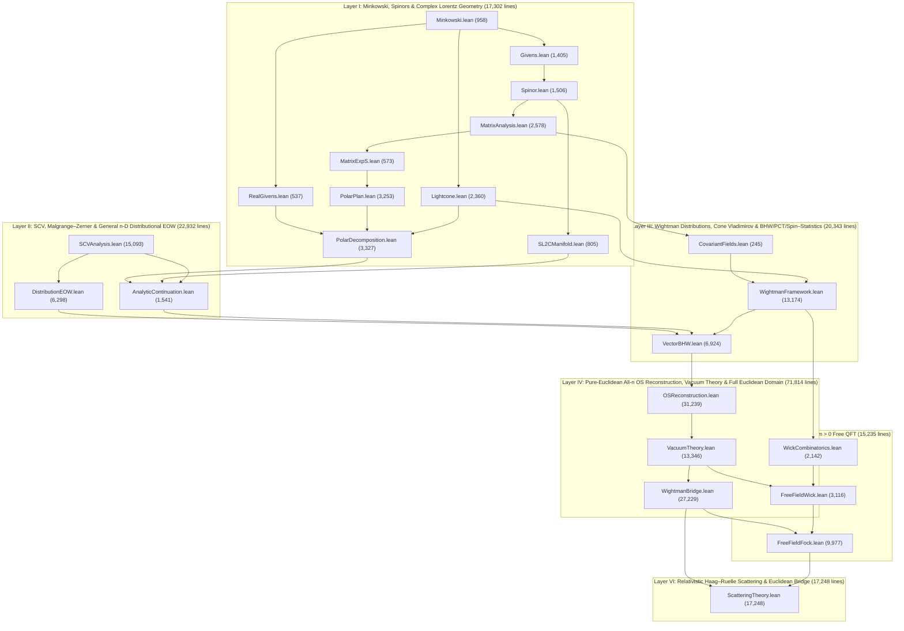

## Axiomatic & Constructive Quantum Field Theory in Lean 4

A machine-checked Lean 4 formalization of **4-dimensional relativistic axiomatic and constructive Quantum Field Theory (QFT)** built on [Mathlib](https://github.com/leanprover-community/mathlib4) (`v4.32.2`).

Starting from real and complex Minkowski geometry, the spinor double cover $SL(2,\mathbb{C}) \times SL(2,\mathbb{C}) \to SO^+(1,3;\mathbb{C})$, several complex variables, and Schwartz tempered distributions, this library develops:

1. **Complex Lorentz Geometry & Jost's Theorem**: Real and complex Lorentz groups, polar/Cartan/Jordan normal forms, path-connectedness of forward-tube stabilizer orbits, and the equivalence between real Jost points and real points of the extended tube $\mathcal{T}'_n$ ($n > 1$).
2. **UV-Cutoff-Free Cone Vladimirov Extension & General $n$-Dimensional Edge-of-the-Wedge**: Forward-tube holomorphic extensions for tempered Wightman distributions satisfying the relativistic forward-cone `SpectrumCondition` (with no ultraviolet cutoff), general $N$-dimensional Osgood and Malgrange–Zerner flattened-tube / cross analyticity theorems, general $n$-dimensional continuous and polynomial-growth distributional Edge-of-the-Wedge theorems, and $4n$-dimensional Jost-window continuation.
3. **General Spinor Bargmann–Hall–Wightman (BHW), Relativistic PCT & Unconditional Spin–Statistics**: Single-valued analytic continuation from $\mathcal{T}_n$ to $\mathcal{T}'_n$ for arbitrary finite-dimensional polynomial representations of $SL(2,\mathbb{C}) \times SL(2,\mathbb{C})$, the distributional PCT theorem, and unconditional general-spin Spin–Statistics ($\eta = \varepsilon$) for arbitrary `(R, S)` with $2\pi$-rotation spin parity $\varepsilon \in \{\pm 1\}$.
4. **Pure-Euclidean All $n$-Point Osterwalder–Schrader (OS) Reconstruction & Full Euclidean Gluing**: OS GNS Hilbert space and canonical C\*-functional-calculus holomorphic contraction semigroup, multi-time semigroup continuation and pure-Euclidean all $n$-point OS $\to$ Wightman reconstruction from `OSAxioms` + `OSTimeClusterDecomposition` + either `OSDampedFieldBounded` or OS (1975) `OSLinearGrowthCondition` ($E0'$), canonical unitary equivalence $\mathcal{H}_{\mathrm{OS}} \simeq_{\mathbb{C}} \mathcal{H}_W$, and unconditional promotion of relativistic `LocalCommutativity` to `FullEuclidOSAxioms` across $\mathbb{R}^{4n}_{\neq}$.
5. **Constructive 4D Massive ($m > 0$) Free QFT**: All $n$-point bosonic and fermionic Wick combinatorics, explicit mass-shell tempered Wightman and full non-coincident Euclidean Schwinger families on $L^2$ Fock space, damped field bounds (`K = 3`) and $E0'$ linear growth, pure-Euclidean reconstruction agreement, exponential OS clustering $\mathcal{O}(e^{-m\tau})$, and all-direction Minkowski cluster decomposition (`WightmanAxiomsWithUniqueVacuum`).
6. **Relativistic Haag–Ruelle Scattering Theory & Euclidean OS Scattering Bridge**: Non-Gaussian `IsolatedMassShellData` and `EuclidIsolatedMassShellData` scattering framework, non-stationary phase rapid polynomial tail decay $\mathcal{O}((1 + |t|)^{-N})$, SNAG-free $L^1$ ergodic Hepp vacuum projection, strong Haag–Ruelle convergence $\lim_{t \to \pm\infty} \Psi_{\mathrm{HR}}(t) = \Phi_{\mathrm{in}/\mathrm{out}}$, isometric Møller wave operators intertwining $\mathbb{R}^4$ translations, S-matrix unitarity under `WeakAsymptoticCompleteness`, Pauli exclusion vs. distinct-mode co-occupancy witnesses, and 4 unconditional $m > 0$ Euclidean scattering models (neutral/charged Klein–Gordon and Majorana/charged spin-1/2 Dirac).

---

## Table of Contents

1. [Verification Guarantees & Codebase Metrics](#1-verification-guarantees--codebase-metrics)
2. [Architecture & Module Dependency Graph](#2-architecture--module-dependency-graph)
3. [Core Mathematical Definitions (Verbatim Lean 4)](#3-core-mathematical-definitions-verbatim-lean-4)
4. [Main Formalized Theorems (Verbatim Lean 4)](#4-main-formalized-theorems-verbatim-lean-4)
5. [Non-Vacuity Witnesses & No-Go Theorems](#5-non-vacuity-witnesses--no-go-theorems)
6. [Key Proof Architectures & Technical Highlights](#6-key-proof-architectures--technical-highlights)
7. [Mathematical Scope, Design Choices & Open Boundaries](#7-mathematical-scope-design-choices--open-boundaries)
8. [Build Instructions, Axiom Verification & Literature Cross-Reference](#8-build-instructions-axiom-verification--literature-cross-reference)

---

## 1. Verification Guarantees & Codebase Metrics

Formalizing infinite-dimensional functional analysis and axiomatic QFT carries specification hazards: definitions can collapse to zero-momentum constants via ultraviolet cutoffs, structures can become uninhabited due to sign or chirality conventions, or theorems can hold vacuously. To mitigate these risks, the codebase is checked against the Lean 4 kernel, `MetaM` AST/unused-hypothesis audits, and explicit 4D $m > 0$ models—while remaining open to independent human review of its mathematical specifications.

| Metric | Verified Value | Details |
| :--- | :---: | :--- |
| **Lean 4 / Mathlib Toolchain** | `v4.32.2` | `leanprover/lean4:v4.32.2` with `mathlib` `v4.32.2` |
| **QFT & Analysis Modules** | **23 files** | Located in `src/` (see [Section 2](#2-architecture--module-dependency-graph); excludes standalone `src/LWEBasic.lean`) |
| **Total Lines of Lean 4** | **164,874 lines** | Comment-free, linter-clean (`weak.linter.mathlibStandardSet = true`) |
| **Top-Level Declarations** | **8,552** | `2,337` `theorem`, `4,504` `lemma`, `1,570` `def`, `44` `abbrev`, `35` `structure`, `57` `instance`, `5` `inductive` |
| **`sorry` / `admit` / Custom `axiom`** | **0** | Mechanically checked by the Lean 4 kernel (reproducible via `#print axioms` in [Section 8](#8-build-instructions-axiom-verification--literature-cross-reference)) |
| **`unsafe` / `opaque` / Metaprogramming Bypasses** | **0** | Purely logical definitions and proofs; independently verifiable in a fresh `lake build` |
| **Permitted Kernel Axioms** | **Standard 3 only** | Every audited theorem depends exclusively on `[propext, Classical.choice, Quot.sound]` |
| **Automated Vacuity & AST Checks** | **0 flagged (`0` unused `Prop`s)** | `MetaM` AST audit confirms `0` unused `Prop` parameters and `0` disguised `rfl` tautologies across `ScatteringTheory.lean` |
| **Concrete 4D $m > 0$ Models** | **4 scattering models** | Neutral Klein–Gordon ($\nu = 1, \eta = +1$), charged Klein–Gordon ($\nu = 2, \eta = +1$), 4-component Majorana–Dirac ($\nu = 2, \eta = -1$), and charged spin-1/2 Dirac ($\nu = 4, \eta = -1$) |

> [!NOTE]
> **Scope of Verification (Kernel Guarantees vs. Independent Semantic Audit)**:
> - **Kernel-Guaranteed**: The absence of `sorry` (`sorryAx`), custom `axiom` declarations, `unsafe`, and `opaque` is checked mechanically by the Lean 4 kernel; anyone can reproduce these checks via the `#print axioms` commands in [Section 8](#8-build-instructions-axiom-verification--literature-cross-reference).
> - **Subject to Independent Verification**: While automated kernel/`MetaM` checks and explicit 4D $m > 0$ model instantiations uncovered no vacuous positive theorems or specification collapses within the audited scope, no automated check can rule out subtle semantic vacuity or definition mismatches across all 8,500+ declarations. Independent mathematical review of [Section 3](#3-core-mathematical-definitions-verbatim-lean-4) and [Section 4](#4-main-formalized-theorems-verbatim-lean-4) is encouraged.

---

## 2. Architecture & Module Dependency Graph

The 23 QFT and analysis modules are organized into six mathematical layers (`A --> B` means `B` imports `A`).



### Complete Module Inventory

#### Layer I: Minkowski Geometry, $SL(2,\mathbb{C})$ Spinors & Complex Lorentz Polar Decomposition (`17,302` lines)

| Module | Lines | Mathematical Scope |
| :--- | ---: | :--- |
| `src/Minkowski.lean` | 958 | Signature $(+,-,-,-)$ real/complex Minkowski metrics, lightcones, Lorentz groups, tubes $\mathcal{T}_n, \mathcal{T}'_n$, and Jost points. |
| `src/Givens.lean` | 1,405 | Complex Givens rotations and elementary $SL(2,\mathbb{C})$ / $SO(4,\mathbb{C})$ matrix factorizations. |
| `src/RealGivens.lean` | 537 | Real orthogonal Givens reductions and $SO(3)$ / $SO^+(1,3)$ boost-rotation decompositions. |
| `src/Spinor.lean` | 1,506 | Pauli $2 \times 2$ 4-vector encoding and double-cover surjection `spinorPhi : SL(2,ℂ) × SL(2,ℂ) →* SO⁺(1,3;ℂ)`. |
| `src/SL2CManifold.lean` | 805 | Complex Lie-manifold topology, path-connectedness, and holomorphic chart structure of $SL(2,\mathbb{C})$. |
| `src/MatrixAnalysis.lean` | 2,578 | Matrix norms, spectral/Jordan analysis, convergent power series, and complex orthogonal Lie algebra bounds. |
| `src/MatrixExpS.lean` | 573 | Exponential map for complex skew-Minkowski generators and determinant/metric preservation. |
| `src/PolarPlan.lean` | 3,253 | Complex Lorentz polar/Cartan decompositions $\Lambda = R \exp(i B)$ and canonical generator normal forms. |
| `src/Lightcone.lean` | 2,360 | Hahn–Banach separation of Jost convex hulls from $V^+$, complex boost into $\mathcal{T}_n$, and Jost's Theorem. |
| `src/PolarDecomposition.lean` | 3,327 | Path-connectedness of complex Lorentz stabilizer orbit domains for single-valued BHW continuation. |

#### Layer II: Several Complex Variables, Malgrange–Zerner & Distributional Edge-of-the-Wedge (`22,932` lines)

| Module | Lines | Mathematical Scope |
| :--- | ---: | :--- |
| `src/SCVAnalysis.lean` | 15,093 | Polydisc Cauchy formulas, $N$-D Osgood lemma, $N$-D Malgrange–Zerner flattened-tube & local cross analyticity, 2D L-shaped Bochner tube theorem, and general $n$-D analytic Edge-of-the-Wedge theorems. |
| `src/DistributionEOW.lean` | 6,298 | Test functions $\mathcal{D}(\Omega)$, distributions $\mathcal{D}'(\Omega,\mathbb{C})$, polynomial tube growth, and general $n$-D continuous & tempered distributional Edge-of-the-Wedge theorems via cone-ODE antiderivatives. |
| `src/AnalyticContinuation.lean` | 1,541 | Scalar Bargmann–Hall–Wightman continuation from $\mathcal{T}_n$ to $\mathcal{T}'_n$ along path-connected complex Lorentz orbits. |

#### Layer III: Tempered Wightman Distributions, Cone Vladimirov & Spinor BHW/PCT/Spin–Statistics (`20,343` lines)

| Module | Lines | Mathematical Scope |
| :--- | ---: | :--- |
| `src/CovariantFields.lean` | 245 | Polynomial spinor representations `HolomorphicLorentzRep ι`, $2\pi$-rotation spin parity `HasSpinParity`, and `PoincareCovariant`. |
| `src/WightmanFramework.lean` | 13,174 | Tempered `WightmanFamily`, `SpectrumCondition`, `LocalCommutativity` $\implies$ `WeakLocality`, `Positivity`, UV-cutoff-free `coneVladimirovTubeExtension`, and 2-point split-product Schwartz density. |
| `src/VectorBHW.lean` | 6,924 | General spinor BHW continuation, distributional PCT theorem, chiral Weyl star no-go, unconditional general-spin Spin–Statistics, and $4n$-D Jost-window EOW continuation. |

#### Layer IV: Pure-Euclidean All $n$-Point OS Reconstruction, Vacuum Theory & Full Euclidean Domain (`71,814` lines)

| Module | Lines | Mathematical Scope |
| :--- | ---: | :--- |
| `src/OSReconstruction.lean` | 31,239 | `OSAxioms` (`orderedEuclidN n`) & `FullEuclidOSAxioms` (`nonCoincidentEuclidN n`), canonical C\*-functional-calculus contraction semigroup, `OSDampedFieldBounded` & `OSLinearGrowthCondition` ($E0'$), multi-time holomorphic continuation `osMultiTimeH`, $SO(4) \times S_n$ covering, unconditional relativistic-to-Euclidean gluing, and OS Spin–Statistics/uniqueness. |
| `src/VacuumTheory.lean` | 13,346 | Equivalence `tubePCT_iff_weakLocality`, fixed-momentum symmetry-breaking counterexamples (`fourMomentumW/S`), concrete `OSDampedFieldBounded` witnesses, and massive two-point propagator analysis. |
| `src/WightmanBridge.lean` | 27,229 | Bundled `WightmanAxioms` / `WightmanAxiomsWithUniqueVacuum`, canonical Laplace unitary equivalence $\mathcal{H}_{\mathrm{OS}} \simeq_{\mathbb{C}} \mathcal{H}_W$, constructive OS $\to$ Wightman `Positivity`, and pure-Euclidean all $n$-point OS $\to$ Wightman reconstruction from `OSDampedFieldBounded` or `OSLinearGrowthCondition`. |

#### Layer V: Wick Combinatorics & 4D $m > 0$ Constructive Free QFT on $L^2$ Fock Space (`15,235` lines)

| Module | Lines | Mathematical Scope |
| :--- | ---: | :--- |
| `src/WickCombinatorics.lean` | 2,142 | Complete/partial chord pairings, `concatRev` cut factorization, fermionic crossing parity `cross_concatRev`, and $S_n$-permutation covariance of Wick sums. |
| `src/FreeFieldWick.lean` | 3,116 | Positive-energy mass-shell measures ($m > 0$), all $n$-point neutral/Majorana Klein–Gordon and Dirac Wightman/Schwinger families, `LocalCommutativity`, equal-time non-vanishing witnesses, and `¬ ZeroMomentumSpectrumCondition`. |
| `src/FreeFieldFock.lean` | 9,977 | Direct-sum $L^2$ Fock space `FockHilbert ν`, Wightman `Positivity` & `OSReflectionPositive`, exponential OS clustering $e^{-m\tau}$, Fock damped bounds (`K = 3`), `OSLinearGrowthCondition`, pure-Euclidean reconstruction agreement, and `freeKG/Dirac_grand_master`. |

#### Layer VI: Relativistic Haag–Ruelle Scattering Theory & Euclidean OS Scattering Bridge (`17,248` lines)

| Module | Lines | Mathematical Scope |
| :--- | ---: | :--- |
| `src/ScatteringTheory.lean` | 17,248 | `VelocityDisjoint` $C_c^\infty(\mathbb{R}^3)$ wavepackets, non-stationary phase rapid tail decay $\mathcal{O}((1+\|t\|)^{-N})$, `IsolatedMassShellData` & `EuclidIsolatedMassShellData`, SNAG-free $L^1$ ergodic Hepp vacuum projection, strong Haag–Ruelle convergence, $\eta$-symmetrized Fock space `SymmFockHilbert ν η`, isometric Møller wave operators & S-matrix unitarity, Pauli exclusion vs. distinct-mode co-occupancy, and 4 unconditional $m > 0$ scattering models (neutral/charged KG & Majorana/charged Dirac). |

---

## 3. Core Mathematical Definitions (Verbatim Lean 4)

To make the mathematical specifications completely transparent—without paraphrasing—all primary definitions below are reproduced verbatim from `src/`.

### 3.1 Minkowski Geometry, Complex Tubes & Jost Points (`Minkowski.lean`)

Spacetime points are modeled as `Fin 4 → ℝ` (and complexified spacetime as `Fin 4 → ℂ`) with signature $(+,-,-,-)$ inner product $x \cdot y = x^0 y^0 - x^1 y^1 - x^2 y^2 - x^3 y^3$. The forward tube $\mathcal{T}_n$ requires every successive difference $z_i - z_{i+1}$ to have its negated imaginary part in the open forward lightcone $V^+$:

```lean
def minkowskiInner (x y : Fin 4 → ℝ) : ℝ :=
  dotProduct x (minkowskiMetricReal.mulVec y)

def forward_light_cone : Set (Fin 4 → ℝ) :=
  { x | x 0 > 0 ∧ minkowskiInner x x > 0 }

def forward_tube_n (n : ℕ) : Set (Fin n → Fin 4 → ℂ) :=
  { z | ∀ (i : Fin n) (hi : i.val + 1 < n),
    (fun k => -((z i - z ⟨i.val + 1, hi⟩) k).im) ∈ forward_light_cone }

def extended_tube_n (n : ℕ) : Set (Fin n → Fin 4 → ℂ) :=
  ⋃ Λ : SpecialSpecialComplexLorentzGroup, (fun z => Λ • z) '' forward_tube_n n

def is_spacelike (v : Fin 4 → ℝ) : Prop :=
  minkowskiInner v v < 0

def jost_differences_n (n : ℕ) (x : Fin n → Fin 4 → ℝ) : Set (Fin 4 → ℝ) :=
  { v | ∃ (i : Fin n) (hi : i.val + 1 < n), v = x i - x ⟨i.val + 1, hi⟩ }

def jost_convex_hull (n : ℕ) (x : Fin n → Fin 4 → ℝ) : Set (Fin 4 → ℝ) :=
  convexHull ℝ (jost_differences_n n x)

def jost_points_n (n : ℕ) : Set (Fin n → Fin 4 → ℝ) :=
  { x | ∀ v ∈ jost_convex_hull n x, is_spacelike v }
```

### 3.2 Holomorphic Spinor Representations & Star Structures (`CovariantFields.lean`, `WightmanFramework.lean`)

Spinor/tensor multiplets indexed by a finite type `ι` carry a polynomial representation $\sigma : SL(2,\mathbb{C}) \times SL(2,\mathbb{C}) \to \mathrm{Mat}_{\iota \times \iota}(\mathbb{C})$; restricting along $A \mapsto (A, \overline{A})$ yields the physical real representation `R.rep`:

```lean
structure HolomorphicLorentzRep (ι : Type*) [Fintype ι] [DecidableEq ι] where
  σ : SL2C × SL2C →* Matrix ι ι ℂ
  polynomial : ∀ i j : ι, ∃ P : MvPolynomial ((Fin 2 × Fin 2) ⊕ (Fin 2 × Fin 2)) ℂ,
    ∀ p : SL2C × SL2C,
      σ p i j = MvPolynomial.eval
        (Sum.elim (fun a => (p.1 : Matrix (Fin 2) (Fin 2) ℂ) a.1 a.2)
                  (fun a => (p.2 : Matrix (Fin 2) (Fin 2) ℂ) a.1 a.2)) P

noncomputable def HolomorphicLorentzRep.rep (R : HolomorphicLorentzRep ι) :
    SL2C →* Matrix ι ι ℂ :=
  R.σ.comp ((MonoidHom.id SL2C).prod sl2cConjHom)

def HolomorphicLorentzRep.HasSpinParity (R : HolomorphicLorentzRep ι) (ε : ℂ) : Prop :=
  R.σ ((-1 : SL2C), (-1 : SL2C)) = ε • (1 : Matrix ι ι ℂ) ∧ (ε = 1 ∨ ε = -1)

def PoincareCovariant {ι : Type*} [Fintype ι] [DecidableEq ι] (R : HolomorphicLorentzRep ι)
    (W : ∀ n : ℕ, (Fin n → ι) → TemperedDistribution (Fin n → Fin 4 → ℝ) ℂ) : Prop :=
  ∀ (n : ℕ) (a : Fin 4 → ℝ) (A : SL2C)
    (f f' : SchwartzMap (Fin n → Fin 4 → ℝ) ℂ),
    (∀ x : Fin n → Fin 4 → ℝ, f' (fun i => poincareAct a A (x i)) = f x) →
    ∀ α : Fin n → ι,
      W n α f' = ∑ β : Fin n → ι, (∏ i, R.rep A (α i) (β i)) * W n β f

structure StarStructure (R : HolomorphicLorentzRep ι) where
  C : Matrix ι ι ℂ
  involutive : C * C.map star = 1
  intertwine : ∀ A B : SL2C,
    C * R.σ (A, B) = (R.σ (sl2c_conj B, sl2c_conj A)).map star * C
```

Concrete instances include `trivialRep` (scalars, $\iota = \mathrm{Unit}$), `stdRep` (4-vectors, $\iota = \mathrm{Fin}\ 4$), `leftWeylRep` / `rightWeylRep` (2-component Weyl spinors), `diracRep` / `diracStarStructure` (4-component $(1/2,0) \oplus (0,1/2)$ bispinors with off-diagonal $C = \gamma^0$), and 2-copy direct sums `chargedKGRep` / `chargedDiracRep`.

### 3.3 Tempered Wightman Distributions, Spectrum, Locality, Positivity & Tube Extensions (`WightmanFramework.lean`, `VectorBHW.lean`)

An $n$-point Wightman function is a Mathlib `TemperedDistribution` (`SchwartzMap (Fin n → Fin 4 → ℝ) ℂ →L[ℂ] ℂ`). `SpectrumCondition` asserts $W_n(f) = 0$ whenever the Minkowski Fourier transform of $f$ vanishes on a neighborhood of the joint forward-cone spectral region $\sum_i p_i = 0$, $\sum_{i \le k} p_i \in \overline{V^+}$:

```lean
abbrev WightmanFamily (ι : Type*) : Type _ :=
  ∀ n : ℕ, (Fin n → ι) → TemperedDistribution (Fin n → Fin 4 → ℝ) ℂ

noncomputable def minkowskiFourier {n : ℕ} (f : SchwartzMap (Fin n → Fin 4 → ℝ) ℂ)
    (p : Fin n → Fin 4 → ℝ) : ℂ :=
  ∫ x : Fin n → Fin 4 → ℝ,
    f x * Complex.exp (-(Complex.I * ((∑ k, minkowskiInner (p k) (x k) : ℝ) : ℂ)))

def spectralRegion (n : ℕ) : Set (Fin n → Fin 4 → ℝ) :=
  { p | (∑ i, p i = 0) ∧
    (∀ k : Fin n, (∑ i ∈ Finset.univ.filter (fun i : Fin n => i ≤ k), p i) ∈
      closure forward_light_cone) }

def SpectrumCondition (W : WightmanFamily ι) : Prop :=
  ∀ (n : ℕ) (α : Fin n → ι) (f : SchwartzMap (Fin n → Fin 4 → ℝ) ℂ),
    (∃ U : Set (Fin n → Fin 4 → ℝ), IsOpen U ∧ spectralRegion n ⊆ U ∧
      ∀ p ∈ U, minkowskiFourier f p = 0) → W n α f = 0

def LocalCommutativity (η : ℂ) (W : WightmanFamily ι) : Prop :=
  ∀ (n : ℕ) (i : Fin n) (hi : i.val + 1 < n) (α : Fin n → ι)
    (f f' : SchwartzMap (Fin n → Fin 4 → ℝ) ℂ),
    tsupport (f : (Fin n → Fin 4 → ℝ) → ℂ) ⊆
      { x | is_spacelike (x i - x ⟨i.val + 1, hi⟩) } →
    (∀ x : Fin n → Fin 4 → ℝ, f' (x ∘ Equiv.swap i ⟨i.val + 1, hi⟩) = f x) →
    W n α f = η * W n (α ∘ Equiv.swap i ⟨i.val + 1, hi⟩) f'

def WeakLocality (η : ℂ) (W : WightmanFamily ι) : Prop :=
  ∀ (n : ℕ) (α : Fin n → ι) (f f' : SchwartzMap (Fin n → Fin 4 → ℝ) ℂ),
    tsupport (f : (Fin n → Fin 4 → ℝ) → ℂ) ⊆ jost_points_n n →
    (∀ x : Fin n → Fin 4 → ℝ, f' (fun i => x (Fin.rev i)) = f x) →
    W n α f = η ^ (n * (n - 1) / 2) * W n (α ∘ Fin.rev) f'

def Positivity {R : HolomorphicLorentzRep ι} (S : StarStructure R) (W : WightmanFamily ι) :
    Prop :=
  ∀ (N : ℕ) (F : ∀ j : ℕ, (Fin j → ι) → SchwartzMap (Fin j → Fin 4 → ℝ) ℂ)
    (G : ∀ j k : ℕ, (Fin j → ι) → (Fin k → ι) →
      SchwartzMap (Fin (j + k) → Fin 4 → ℝ) ℂ),
    (∀ j k α α' (x : Fin (j + k) → Fin 4 → ℝ),
      G j k α α' x =
        (starRingEnd ℂ) (F j α (fun i => x (Fin.castAdd k (Fin.rev i)))) *
          F k α' (fun i => x (Fin.natAdd j i))) →
    0 ≤ ∑ j ∈ Finset.range (N + 1), ∑ k ∈ Finset.range (N + 1),
      ∑ α : Fin j → ι, ∑ α' : Fin k → ι, ∑ β : Fin j → ι,
        (∏ i, S.C (α i) (β i)) * W (j + k) (Fin.append (β ∘ Fin.rev) α') (G j k α α')

structure TubeExtension (W : WightmanFamily ι) where
  H : ∀ n : ℕ, (Fin n → ι) → (Fin n → Fin 4 → ℂ) → ℂ
  analytic : ∀ n α, AnalyticOn ℂ (H n α) (forward_tube_n n)
  boundary : ∀ (n : ℕ) (α : Fin n → ι) (f : SchwartzMap (Fin n → Fin 4 → ℝ) ℂ)
    (v : Fin 4 → ℝ), v ∈ forward_light_cone →
    Tendsto (fun t : ℝ => ∫ x : Fin n → Fin 4 → ℝ,
        H n α (fun i k => (x i k : ℂ) + Complex.I * ((t * (i : ℕ) * v k : ℝ) : ℂ)) * f x)
      (𝓝[>] 0) (𝓝 (W n α f))

def TubeCovariant {W : WightmanFamily ι} (R : HolomorphicLorentzRep ι)
    (E : TubeExtension W) : Prop :=
  ∀ (n : ℕ) (A : SL2C) (z : Fin n → Fin 4 → ℂ),
    z ∈ forward_tube_n n → spinorPhi (A, sl2c_conj A) • z ∈ forward_tube_n n →
    ∀ α : Fin n → ι,
      E.H n α (spinorPhi (A, sl2c_conj A) • z) =
        ∑ β : Fin n → ι, (∏ i, R.rep A (α i) (β i)) * E.H n β z

def TubePCT (η : ℂ) (R : HolomorphicLorentzRep ι) {W : WightmanFamily ι}
    (E : TubeExtension W) : Prop :=
  ∀ (n : ℕ) (α : Fin n → ι), ∀ z ∈ forward_tube_n n,
    E.H n α (-(z ∘ Fin.rev)) =
      η ^ (n * (n - 1) / 2) *
        ∑ β : Fin n → ι, (∏ i, R.σ (-1, 1) (α i) (β i)) * E.H n (β ∘ Fin.rev) z

def WightmanPCT (η : ℂ) (R : HolomorphicLorentzRep ι) (W : WightmanFamily ι) : Prop :=
  ∀ (n : ℕ) (α : Fin n → ι) (f f' : SchwartzMap (Fin n → Fin 4 → ℝ) ℂ),
    (∀ x : Fin n → Fin 4 → ℝ, f' (fun i => -x (Fin.rev i)) = f x) →
    W n α f =
      η ^ (n * (n - 1) / 2) *
        ∑ β : Fin n → ι, (∏ i, R.σ (-1, 1) (α i) (β i)) * W n (β ∘ Fin.rev) f'
```

### 3.4 Bundled Relativistic Wightman Axiom Systems (`WightmanBridge.lean`)

`WightmanAxioms` and `WightmanAxiomsWithUniqueVacuum` (`ForwardConeSpectrumCondition := SpectrumCondition`) bundle GNS Hilbert spaces, cyclic vacua, all-direction cluster decomposition ($\forall a \neq 0$), and uniqueness of translation-invariant vectors:

```lean
structure WightmanAxioms (R : HolomorphicLorentzRep ι) (S : StarStructure R)
    (η : ℂ) where
  WData : WightmanPositiveData R S
  E : TubeExtension WData.W
  positivity : Positivity S WData.W
  poincare : PoincareCovariant R WData.W
  spectrum : ForwardConeSpectrumCondition WData.W
  weakLocality : WeakLocality η WData.W
  tube_covariant : TubeCovariant R E
  tube_pct : TubePCT η R E
  cyclic : WightmanVacuumCyclic WData

structure WightmanAxiomsWithUniqueVacuum
    (R : HolomorphicLorentzRep ι) (S : StarStructure R) (η : ℂ) extends
    WightmanAxioms R S η where
  vacuumNormalized : WightmanVacuumNormalized S WData.W
  cluster : ∀ a : Fin 4 → ℝ, a ≠ 0 → WightmanClusterAlong WData a
  vacuumUnique :
    WightmanVacuumUnique WData
      (wightmanTranslationInvariant_of_poincare R poincare)
```

### 3.5 Time-Ordered & Full Non-Coincident Euclidean Osterwalder–Schrader Axioms (`OSReconstruction.lean`)

`OSAxioms` on strictly time-ordered points (`orderedEuclidN n`) and `FullEuclidOSAxioms` across all pairwise non-coincident Euclidean points $\mathbb{R}^{4n}_{\neq}$ (`nonCoincidentEuclidN n`), together with clustering and growth conditions (`OSDampedFieldBounded` and OS 1975 `OSLinearGrowthCondition` $E0'$):

```lean
def orderedEuclidN (n : ℕ) : Set (Fin n → Fin 4 → ℝ) :=
  { x | ∀ (i : Fin n) (hi : i.val + 1 < n), x i 0 < x ⟨i.val + 1, hi⟩ 0 }

def nonCoincidentEuclidN (n : ℕ) : Set (Fin n → Fin 4 → ℝ) :=
  {x | ∀ i j : Fin n, i ≠ j → x i ≠ x j}

def OSReflectionPositive {R : HolomorphicLorentzRep ι} (S : StarStructure R)
    (𝒮 : SchwingerFamily ι) : Prop :=
  ∀ Ψ : OSConfig ι →₀ ℂ, 0 ≤ (osPreInner S 𝒮 Ψ Ψ).re

def OSTranslationInvariant (𝒮 : SchwingerFamily ι) : Prop :=
  ∀ (n : ℕ) (α : Fin n → ι) (x : Fin n → Fin 4 → ℝ),
    x ∈ orderedEuclidN n → ∀ a : Fin 4 → ℝ,
    𝒮 n α (fun i => x i + a) = 𝒮 n α x

def EuclidRotCovariant (R : HolomorphicLorentzRep ι) (𝒮 : SchwingerFamily ι) : Prop :=
  ∀ (n : ℕ) (U V : SU2) (x : Fin n → Fin 4 → ℝ),
    x ∈ orderedEuclidN n → euclidRotN n U V x ∈ orderedEuclidN n →
    ∀ α : Fin n → ι,
    𝒮 n α (euclidRotN n U V x) =
      ∑ β : Fin n → ι,
        (∏ i : Fin n, R.σ (su2ToSL2C U, su2ToSL2C V) (α i) (β i)) * 𝒮 n β x

structure OSAxioms (R : HolomorphicLorentzRep ι) (S : StarStructure R)
    (η : ℂ) (𝒮 : SchwingerFamily ι) : Prop where
  os0_smooth : ∀ (n : ℕ) (α : Fin n → ι),
    ContDiffOn ℝ (⊤ : ℕ∞) (𝒮 n α) (orderedEuclidN n)
  os1_translation : OSTranslationInvariant 𝒮
  os1_rotation : EuclidRotCovariant R 𝒮
  os2_hermiticity : OSHermiticity S 𝒮
  os2_positivity : OSReflectionPositive S 𝒮
  os3_symmetry : ∀ (n : ℕ) (α : Fin n → ι) (x : Fin n → Fin 4 → ℝ),
    x ∈ orderedEuclidN n →
    𝒮 n α (-(x ∘ Fin.rev)) =
      η ^ (n * (n - 1) / 2) *
        ∑ β : Fin n → ι,
          (∏ i : Fin n, R.σ (-1, 1) (α i) (β i)) * 𝒮 n (β ∘ Fin.rev) x

def OSPermutationSymmetry (η : ℂ) (𝒮 : SchwingerFamily ι) : Prop :=
  ∀ (n : ℕ) (π : Equiv.Perm (Fin n)) (α : Fin n → ι) (x : Fin n → Fin 4 → ℝ),
    x ∈ nonCoincidentEuclidN n →
    𝒮 n (α ∘ π) (x ∘ π) = η ^ permInversions π * 𝒮 n α x

structure FullEuclidOSAxioms (R : HolomorphicLorentzRep ι) (S : StarStructure R)
    (η : ℂ) (𝒮 : SchwingerFamily ι) : Prop where
  os0_smooth : ∀ (n : ℕ) (α : Fin n → ι),
    ContDiffOn ℝ (⊤ : ℕ∞) (𝒮 n α) (nonCoincidentEuclidN n)
  os1_translation : FullEuclidTranslationInvariant 𝒮
  os1_rotation : FullEuclidRotCovariant R 𝒮
  os2_hermiticity : OSHermiticity S 𝒮
  os2_positivity : OSReflectionPositive S 𝒮
  os3_permutation : OSPermutationSymmetry η 𝒮

def OSTimeClusterDecomposition {R : HolomorphicLorentzRep ι} {S : StarStructure R}
    (D : OSReflectionPositiveData R S) : Prop :=
  ∀ A B : OSConfig ι,
    Tendsto
      (fun τ : ℝ =>
        osKernel S D.𝒮 A (osConfigTimeShift (max τ 0) (le_max_right τ 0) B))
      atTop
      (𝓝 (osKernel S D.𝒮 A (osVacuumConfig ι) *
        osKernel S D.𝒮 (osVacuumConfig ι) B))

def OSDampedFieldBounded {R : HolomorphicLorentzRep ι} {S : StarStructure R}
    (D : OSReflectionPositiveData R S) : Prop :=
  ∃ (C₀ : ℝ) (K : ℕ), 0 ≤ C₀ ∧
    ∀ (α₀ : ι) (x_sp : Fin 3 → ℝ) (ε : ℝ) (hε : 0 < ε) (Ψ : OSPreHilbertSpace D),
      ‖osPrependShiftLM D α₀ x_sp ε hε Ψ‖ ≤ C₀ * (1 + ε⁻¹) ^ K * ‖Ψ‖

def OSLinearGrowthCondition (𝒮 : SchwingerFamily ι) : Prop :=
  ∃ (C A : ℝ) (M : ℕ), 0 ≤ C ∧ 1 ≤ A ∧
    ∀ (n : ℕ) (α : Fin n → ι) (x : Fin n → Fin 4 → ℝ),
      x ∈ orderedEuclidN n →
      ‖𝒮 n α x‖ ≤
        C * A ^ n * ((n.factorial : ℝ) ^ M) *
          ∏ k : Fin (n - 1),
            (1 + (x ⟨k.val + 1, by omega⟩ 0 - x ⟨k.val, by omega⟩ 0)⁻¹) ^ M
```

### 3.6 Wick Pairings, $L^2$ Fock Space & 4D $m > 0$ Free Fields (`WickCombinatorics.lean`, `FreeFieldWick.lean`, `FreeFieldFock.lean`)

Complete chord pairings (`ChordPairing n`), $t = 0$ cut factorizations (`PartialPairing n r`), direct-sum $L^2$ Fock spaces `FockHilbert ν`, and 4D $m > 0$ Wightman/Schwinger families:

```lean
structure ChordPairing (n : ℕ) where
  mate : Equiv.Perm (Fin n)
  involutive : Function.Involutive mate
  ne_self : ∀ i : Fin n, mate i ≠ i

structure PartialPairing (n r : ℕ) where
  unpaired : Fin r → Fin n
  strictMono_unpaired : StrictMono unpaired
  mate : Equiv.Perm (Fin n)
  involutive : Function.Involutive mate
  fixed_iff : ∀ i : Fin n, mate i = i ↔ ∃ a : Fin r, unpaired a = i

abbrev FockHilbert (ν : ℕ) : Type :=
  MeasureTheory.Lp ℂ 2 (fockMeasure ν)

noncomputable def freeKGW (m : ℝ) (hm : 0 < m) : WightmanFamily Unit :=
  wickMassShellW m 1 massiveKGCoeff (massiveKGCoeff_data hm)

noncomputable def freeKGS (m : ℝ) (hm : 0 < m) : SchwingerFamily Unit :=
  wickMassShellS m hm 1 massiveKGCoeff (massiveKGCoeff_data hm)

noncomputable def freeKGFullS (m : ℝ) (hm : 0 < m) : SchwingerFamily Unit :=
  wickMassShellFullS trivialRep m hm 1 massiveKGCoeff (massiveKGCoeff_data hm)

noncomputable def freeDiracW (m : ℝ) (hm : 0 < m) :
    WightmanFamily (Fin 2 ⊕ Fin 2) :=
  wickMassShellW m (-1) (diracMassShellCoeff m) (diracMassShellCoeff_data hm)

noncomputable def freeDiracS (m : ℝ) (hm : 0 < m) :
    SchwingerFamily (Fin 2 ⊕ Fin 2) :=
  wickMassShellS m hm (-1) (diracMassShellCoeff m) (diracMassShellCoeff_data hm)

noncomputable def freeDiracFullS (m : ℝ) (hm : 0 < m) :
    SchwingerFamily (Fin 2 ⊕ Fin 2) :=
  wickMassShellFullS diracRep m hm (-1) (diracMassShellCoeff m) (diracMassShellCoeff_data hm)
```

### 3.7 Isolated Mass-Shell Axioms, Haag–Ruelle Wave Operators, S-Matrix & Euclidean Scattering Bridge (`ScatteringTheory.lean`)

Compactly supported $C_c^\infty(\mathbb{R}^3)$ wavepackets (`SmoothWavepacket`), `VelocityDisjoint` separation, interacting-compatible `IsolatedMassShellData` with continuum threshold $M > m$, $\eta$-symmetrized Fock space `SymmFockHilbert ν η`, S-matrix `scatteringOperatorCLM`, and `EuclidIsolatedMassShellData`:

```lean
structure SmoothWavepacket where
  amp : (Fin 3 → ℝ) → ℂ
  smooth : ContDiff ℝ (⊤ : ℕ∞) amp
  compactSupport : HasCompactSupport amp

def velocitySupport (m : ℝ) (f : SmoothWavepacket) : Set (Fin 3 → ℝ) :=
  velocityVec m '' tsupport f.amp

def VelocityDisjoint (m : ℝ) (f₁ f₂ : SmoothWavepacket) : Prop :=
  Disjoint (velocitySupport m f₁) (velocitySupport m f₂)

def MassGapSpectrumCondition {ι : Type*} (m M : ℝ) (W : WightmanFamily ι) : Prop :=
  ∀ (n : ℕ) (α : Fin n → ι) (f : SchwartzMap (Fin n → Fin 4 → ℝ) ℂ),
    (∃ U : Set (Fin n → Fin 4 → ℝ), IsOpen U ∧ massGapSpectralRegion m M n ⊆ U ∧
      ∀ p ∈ U, minkowskiFourier f p = 0) → W n α f = 0

structure IsolatedMassShellData {ι : Type*} [Fintype ι] [DecidableEq ι]
    (R : HolomorphicLorentzRep ι) (S : StarStructure R)
    (m M : ℝ) (η : ℂ) where
  hm : 0 < m
  hM : m < M
  wightman : GeneralWightmanAxiomsWithUniqueVacuum R S η
  locality : LocalCommutativity η wightman.WData.W
  massGap : MassGapSpectrumCondition m M wightman.WData.W
  C_shell : (Fin 2 → ι) → (Fin 4 → ℝ) → ℂ
  hC : MassShellCoeffData m C_shell
  mode : MassShellModeData R S m η C_shell
  dual_w : Fin mode.ν → (Fin 3 → ℝ) → ι → ℂ
  contDiff_dual_w : ∀ (s : Fin mode.ν) (α : ι),
    ContDiff ℝ (⊤ : ℕ∞) (fun p : Fin 3 → ℝ => dual_w s p α)
  dual_orthonormal : ∀ (s₁ s₂ : Fin mode.ν) (p : Fin 3 → ℝ),
    ∑ α : ι, mode.w s₁ p α * dual_w s₂ p α = if s₁ = s₂ then 1 else 0
  twoPoint_shell : ∀ (β : Fin 2 → ι) (F : SchwartzMap (Fin 2 → Fin 4 → ℝ) ℂ),
    (∃ U : Set (Fin 2 → Fin 4 → ℝ), IsOpen U ∧
      { p : Fin 2 → Fin 4 → ℝ |
          p 0 + p 1 = 0 ∧ (p 0 = 0 ∨ p 0 ∈ continuumCone M) } ⊆ U ∧
      ∀ p ∈ U, minkowskiFourier F p = 0) →
    wightman.WData.W 2 β F = massShellTwoPointW m C_shell hC 2 β F

abbrev SymmFockHilbert (ν : ℕ) (η : ℂ) : Type :=
  ↥(SymmFockSubmodule ν η)

def scatteringOperatorCLM
    {R : HolomorphicLorentzRep ι} {S : StarStructure R}
    {m M : ℝ} {η : ℂ} (D : IsolatedMassShellData R S m M η) :
    SymmFockHilbert D.mode.ν η →L[ℂ] SymmFockHilbert D.mode.ν η :=
  (mollerWaveOut D).toContinuousLinearMap.adjoint.comp (mollerWaveIn D).toContinuousLinearMap

def WeakAsymptoticCompleteness
    {R : HolomorphicLorentzRep ι} {S : StarStructure R}
    {m M : ℝ} {η : ℂ} (D : IsolatedMassShellData R S m M η) : Prop :=
  AsymptoticSubspaceIn D = AsymptoticSubspaceOut D

def AsymptoticCompleteness
    {R : HolomorphicLorentzRep ι} {S : StarStructure R}
    {m M : ℝ} {η : ℂ} (D : IsolatedMassShellData R S m M η) : Prop :=
  AsymptoticSubspaceIn D = ⊤ ∧ AsymptoticSubspaceOut D = ⊤

structure EuclidIsolatedMassShellData {ι : Type*} [Fintype ι] [DecidableEq ι]
    (R : HolomorphicLorentzRep ι) (S : StarStructure R)
    (m M : ℝ) (η : ℂ) (𝒮 : SchwingerFamily ι) where
  hm : 0 < m
  hM : m < M
  fullOS : FullEuclidOSAxioms R S η 𝒮
  timeCluster : OSTimeClusterDecomposition fullOS.toOSAxioms.toReflectionPositiveData
  linearGrowth : OSLinearGrowthCondition 𝒮
  vacuumNormalized : OSVacuumNormalized 𝒮
  massGap :
    MassGapSpectrumCondition m M
      (osReconstructedWightmanFamily_of_linearGrowth fullOS.toOSAxioms linearGrowth)
  C_shell : (Fin 2 → ι) → (Fin 4 → ℝ) → ℂ
  hC : MassShellCoeffData m C_shell
  mode : MassShellModeData R S m η C_shell
  dual_w : Fin mode.ν → (Fin 3 → ℝ) → ι → ℂ
  contDiff_dual_w : ∀ (s : Fin mode.ν) (α : ι),
    ContDiff ℝ (⊤ : ℕ∞) (fun p : Fin 3 → ℝ => dual_w s p α)
  dual_orthonormal : ∀ (s₁ s₂ : Fin mode.ν) (p : Fin 3 → ℝ),
    ∑ α : ι, mode.w s₁ p α * dual_w s₂ p α = if s₁ = s₂ then 1 else 0
  twoPoint_shell : ∀ (β : Fin 2 → ι) (F : SchwartzMap (Fin 2 → Fin 4 → ℝ) ℂ),
    (∃ U : Set (Fin 2 → Fin 4 → ℝ), IsOpen U ∧
      { p : Fin 2 → Fin 4 → ℝ |
          p 0 + p 1 = 0 ∧ (p 0 = 0 ∨ p 0 ∈ continuumCone M) } ⊆ U ∧
      ∀ p ∈ U, minkowskiFourier F p = 0) →
    osReconstructedWightmanFamily_of_linearGrowth fullOS.toOSAxioms linearGrowth 2 β F =
      massShellTwoPointW m C_shell hC 2 β F
```

---

## 4. Main Formalized Theorems (Verbatim Lean 4)

### 4.1 Complex Lorentz Geometry, Orbit Path-Connectedness & Jost's Theorem

- **Jost's Theorem** (`src/Lightcone.lean`) & **Path-Connectedness of Complex Lorentz Stabilizer Orbits** (`src/PolarDecomposition.lean`): Real Jost configurations coincide with real points of $\mathcal{T}'_n$ ($n > 1$), and $\{\Lambda \in SO^+(1,3;\mathbb{C}) \mid \Lambda \cdot z \in \mathcal{T}_n\}$ is path-connected for every $z \in \mathcal{T}_n$.

```lean
theorem jost_theorem (n : ℕ) (x : Fin n → Fin 4 → ℝ) (hn : n > 1) :
  x ∈ jost_points_n n ↔ coeReal n x ∈ extended_tube_n n

lemma orbit_domain_path_connected (n : ℕ) (z : Fin n → Fin 4 → ℂ) (hz : z ∈ forward_tube_n n) :
    IsPathConnected (orbit_domain n z)
```

### 4.2 Several Complex Variables, Malgrange–Zerner Flat-Tube Analyticity & General $n$-Dimensional Edge-of-the-Wedge Theorems

- **Osgood, Malgrange–Zerner & Bochner Tube Theorems** (`src/SCVAnalysis.lean`): Separate coordinate holomorphicity on open subsets of $\mathbb{C}^N$ implies joint holomorphicity (`osgood_nd`), $N$ bounded 1D strip branches sharing a continuous real boundary glue into a holomorphic function on the octahedron tube (`malgrange_zerner_flat_tube`, localized to real cubes in `malgrange_zerner_local_cross`), and bounded 2D L-shaped tubes extend to their convex hull (`bochner_tube_theorem`).
- **General $n$-Dimensional Analytic & Tempered Distributional Edge-of-the-Wedge** (`src/SCVAnalysis.lean`, `src/DistributionEOW.lean`, `src/VectorBHW.lean`): Continuous-boundary (`orthant_eow_extension`, `eow_all_dim`) and polynomial-growth distributional (`local_eow_of_tempered_boundary`) opposite-cone extensions in arbitrary dimension $n \in \mathbb{N}$, instantiated in $4n$ variables across Jost windows (`coneVladimirov_jost_eow_extension`).

```lean
theorem osgood_nd : ∀ (N : ℕ) {U : Set (Fin N → ℂ)}, IsOpen U →
    ∀ (f : (Fin N → ℂ) → ℂ), ContinuousOn f U →
    (∀ z ∈ U, ∀ m : Fin N, DifferentiableAt ℂ (fun w => f (Function.update z m w)) (z m)) →
    DifferentiableOn ℂ f U

theorem malgrange_zerner_flat_tube (N : ℕ) {α M : ℝ} (hα : 0 < α) (hM : 0 ≤ M)
    (f₀ : (Fin N → ℝ) → ℂ) (f_br : Fin N → (Fin N → ℂ) → ℂ)
    (hf₀_cont : Continuous f₀) (hf₀_bdd : ∀ x : Fin N → ℝ, ‖f₀ x‖ ≤ M)
    (h_real : ∀ (m : Fin N) (x : Fin N → ℝ), f_br m (fun j => (x j : ℂ)) = f₀ x)
    (h_cont_br : ∀ m : Fin N, ContinuousOn (f_br m) (FlatStrip N α m))
    (h_bdd_br : ∀ (m : Fin N), ∀ z ∈ FlatStrip N α m, ‖f_br m z‖ ≤ M)
    (h_holo_br : ∀ (m : Fin N) (x : Fin N → ℝ),
      DifferentiableOn ℂ (fun w => f_br m (Function.update (fun j => (x j : ℂ)) m w))
        { w : ℂ | |w.im| < α }) :
    ∃ F : (Fin N → ℂ) → ℂ,
      DifferentiableOn ℂ F (TubeDomain (Octahedron N α)) ∧
      (∀ z ∈ TubeDomain (Octahedron N α), ‖F z‖ ≤ M) ∧
      (∀ x : Fin N → ℝ, F (fun j => (x j : ℂ)) = f₀ x) ∧
      (∀ (m : Fin N), ∀ z ∈ FlatStrip N α m, F z = f_br m z)

theorem eow_all_dim {n : ℕ} (V_plus U : Set (Fin n → ℝ))
    (hV_plus_open : IsOpen V_plus)
    (hV_plus_convex : Convex ℝ V_plus)
    (hV_plus_cone : ∀ v ∈ V_plus, ∀ (c : ℝ), c > 0 → (fun i => c * v i) ∈ V_plus)
    (hV_plus_ne : V_plus.Nonempty)
    (hU_open : IsOpen U)
    (f : (Fin n → ℂ) → ℂ)
    (h_cont : ContinuousOn f (WedgeDomain V_plus ((fun v : Fin n → ℝ => -v) '' V_plus) U))
    (h_holo_plus : DifferentiableOn ℂ f (TubeDomain V_plus))
    (h_holo_minus : DifferentiableOn ℂ f (TubeDomain ((fun v : Fin n → ℝ => -v) '' V_plus))) :
    ∃ W : Set (Fin n → ℂ), IsOpen W ∧
      (WedgeDomain V_plus ((fun v : Fin n → ℝ => -v) '' V_plus) U) ⊆ W ∧
      ∃ F : (Fin n → ℂ) → ℂ, DifferentiableOn ℂ F W ∧
      EqOn F f (WedgeDomain V_plus ((fun v : Fin n → ℝ => -v) '' V_plus) U)

theorem local_eow_of_tempered_boundary {n : ℕ}
    (Ω_n : Opens (Fin n → ℝ))
    (V_plus V_minus : Set (Fin n → ℝ))
    (hV_plus_open : IsOpen V_plus)
    (hV_minus_open : IsOpen V_minus)
    (h_opposite : V_minus = (fun v => -v) '' V_plus)
    (hV_plus_conv : Convex ℝ V_plus)
    (hV_ne : V_plus.Nonempty)
    (h0_not_mem : (0 : Fin n → ℝ) ∉ V_plus)
    (hV_plus_cone : ∀ v ∈ V_plus, ∀ c : ℝ, c > 0 → (fun i => c * v i) ∈ V_plus)
    (f_plus f_minus : (Fin n → ℂ) → ℂ)
    (hf_plus_holo : DifferentiableOn ℂ f_plus (TubeDomain V_plus))
    (hf_minus_holo : DifferentiableOn ℂ f_minus (TubeDomain V_minus))
    (hf_plus_growth : HasPolynomialTubeGrowth V_plus f_plus)
    (hf_minus_growth : HasPolynomialTubeGrowth V_minus f_minus)
    (U : Opens (Fin n → ℝ)) (hU : (U : Set (Fin n → ℝ)) ⊆ Ω_n)
    (T_plus : 𝓓'(Ω_n, ℂ)) (hT_plus : HasBoundaryValue Ω_n f_plus V_plus T_plus)
    (T_minus : 𝓓'(Ω_n, ℂ)) (hT_minus : HasBoundaryValue Ω_n f_minus V_minus T_minus)
    (h_match : EqualOn Ω_n T_plus T_minus U hU) :
    ∃ (W : Opens (Fin n → ℂ)) (F : (Fin n → ℂ) → ℂ),
      (∀ x ∈ U, (fun i => (x i : ℂ)) ∈ W) ∧
      DifferentiableOn ℂ F (W : Set (Fin n → ℂ)) ∧
      EqOn F f_plus ((W : Set (Fin n → ℂ)) ∩ TubeDomain V_plus) ∧
      EqOn F f_minus ((W : Set (Fin n → ℂ)) ∩ TubeDomain V_minus)

theorem coneVladimirov_jost_eow_extension
    {η : ℂ} (R : HolomorphicLorentzRep ι) (W : WightmanFamily ι)
    (hspec : SpectrumCondition W) (hP : PoincareCovariant R W)
    (hloc : WeakLocality η W) (n : ℕ) (α : Fin n → ι) :
    ∃ (W_jost : TopologicalSpace.Opens (Fin (n * 4) → ℂ))
      (F : (Fin (n * 4) → ℂ) → ℂ),
      (∀ u ∈ jostFlatOpens n, (fun p => (u p : ℂ)) ∈ W_jost) ∧
      DifferentiableOn ℂ F (W_jost : Set (Fin (n * 4) → ℂ)) ∧
      EqOn F (tubeForwardFlat (coneVladimirovTubeExtension R W hspec hP) n α)
        ((W_jost : Set (Fin (n * 4) → ℂ)) ∩ TubeDomain (forwardTubeConeFlat n)) ∧
      EqOn F (tubeBackwardRevFlat η (coneVladimirovTubeExtension R W hspec hP) n α)
        ((W_jost : Set (Fin (n * 4) → ℂ)) ∩
          TubeDomain ((fun y => -y) '' forwardTubeConeFlat n))
```

### 4.3 UV-Cutoff-Free Cone Vladimirov Extension & Locality Hierarchy

- **Cone Vladimirov Extension & Locality Hierarchy** (`src/WightmanFramework.lean`): Every `PoincareCovariant` `WightmanFamily` satisfying `SpectrumCondition` admits a `TubeCovariant`, translation-invariant `TubeExtension` on $\mathcal{T}_n$, and adjacent spacelike `LocalCommutativity` implies permutation spacelike locality and Jost `WeakLocality`.

```lean
noncomputable def coneVladimirovTubeExtension {ι : Type*} [Fintype ι] [DecidableEq ι]
    (R : HolomorphicLorentzRep ι) (W : WightmanFamily ι)
    (hspec : SpectrumCondition W) (hP : PoincareCovariant R W) : TubeExtension W

lemma coneVladimirov_tubeCovariant {ι : Type*} [Fintype ι] [DecidableEq ι]
    (R : HolomorphicLorentzRep ι) (W : WightmanFamily ι)
    (hspec : SpectrumCondition W) (hP : PoincareCovariant R W) :
    TubeCovariant R (coneVladimirovTubeExtension R W hspec hP)

theorem LocalCommutativity.toWeakLocality {η : ℂ} {W : WightmanFamily ι}
    (hloc : LocalCommutativity η W) : WeakLocality η W
```

### 4.4 General Spinor Bargmann–Hall–Wightman & Relativistic PCT Theorems

- **Spinor BHW & Relativistic PCT** (`src/VectorBHW.lean`, `src/VacuumTheory.lean`): Any `TubeCovariant` extension on $\mathcal{T}_n$ continues uniquely to $\mathcal{T}'_n$ with full $SL(2,\mathbb{C}) \times SL(2,\mathbb{C})$ covariance (`spinor_bhw_theorem`), yielding `tubePCT_iff_weakLocality` and the distributional PCT theorem `wightman_pct_of_spectrumCondition`.

```lean
theorem spinor_bhw_theorem (R : HolomorphicLorentzRep ι) (W : WightmanFamily ι)
    (E : TubeExtension W) (h_cov : TubeCovariant R E) :
    ∃! H_ext : ∀ n : ℕ, (Fin n → ι) → (Fin n → Fin 4 → ℂ) → ℂ,
      (∀ n α, AnalyticOn ℂ (H_ext n α) (extended_tube_n n)) ∧
      (∀ n (g : SL2C × SL2C) z α,
        H_ext n α (spinorPhi g • z) =
          ∑ β : Fin n → ι, (∏ i, R.σ g (α i) (β i)) * H_ext n β z) ∧
      (∀ n α, ∀ z ∈ forward_tube_n n, H_ext n α z = E.H n α z) ∧
      (∀ n α, ∀ z ∉ extended_tube_n n, H_ext n α z = 0)

theorem tubePCT_iff_weakLocality (R : HolomorphicLorentzRep ι)
    (W : WightmanFamily ι) {η : ℂ} (E : TubeExtension W)
    (h_cov : TubeCovariant R E) :
    TubePCT η R E ↔ WeakLocality η W

theorem wightman_pct_of_spectrumCondition (R : HolomorphicLorentzRep ι) (W : WightmanFamily ι)
    {η : ℂ} (hspec : SpectrumCondition W) (hP : PoincareCovariant R W)
    (hloc : WeakLocality η W) :
    WightmanPCT η R W
```

### 4.5 Unconditional General-Spin Spin–Statistics Theorems

- **Relativistic, Time-Ordered OS & Full-Euclidean General-Spin Spin–Statistics** (`src/VectorBHW.lean`, `src/OSReconstruction.lean`, `src/WightmanBridge.lean`): For any `(R, S)` with `R.HasSpinParity ε` ($\varepsilon \in \{\pm 1\}$, including off-diagonal $C = \gamma^0$ Dirac bispinors and general $(m_1/2, m_2/2) \oplus (m_2/2, m_1/2)$ spinor-tensors), wrong statistics ($\eta \neq \varepsilon$) forces $W_2 \equiv 0$ on the relativistic side and forces **every** $n$-point Schwinger/Wightman function ($n \ge 1$) to vanish on the OS side (`WightmanAxioms.spin_statistics`, `dirac_forwardCone_os_spin_statistics_any_nPoint`, `spinorTensorBispinor_forwardCone_os_spin_statistics_any_nPoint`).

```lean
theorem spin_statistics_of_spectrumCondition {R : HolomorphicLorentzRep ι}
    (S : StarStructure R) (W : WightmanFamily ι) {η ε : ℂ}
    (hspec : SpectrumCondition W) (hP : PoincareCovariant R W)
    (hpos : Positivity S W) (hε : R.HasSpinParity ε)
    (hloc : WeakLocality η W)
    (h_nondeg : ∃ β : Fin 2 → ι, W 2 β ≠ 0) :
    η = ε

theorem osAxioms_spin_statistics
    {R : HolomorphicLorentzRep ι} {S : StarStructure R} {η ε : ℂ} {𝒮 : SchwingerFamily ι}
    (hOS : OSAxioms R S η 𝒮) (hε : R.HasSpinParity ε)
    (h_nondeg : ∃ (n : ℕ) (_ : 1 ≤ n) (α : Fin n → ι) (x : Fin n → Fin 4 → ℝ),
      x ∈ orderedEuclidN n ∧ 𝒮 n α x ≠ 0) :
    η = ε

theorem fullEuclidOSAxioms_spin_statistics
    {R : HolomorphicLorentzRep ι} {S : StarStructure R} {η ε : ℂ} {𝒮 : SchwingerFamily ι}
    (hOS : FullEuclidOSAxioms R S η 𝒮) (hε : R.HasSpinParity ε)
    (h_nondeg : ∃ (n : ℕ) (_ : 1 ≤ n) (α : Fin n → ι) (x : Fin n → Fin 4 → ℝ),
      x ∈ nonCoincidentEuclidN n ∧ 𝒮 n α x ≠ 0) :
    η = ε

theorem ForwardConeOSReconstructedWightman.wrong_statistics_all_nPoint_eq_zero
    (P : ForwardConeOSReconstructedWightman R S η 𝒮)
    {ε : ℂ} (hε : R.HasSpinParity ε)
    (h_wrong : η ≠ ε) :
    (∀ (n : ℕ), 1 ≤ n → ∀ (α : Fin n → ι) (x : Fin n → Fin 4 → ℝ),
      x ∈ orderedEuclidN n → 𝒮 n α x = 0) ∧
    (∀ (n : ℕ), 1 ≤ n → ∀ (α : Fin n → ι) (z : Fin n → Fin 4 → ℂ),
      z ∈ forward_tube_n n → P.E.H n α z = 0) ∧
    (∀ (n : ℕ), 1 ≤ n → ∀ (α : Fin n → ι) (f : SchwartzMap (Fin n → Fin 4 → ℝ) ℂ),
      P.W n α f = 0) ∧
    (OSVacuumNormalized 𝒮 → ∀ Φ : P.Hilbert, Φ = ⟪P.vacuum, Φ⟫_ℂ • P.vacuum)
```

### 4.6 Pure-Euclidean All $n$-Point Osterwalder–Schrader $\to$ Wightman Reconstruction & Full Euclidean Gluing

- **Pure-Euclidean All $n$-Point Reconstruction** (`src/OSReconstruction.lean`, `src/WightmanBridge.lean`): Directly from `OSAxioms` + `OSTimeClusterDecomposition` + either `OSDampedFieldBounded` (`os_full_wightman_reconstruction`) or OS (1975) `OSLinearGrowthCondition` ($E0'$, `fullEuclid_os_generalWightman_reconstruction_of_linearGrowth`)—with zero exogenous tube or positivity assumptions—multi-time continuation `osMultiTimeH` (`exists_osMultiTimeH_growth_bound`), Malgrange–Zerner boost Ward identities, and Vladimirov positivity (`positivity_of_osAxioms_and_tube`) construct `PoincareCovariant`, `SpectrumCondition`, `GeneralWightmanAxiomsWithUniqueVacuum`, and the canonical Laplace unitary equivalence `osToWightmanLinearIsometryEquiv : P.Hilbert ≃ₗᵢ[ℂ] P.WightmanHilbertSpace` (alongside the standalone $n \le 2$ reconstruction `os_two_point_wightman_reconstruction`).
- **$SO(4) \times S_n$ Orbit Covering, Unconditional Euclidean Gluing & Uniqueness** (`src/OSReconstruction.lean`, `src/WightmanBridge.lean`): `exists_euclidRot_perm_mem_orderedEuclidN` maps every non-coincident Euclidean configuration into `orderedEuclidN n`, yielding `fullEuclid_eq_of_eq_on_orderedEuclidN`, `wightman_unique_unconditional`, and unconditional promotion of relativistic `LocalCommutativity` to `FullEuclidOSAxioms` (`euclidExtendedTubePermLocality_of_localCommutativity`, `ForwardConeOSReconstructedWightman.toFullEuclidOSAxioms`).

```lean
noncomputable def osReconstructedWightmanFamily
    {R : HolomorphicLorentzRep ι} {S : StarStructure R} {η : ℂ} {𝒮 : SchwingerFamily ι}
    (hOS : OSAxioms R S η 𝒮)
    (hcluster : OSTimeClusterDecomposition hOS.toReflectionPositiveData)
    (hdamped : OSDampedFieldBounded hOS.toReflectionPositiveData) :
    WightmanFamily ι

theorem osReconstructed_poincareCovariant
    {R : HolomorphicLorentzRep ι} {S : StarStructure R} {η : ℂ} {𝒮 : SchwingerFamily ι}
    (hOS : OSAxioms R S η 𝒮)
    (hcluster : OSTimeClusterDecomposition hOS.toReflectionPositiveData)
    (hdamped : OSDampedFieldBounded hOS.toReflectionPositiveData) :
    PoincareCovariant R (osReconstructedWightmanFamily hOS hcluster hdamped)

theorem osReconstructed_spectrumCondition
    {R : HolomorphicLorentzRep ι} {S : StarStructure R} {η : ℂ} {𝒮 : SchwingerFamily ι}
    (hOS : OSAxioms R S η 𝒮)
    (hcluster : OSTimeClusterDecomposition hOS.toReflectionPositiveData)
    (hdamped : OSDampedFieldBounded hOS.toReflectionPositiveData) :
    SpectrumCondition (osReconstructedWightmanFamily hOS hcluster hdamped)

noncomputable def ForwardConeOSReconstructedWightman.osToWightmanLinearIsometryEquiv
    (P : ForwardConeOSReconstructedWightman R S η 𝒮) :
    P.Hilbert ≃ₗᵢ[ℂ] P.WightmanHilbertSpace

theorem euclidExtendedTubePermLocality_of_localCommutativity
    (R : HolomorphicLorentzRep ι) (W : WightmanFamily ι) {η : ℂ}
    (E : TubeExtension W) (h_cov : TubeCovariant R E) (hloc : LocalCommutativity η W) :
    EuclidExtendedTubePermLocality η (spinor_H_ext R W E)

theorem ForwardConeOSReconstructedWightman.wightman_unique_unconditional
    (P₁ P₂ : ForwardConeOSReconstructedWightman R S η 𝒮) :
    P₁.W = P₂.W

theorem fullEuclid_os_generalWightman_reconstruction_of_linearGrowth
    {R : HolomorphicLorentzRep ι} {S : StarStructure R} {η : ℂ} {𝒮 : SchwingerFamily ι}
    (hFull : FullEuclidOSAxioms R S η 𝒮)
    (hcluster : OSTimeClusterDecomposition hFull.toOSAxioms.toReflectionPositiveData)
    (hlg : OSLinearGrowthCondition 𝒮)
    (hnorm : OSVacuumNormalized 𝒮) :
    let hOS := hFull.toOSAxioms
    let T := osReconstructedTubeExtensionData_of_linearGrowth hOS hlg
    let P := T.toForwardConeOSReconstructedWightman hOS hcluster
    let G := T.toGeneralWightmanAxiomsWithUniqueVacuum hOS hcluster hnorm
    let U := T.osToWightmanUnitaryEquiv hOS hcluster
    G.WData.W = osReconstructedWightmanFamily_of_linearGrowth hOS hlg ∧
    LocalCommutativity η G.WData.W ∧
    PermSpacelikeLocality η G.WData.W ∧
    (∀ (n : ℕ) (α : Fin n → ι) (x : Fin n → Fin 4 → ℝ),
      x ∈ orderedEuclidN n → 𝒮 n α x = schwingerFromTube T.E n α x) ∧
    U P.vacuum = P.wightmanVacuumVec ∧
    (∀ (a : Fin 4 → ℝ) (Ψ : P.Hilbert),
      U (P.semigroup.spacetimeTranslate P.osAxioms.os1_translation (euclidTimeReflect a) Ψ) =
        wightmanTranslate P.toWightmanPositiveData
          (wightmanTranslationInvariant_of_poincare R P.poincare) a (U Ψ)) ∧
    ((∀ {ε : ℂ}, R.HasSpinParity ε →
        (∃ β : Fin 2 → ι,
          osReconstructedWightmanFamily_of_linearGrowth hOS hlg 2 β ≠ 0) →
        η = ε) ∧
      (∀ {ε : ℂ}, R.HasSpinParity ε →
        (∃ (n : ℕ) (_ : 1 ≤ n) (α : Fin n → ι) (x : Fin n → Fin 4 → ℝ),
          x ∈ orderedEuclidN n ∧ 𝒮 n α x ≠ 0) → η = ε)) ∧
    ((η = 1 ∨ η = -1) →
      FullEuclidOSAxioms R S η P.permutedSchwinger ∧
      ∀ (n : ℕ) (α : Fin n → ι) (x : Fin n → Fin 4 → ℝ),
        x ∈ nonCoincidentEuclidN n → P.permutedSchwinger n α x = 𝒮 n α x)
```

### 4.7 Constructive 4D Massive ($m > 0$) Free Klein–Gordon & Spin-1/2 Dirac QFT

In `WickCombinatorics.lean`, `FreeFieldWick.lean`, and `FreeFieldFock.lean`, every Euclidean (`OSAxioms`, `FullEuclidOSAxioms`, `OSDampedFieldBounded`, `OSLinearGrowthCondition`) and Minkowski (`LocalCommutativity`, `WightmanAxiomsWithUniqueVacuum`) axiom is constructively inhabited for any $m > 0$, with exact pure-Euclidean reconstruction agreement across all $n \in \mathbb{N}$:

```lean
theorem cross_concatRev {j k r : ℕ} (L : PartialPairing j r) (R : PartialPairing k r)
    (σ : Equiv.Perm (Fin r)) :
    (concatRev L R σ).cross = L.partialCross + R.partialCross + permInversions σ

theorem eta_pow_cross_conjSwap {η : ℂ} (hη : η = 1 ∨ η = -1)
    {n : ℕ} (P : ChordPairing n) (i : Fin n) (hi : i.val + 1 < n) :
    η ^ (conjSwap P i hi).cross =
      (if P.mate i = ⟨i.val + 1, hi⟩ then 1 else η) * η ^ P.cross

theorem freeKG_localCommutativity {m : ℝ} (hm : 0 < m) :
    LocalCommutativity 1 (freeKGW m hm)

theorem freeDirac_localCommutativity {m : ℝ} (hm : 0 < m) :
    LocalCommutativity (-1) (freeDiracW m hm)

theorem freeKGFullEuclidOSAxioms {m : ℝ} (hm : 0 < m) :
    FullEuclidOSAxioms trivialRep trivialStarStructure 1 (freeKGFullS m hm)

theorem freeDiracFullEuclidOSAxioms {m : ℝ} (hm : 0 < m) :
    FullEuclidOSAxioms diracRep diracStarStructure (-1) (freeDiracFullS m hm)

noncomputable def freeKGWightmanAxiomsWithUniqueVacuum {m : ℝ} (hm : 0 < m) :
    WightmanAxiomsWithUniqueVacuum trivialRep trivialStarStructure 1

noncomputable def freeDiracWightmanAxiomsWithUniqueVacuum {m : ℝ} (hm : 0 < m) :
    WightmanAxiomsWithUniqueVacuum diracRep diracStarStructure (-1)

theorem freeKGOSDampedFieldBounded {m : ℝ} (hm : 0 < m) :
    OSDampedFieldBounded (freeKGOSAxioms hm).toReflectionPositiveData

theorem freeDiracOSDampedFieldBounded {m : ℝ} (hm : 0 < m) :
    OSDampedFieldBounded (freeDiracOSAxioms hm).toReflectionPositiveData

theorem freeKGOSLinearGrowthCondition {m : ℝ} (hm : 0 < m) :
    OSLinearGrowthCondition (freeKGS m hm)

theorem freeDiracOSLinearGrowthCondition {m : ℝ} (hm : 0 < m) :
    OSLinearGrowthCondition (freeDiracS m hm)

theorem freeKG_osReconstructedWightmanFamily_eq {m : ℝ} (hm : 0 < m) :
    osReconstructedWightmanFamily (freeKGOSAxioms hm) (freeKGOSTimeCluster hm)
      (freeKGOSDampedFieldBounded hm) = freeKGW m hm

theorem freeDirac_osReconstructedWightmanFamily_eq {m : ℝ} (hm : 0 < m) :
    osReconstructedWightmanFamily (freeDiracOSAxioms hm) (freeDiracOSTimeCluster hm)
      (freeDiracOSDampedFieldBounded hm) = freeDiracW m hm
```

The end-to-end synthesis theorems `freeKG_grand_master` and `freeDirac_grand_master` (`src/FreeFieldFock.lean`) jointly package `FullEuclidOSAxioms`, sharp exponential OS clustering $\mathcal{O}(e^{-m\tau})$, equal-time non-coincident non-vanishing, all-$n$ OS reconstruction agreement under both `OSDampedFieldBounded` and `OSLinearGrowthCondition`, all-direction Minkowski clustering, unique vacuum, unconditional Spin–Statistics, and `¬ ZeroMomentumSpectrumCondition` (verified in [Section 8](#8-build-instructions-axiom-verification--literature-cross-reference)).

### 4.8 Relativistic Haag–Ruelle Scattering, S-Matrix Unitarity, Pauli Exclusion & Euclidean Scattering Bridge (`ScatteringTheory.lean`)

- **Haag–Ruelle Convergence, Isometric Møller Operators & S-Matrix Unitarity**: For any non-Gaussian `IsolatedMassShellData` and pairwise `VelocityDisjoint` wavepackets, `haagRuelleChainVec D r s f t` converges strongly as $t \to \pm\infty$ at rate $\mathcal{O}((1+|t|)^{-1})$ to `haagRuelleOutVec` / `haagRuelleInVec` with exact $\eta$-symmetrized Fock inner products (`inner_haagRuelleOutVec_eq`). Dense isometric extension yields `mollerWaveOut` and `mollerWaveIn` intertwining $\mathbb{R}^4$ translations and the contraction S-matrix `scatteringOperatorCLM D` (`‖S‖ ≤ 1`), which is two-sided unitary under `WeakAsymptoticCompleteness D`.
- **Pauli Exclusion vs. Distinct-Mode Co-Occupancy & Euclidean Scattering Bridge**: Fermionic wave operators vanish on identical `(s₀, f₀)` pairs (`mollerWaveIn_two_same_eq_zero_of_fermion`) while remaining strictly non-zero for any distinct mode pair `s₁ ≠ s₂` sharing the same wavepacket `f₀` (`mollerWaveIn_two_same_wavepacket_diff_spin_ne_zero`); `fullEuclid_os_haagRuelle_scattering_synthesis` bridges `EuclidIsolatedMassShellData` directly to OS Møller operators and S-matrices.

```lean
theorem tendsto_haagRuelleChainVec_atTop
    {R : HolomorphicLorentzRep ι} {S : StarStructure R}
    {m M : ℝ} {η : ℂ} (D : IsolatedMassShellData R S m M η)
    (r : ℕ) (s : Fin r → Fin D.mode.ν) (f : Fin r → SmoothWavepacket)
    (hf : Pairwise fun i j : Fin r => VelocityDisjoint m (f i) (f j)) :
    Tendsto (haagRuelleChainVec D r s f) atTop (𝓝 (haagRuelleOutVec D r s f hf))

theorem tendsto_haagRuelleChainVec_atBot
    {R : HolomorphicLorentzRep ι} {S : StarStructure R}
    {m M : ℝ} {η : ℂ} (D : IsolatedMassShellData R S m M η)
    (r : ℕ) (s : Fin r → Fin D.mode.ν) (f : Fin r → SmoothWavepacket)
    (hf : Pairwise fun i j : Fin r => VelocityDisjoint m (f i) (f j)) :
    Tendsto (haagRuelleChainVec D r s f) atBot (𝓝 (haagRuelleInVec D r s f hf))

theorem inner_haagRuelleOutVec_eq
    {R : HolomorphicLorentzRep ι} {S : StarStructure R}
    {m M : ℝ} {η : ℂ} (D : IsolatedMassShellData R S m M η)
    (r : ℕ) (s₁ : Fin r → Fin D.mode.ν) (f : Fin r → SmoothWavepacket)
    (hf : Pairwise fun i j : Fin r => VelocityDisjoint m (f i) (f j))
    (s₂ : Fin r → Fin D.mode.ν) (g : Fin r → SmoothWavepacket)
    (hg : Pairwise fun i j : Fin r => VelocityDisjoint m (g i) (g j)) :
    ⟪haagRuelleOutVec D r s₁ f hf, haagRuelleOutVec D r s₂ g hg⟫_ℂ =
      ∑ σ : Equiv.Perm (Fin r), η ^ permInversions σ *
        ∏ i : Fin r, ⟪fockOneParticleVec D.mode.ν (s₁ i) (f i),
          fockOneParticleVec D.mode.ν (s₂ (σ.symm i)) (g (σ.symm i))⟫_ℂ

def mollerWaveOut
    {R : HolomorphicLorentzRep ι} {S : StarStructure R}
    {m M : ℝ} {η : ℂ} (D : IsolatedMassShellData R S m M η) :
    SymmFockHilbert D.mode.ν η →ₗᵢ[ℂ] D.Hilbert

def mollerWaveIn
    {R : HolomorphicLorentzRep ι} {S : StarStructure R}
    {m M : ℝ} {η : ℂ} (D : IsolatedMassShellData R S m M η) :
    SymmFockHilbert D.mode.ν η →ₗᵢ[ℂ] D.Hilbert

theorem scatteringOperatorCLM_comm_translate
    {R : HolomorphicLorentzRep ι} {S : StarStructure R}
    {m M : ℝ} {η : ℂ} (D : IsolatedMassShellData R S m M η)
    (a : Fin 4 → ℝ) (Ψ : SymmFockHilbert D.mode.ν η) :
    scatteringOperatorCLM D (symmFockMinkowskiTranslate m D.mode.ν η a Ψ) =
      symmFockMinkowskiTranslate m D.mode.ν η a (scatteringOperatorCLM D Ψ)

theorem scatteringOperatorCLM_adjoint_comp_self
    {R : HolomorphicLorentzRep ι} {S : StarStructure R}
    {m M : ℝ} {η : ℂ} (D : IsolatedMassShellData R S m M η)
    (hweak : WeakAsymptoticCompleteness D) :
    (scatteringOperatorCLM D).adjoint.comp (scatteringOperatorCLM D) =
      ContinuousLinearMap.id ℂ (SymmFockHilbert D.mode.ν η)

theorem scatteringOperatorCLM_comp_adjoint
    {R : HolomorphicLorentzRep ι} {S : StarStructure R}
    {m M : ℝ} {η : ℂ} (D : IsolatedMassShellData R S m M η)
    (hweak : WeakAsymptoticCompleteness D) :
    (scatteringOperatorCLM D).comp (scatteringOperatorCLM D).adjoint =
      ContinuousLinearMap.id ℂ (SymmFockHilbert D.mode.ν η)

theorem haagRuelleOutVec_swap_two
    {R : HolomorphicLorentzRep ι} {S : StarStructure R}
    {m M : ℝ} {η : ℂ} (D : IsolatedMassShellData R S m M η)
    (s₁ s₂ : Fin D.mode.ν) (f₁ f₂ : SmoothWavepacket)
    (hf : Pairwise fun i j : Fin 2 => VelocityDisjoint m (![f₁, f₂] i) (![f₁, f₂] j))
    (hf' : Pairwise fun i j : Fin 2 => VelocityDisjoint m (![f₂, f₁] i) (![f₂, f₁] j)) :
    haagRuelleOutVec D 2 ![s₁, s₂] ![f₁, f₂] hf =
      η • haagRuelleOutVec D 2 ![s₂, s₁] ![f₂, f₁] hf'

theorem mollerWaveIn_two_same_eq_zero_of_fermion
    {R : HolomorphicLorentzRep ι} {S : StarStructure R}
    {m M : ℝ} (D : IsolatedMassShellData R S m M (-1))
    (s₀ : Fin D.mode.ν) (f₀ : SmoothWavepacket) :
    mollerWaveIn D
        (symmFockMultiParticleVec D.mode.ν (-1) D.mode.hη 2 (fun _ => s₀) (fun _ => f₀)) =
      0

theorem mollerWaveIn_two_same_wavepacket_diff_spin_ne_zero
    {R : HolomorphicLorentzRep ι} {S : StarStructure R}
    {m M : ℝ} {η : ℂ} (D : IsolatedMassShellData R S m M η)
    {s₁ s₂ : Fin D.mode.ν} (hs : s₁ ≠ s₂)
    {f₀ : SmoothWavepacket} (hf₀ : ∃ p : Fin 3 → ℝ, f₀.amp p ≠ 0) :
    mollerWaveIn D
        (symmFockMultiParticleVec D.mode.ν η D.mode.hη 2 ![s₁, s₂] (fun _ => f₀)) ≠
      0

theorem fullEuclid_os_haagRuelle_scattering_synthesis
    {ι : Type*} [Fintype ι] [DecidableEq ι]
    {R : HolomorphicLorentzRep ι} {S : StarStructure R}
    {m M : ℝ} {η : ℂ} {𝒮 : SchwingerFamily ι}
    (E : EuclidIsolatedMassShellData R S m M η 𝒮) :
    let D := E.toIsolatedMassShellData
    D.wightman.WData.W =
      osReconstructedWightmanFamily_of_linearGrowth E.fullOS.toOSAxioms E.linearGrowth ∧
    LocalCommutativity η D.wightman.WData.W ∧
    PermSpacelikeLocality η D.wightman.WData.W ∧
    (∀ (n : ℕ) (α : Fin n → ι) (x : Fin n → Fin 4 → ℝ),
      x ∈ orderedEuclidN n → 𝒮 n α x = schwingerFromTube E.tubeData.E n α x) ∧
    (∀ {ε : ℂ}, R.HasSpinParity ε →
      (∃ (n : ℕ) (_ : 1 ≤ n) (α : Fin n → ι) (x : Fin n → Fin 4 → ℝ),
        x ∈ orderedEuclidN n ∧ 𝒮 n α x ≠ 0) → η = ε) ∧
    (∀ (r : ℕ) (s : Fin r → Fin D.mode.ν) (f : Fin r → SmoothWavepacket)
      (hf : Pairwise fun i j : Fin r => VelocityDisjoint m (f i) (f j)),
      Tendsto (haagRuelleChainVec D r s f) atTop (𝓝 (haagRuelleOutVec D r s f hf)) ∧
      Tendsto (haagRuelleChainVec D r s f) atBot (𝓝 (haagRuelleInVec D r s f hf))) ∧
    E.osMollerWaveIn (symmFockVacuum E.mode.ν η) = E.osVacuumVec ∧
    E.osMollerWaveOut (symmFockVacuum E.mode.ν η) = E.osVacuumVec ∧
    (∀ (a : Fin 4 → ℝ) (Ψ : SymmFockHilbert E.mode.ν η),
      E.osSpacetimeTranslate a (E.osMollerWaveIn Ψ) =
        E.osMollerWaveIn (symmFockMinkowskiTranslate m E.mode.ν η a Ψ)) ∧
    (∀ (a : Fin 4 → ℝ) (Ψ : SymmFockHilbert E.mode.ν η),
      E.osSpacetimeTranslate a (E.osMollerWaveOut Ψ) =
        E.osMollerWaveOut (symmFockMinkowskiTranslate m E.mode.ν η a Ψ)) ∧
    (E.osMollerWaveOut.toContinuousLinearMap.adjoint.comp
      E.osMollerWaveIn.toContinuousLinearMap = scatteringOperatorCLM D) ∧
    scatteringOperatorCLM D (symmFockVacuum D.mode.ν η) = symmFockVacuum D.mode.ν η ∧
    (∀ (s : Fin D.mode.ν) (f : SmoothWavepacket),
      scatteringOperatorCLM D (symmFockOneParticleVec D.mode.ν η s f) =
        symmFockOneParticleVec D.mode.ν η s f) ∧
    (∀ (a : Fin 4 → ℝ) (Ψ : SymmFockHilbert D.mode.ν η),
      scatteringOperatorCLM D (symmFockMinkowskiTranslate m D.mode.ν η a Ψ) =
        symmFockMinkowskiTranslate m D.mode.ν η a (scatteringOperatorCLM D Ψ))
```

All four unconditional 4D $m > 0$ Euclidean scattering models instantiate `EuclidIsolatedMassShellData` with threshold $M = 2m$, proving `AsymptoticCompleteness`, surjectivity and equality of `osMollerWaveIn` / `osMollerWaveOut`, `scatteringOperatorCLM D = id`, Spin–Statistics on `FullEuclidOSAxioms`, and non-vanishing $r$-particle asymptotic states for every $r \in \mathbb{N}$:

| 4D $m > 0$ Model | Representation `(R, S)` | $(\nu, \eta)$ | Asymptotic Space | Same-Wavepacket 2-Particle Witnesses | Master Theorem (`ScatteringTheory.lean`) |
| :--- | :--- | :---: | :---: | :--- | :--- |
| **Neutral Klein–Gordon** | `(trivialRep, trivialStarStructure)` | $(1, +1)$ | `SymmFockHilbert 1 1` | Symmetric bosonic occupancy | `freeKG_euclid_scattering_master` |
| **Charged Klein–Gordon** | `(chargedKGRep, chargedKGStarStructure)` | $(2, +1)$ | `SymmFockHilbert 2 1` | `![0, 1]` particle–antiparticle $\neq 0$ | `chargedKG_euclid_scattering_master` |
| **4-Component Majorana–Dirac** | `(diracRep, diracStarStructure)` | $(2, -1)$ | `SymmFockHilbert 2 (-1)` | Pauli `(s₀, s₀) = 0`; opposite spin `![0, 1] ≠ 0` | `freeDirac_euclid_scattering_master` |
| **Charged Spin-1/2 Dirac** | `(chargedDiracRep, chargedDiracStarStructure)` | $(4, -1)$ | `SymmFockHilbert 4 (-1)` | Pauli `(s₀, s₀) = 0`; any `s₁ ≠ s₂` spin/charge $\neq 0$ | `chargedDirac_euclid_scattering_master` |

---

## 5. Non-Vacuity Witnesses & No-Go Theorems

Beyond positive theorems, the library proves sharp **no-go theorems** and **non-vacuity witnesses** confirming that axiom hypotheses are independent, tight, and non-trivial:

1. **Strict Separation from Zero-Momentum Models & Equal-Time Non-Coincident Witnesses** (`src/FreeFieldWick.lean`):
   Both `freeKGW` and `freeDiracW` refute `ZeroMomentumSpectrumCondition`, and both `freeKGFullS` and `freeDiracFullS` are strictly non-vanishing at `equalTimeTwoPoint r = ![0, ![0, r, 0, 0]]` ($r > 0$), which lies outside `orderedEuclidN 2` inside `nonCoincidentEuclidN 2`:
   ```lean
   theorem not_zeroMomentumSpectrumCondition_freeKGW {m : ℝ} (hm : 0 < m) :
       ¬ ZeroMomentumSpectrumCondition (freeKGW m hm)

   theorem not_zeroMomentumSpectrumCondition_freeDiracW {m : ℝ} (hm : 0 < m) :
       ¬ ZeroMomentumSpectrumCondition (freeDiracW m hm)

   theorem freeKGFullS_equalTime_ne_zero {m : ℝ} (hm : 0 < m) {r : ℝ} (hr : 0 < r) :
       freeKGFullS m hm 2 default (equalTimeTwoPoint r) ≠ 0

   theorem freeDiracFullS_equalTime_exists_ne_zero {m : ℝ} (hm : 0 < m) {r : ℝ} (hr : 0 < r) :
       ∃ α : Fin 2 → Fin 2 ⊕ Fin 2, freeDiracFullS m hm 2 α (equalTimeTwoPoint r) ≠ 0
   ```

2. **Chiral Weyl Star-Structure No-Go Theorems** (`src/VectorBHW.lean`, `src/OSReconstruction.lean`):
   Evaluating $C \sigma(A,B) = \overline{\sigma(\overline{B},\overline{A})} C$ at $(-1, 1)$ and $(1, -1)$ forces $-I_2 = I_2$, proving pure 2-component chiral Weyl spinors admit no self-conjugate `StarStructure`:
   ```lean
   theorem isEmpty_starStructure_leftWeylRep : IsEmpty (StarStructure leftWeylRep)
   theorem isEmpty_starStructure_rightWeylRep : IsEmpty (StarStructure rightWeylRep)
   ```

3. **Lorentz Symmetry Breaking & Euclidean Bridge Obstruction at Fixed Momentum $q \neq 0$** (`src/VacuumTheory.lean`):
   Plane-wave 2-point families concentrated at $q \neq 0$ break `PoincareCovariant` and obstruct `ForwardConeOSReconstructedWightman`:
   ```lean
   theorem not_poincareCovariant_fourMomentumW {q : Fin 4 → ℝ} (hq : q ≠ 0) :
       ¬ PoincareCovariant trivialRep (fourMomentumW q)

   theorem isEmpty_forwardConeOSReconstructedWightman_fourMomentumS
       {q : Fin 4 → ℝ} (hq : q ≠ 0) (η : ℂ) :
       IsEmpty (ForwardConeOSReconstructedWightman trivialRep trivialStarStructure η
         (fourMomentumS q))
   ```

4. **Wrong-Statistics Impossibility** (`src/VacuumTheory.lean`):
   ```lean
   theorem not_fermionic_weakLocality_massiveKGW {m : ℝ} (hm : 0 < m) :
       ¬ WeakLocality (-1) (massiveKGW m hm)

   theorem not_bosonic_weakLocality_massiveDiracW {m : ℝ} (hm : 0 < m) :
       ¬ WeakLocality 1 (massiveDiracW m hm)
   ```

5. **Non-Vanishing $r$-Particle Scattering States & Pauli Exclusion vs. Co-Occupancy** (`src/ScatteringTheory.lean`):
   `exists_disjoint_haagRuelleVec_ne_zero` constructs pairwise `VelocityDisjoint` wavepackets (`disjointBumpPacket r`) with non-zero Fock, `in`, and `out` states for every $r \in \mathbb{N}$ ($r \ge 2$ included), while concrete models witness both Pauli vanishing (`freeDirac_pauli_exclusion_in`, `chargedDirac_pauli_exclusion_in`) and distinct-mode co-occupancy (`freeDirac_two_same_wavepacket_opposite_spin_in`, `chargedKG_two_same_wavepacket_particle_antiparticle_ne_zero`, `chargedDirac_two_same_wavepacket_diff_mode_in`):
   ```lean
   theorem exists_disjoint_haagRuelleVec_ne_zero
       {R : HolomorphicLorentzRep ι} {S : StarStructure R}
       {m M : ℝ} {η : ℂ} (D : IsolatedMassShellData R S m M η)
       (hν : 0 < D.mode.ν) (r : ℕ) :
       ∃ (s : Fin r → Fin D.mode.ν) (f : Fin r → SmoothWavepacket)
         (hf : Pairwise fun i j : Fin r => VelocityDisjoint m (f i) (f j)),
         symmFockMultiParticleVec D.mode.ν η D.mode.hη r s f ≠ 0 ∧
         haagRuelleInVec D r s f hf ≠ 0 ∧
         haagRuelleOutVec D r s f hf ≠ 0
   ```

---

## 6. Key Proof Architectures & Technical Highlights

### 6.1 Orbit Path-Connectedness via Explicit Complex Lorentz Polar & Jordan Normal Forms
In `PolarPlan.lean` and `PolarDecomposition.lean`, every $\Lambda \in SO^+(1,3;\mathbb{C})$ mapping $z \in \mathcal{T}_n$ into $\mathcal{T}_n$ is explicitly deformed to a real $R \in SO^+(1,3;\mathbb{R})$ while keeping the homotopy inside $\mathcal{T}_n$, via canonical Jordan/Givens normal forms of Minkowski-skew generators and convexity of $V^+$, then connected to $I_4$ through spatial $SO(3)$ Givens rotations and hyperbolic boosts.

### 6.2 UV-Cutoff-Free Cone Vladimirov Extension via Schwartz Jet Factorization
Because $e^{i \sum_k p_k \cdot z_k}$ grows exponentially outside the dual forward cone, `WightmanFramework.lean` introduces smooth cone cutoff multipliers adapted to $\overline{V^+}$, proves uniform polynomial Schwartz seminorm bounds on compact subsets of $\mathcal{T}_n$, and uses finite-order Taylor/jet vanishing with Hahn–Banach kernel annihilator arguments to establish cutoff-independence, holomorphicity, Lorentz covariance, and $t \to 0^+$ Schwartz boundary-value convergence (`coneVladimirovTubeExtension`) without any UV momentum cutoff.

### 6.3 Fermionic Reflection Positivity via Partial Pairings & Crossing-Number Parity
In `WickCombinatorics.lean`, every complete chord pairing on `Fin (j + k)` factors bijectively into a reversed left partial pairing $L \in \mathrm{PartialPairing}\ j\ r$, a right partial pairing $R \in \mathrm{PartialPairing}\ k\ r$, and a bridge permutation $\sigma \in S_r$ across $t = 0$, satisfying `cross_concatRev`:
$$\mathrm{cross}(\mathrm{concatRev}(L, R, \sigma)) = \mathrm{partialCross}(L) + \mathrm{partialCross}(R) + \mathrm{inv}(\sigma).$$
This expresses both Wightman positivity and OS reflection positivity as genuine norm-squares $\| \Psi_{\mathrm{Fock}} \|_{L^2}^2 \ge 0$. Because `diracStarStructure` imposes the self-conjugate Majorana condition $C = \begin{pmatrix} 0 & I_2 \\ I_2 & 0 \end{pmatrix}$ on $(1/2,0) \oplus (0,1/2)$, the positive-frequency weight matrix has rank $\nu = 2$ (`diracModeData` on `FockHilbert 2` for 4-component Majorana–Dirac), while the 2-copy direct sum `chargedDiracModeData` in `ScatteringTheory.lean` realizes the full $\nu = 4$ electron–positron spin–charge space `FockHilbert 4`.

### 6.4 All-Direction Lorentz Cluster Decomposition via Mass-Shell Non-Stationary Phase
Uniqueness of the translation-invariant vacuum (`freeKGVacuumUnique`, `freeDiracVacuumUnique`) follows from cluster decay along every $a \in \mathbb{R}^4 \setminus \{0\}$. For $\mathbf{a} \neq 0$, integration by parts in $\mathbf{p}$ yields decay; for purely timelike $\mathbf{a} = 0, a^0 \neq 0$ (stationary at $\mathbf{p} = 0$), splitting into an arbitrarily small $L^1$ ball $B_\varepsilon(0)$ plus exterior non-stationary phase kills all cross-sector pairings as $t \to \infty$.

### 6.5 Unconditional General-Spin Spin–Statistics via PSD/PCT Sesquilinear Cancellation
To handle off-diagonal star matrices such as $C = \gamma^0$ uniformly: (1) evaluating `StarStructure.intertwine` at $(-1, 1)$ with `R.HasSpinParity ε` yields $C \sigma(-1,1) = \varepsilon \overline{\sigma(-1,1)} C$, so PSD + mutual PCT transposition forces $u^\dagger (C M_1) u \ge 0$ and $(\eta \varepsilon) u^\dagger (C M_1) u \ge 0$, hence $M_1 = M_2 = 0$ whenever $\eta \neq \varepsilon$ (`eq_zero_of_psd_pct_pair_ne_spinParity`); (2) cone-adapted split-product Schwartz density kills $W_2$ on the Minkowski side, while Cauchy–Schwarz on 1-point OS vectors and $SO(4) \times S_n$ covering kill all $n$-point Schwinger functions ($n \ge 1$) across `nonCoincidentEuclidN n`.

### 6.6 Full Non-Coincident Euclidean Gluing & Minkowski Adjacent Spacelike Locality
1. **$SO(4) \times S_n$ Covering**: Separating $x_i - x_j$ along a unit $u \in \mathbb{R}^4$, rotating $u$ to the time axis via $SU(2)$, and sorting times lands in `orderedEuclidN n` and embeds `wickEmbedN` into $\mathcal{T}'_n$ (`exists_euclidRot_perm_mem_orderedEuclidN`).
2. **Adjacent-Swap Crossing Parity & 2-Point Slice Cancellation**: `eta_pow_cross_conjSwap` pairs chords with $P.\mathrm{mate}(i) \neq i+1$ up to factor $\eta$, while chords pairing $(i, i+1)$ factor by Fubini into a 2-point spacelike slice where `jost_points_n 2` weak locality cancels against the swapped partner (`wickMassShellLocalCommutativity`).

### 6.7 General $n$-Dimensional Edge-of-the-Wedge & Relativistic-to-Full-Euclidean Bridge
`orthant_eow_extension` and `eow_all_dim` lift 1D diagonal Morera continuation to $\mathbb{C}^n$ via Cauchy integral formulas; `local_eow_of_tempered_boundary` regularizes polynomial-growth tube functions by $(N+2)$-fold cone antiderivatives (`coneVladimirov_jost_eow_extension`). Combining nonempty collinear real Jost overlaps $J_n \cap \sigma^{-1}(J_n)$ with a 1-variable strip curve $\gamma(s)$ using a 4D orthogonal spatial direction $w \perp u_1, u_2$ proves `euclidExtendedTubePermLocality_of_localCommutativity` and promotes relativistic `LocalCommutativity` unconditionally to `FullEuclidOSAxioms`.

### 6.8 Multi-Time Semigroup Continuation, Malgrange–Zerner Cross Analyticity & Pure-Euclidean OS Reconstruction
Gaussian-regularized contour shifts prove `malgrange_zerner_flat_tube` and `malgrange_zerner_local_cross`. Interleaving damped OS field operators $\Phi_\varepsilon$ (`OSDampedFieldBounded` or `OSLinearGrowthCondition`) with the canonical holomorphic contraction semigroup $Z(\tau_k - 2\varepsilon)$ continues $\mathcal{S}_n$ to $(\mathbb{C}_+)^{n-1} \times \mathbb{R}^{3n}$ (`osMultiTimeH`). Real-analytic spatial Cauchy bounds convert Euclidean $(0,j)$-rotation Ward identities into infinitesimal Minkowski boosts that integrate to full $SL(2,\mathbb{C})$ `PoincareCovariant` and `SpectrumCondition` (`os_full_wightman_reconstruction`).

### 6.9 Truncated-Wightman-Free Haag–Ruelle Convergence & SNAG-Free Hepp Vacuum Projection
Rather than expanding $2r$-point functions into truncated Wightman distributions $W_k^T$ or invoking SNAG's theorem, `ScatteringTheory.lean` (1) splits smeared creation operators via `velocityConeCutoff` into a compact velocity-cone core plus an $\mathcal{O}((1+|t|)^{-N})$ non-stationary phase tail, (2) commutes spacelike-separated core time derivatives $\dot{B}_j^{\mathrm{core}}(t)$ via exact `LocalCommutativity` to annihilate $\Omega$, and (3) proves an $L^1$-ergodic momentum-bump projection `hepp_subgap_vacuum_projection` collapsing finite-time sub-gap products $B_{s_1,f}(t_1)^* B_{s_2,g}(t_2)\Omega$ onto $\langle f_{s_1}, g_{s_2} \rangle_{\mathcal{H}_1} \Omega$ because $(p_g - p_f)^2 \le \frac{1}{2}m^2 < m^2$ on $\mathrm{supp}\,\chi_{m,M}$.

---

## 7. Mathematical Scope, Design Choices & Open Boundaries

The boundaries between what is **unconditionally proved today** and what relies on **structured hypotheses or restricted domains** are documented explicitly below:

1. **Euclidean Domains (`orderedEuclidN n` and Full Non-Coincident `nonCoincidentEuclidN n`)**: Both time-ordered `OSAxioms` and full non-coincident `FullEuclidOSAxioms` on $\mathbb{R}^{4n}_{\neq}$ are unconditionally connected via $SO(4) \times S_n$ covering, uniqueness from `orderedEuclidN n`, full-Euclidean Spin–Statistics, and general $n$-point gluing from relativistic `LocalCommutativity`, and constructively inhabited by all four 4D $m > 0$ free models.
2. **Pure-Euclidean All $n$-Point OS Reconstruction**: Canonical C\*-functional-calculus contraction semigroups, multi-time continuation `osMultiTimeH`, Malgrange–Zerner boost Ward identities, and canonical Laplace unitary equivalence $\mathcal{H}_{\mathrm{OS}} \simeq_{\mathbb{C}} \mathcal{H}_W$ reconstruct full relativistic Wightman QFT across all $n \in \mathbb{N}$ directly from `OSAxioms` + `OSTimeClusterDecomposition` + either `OSDampedFieldBounded` or OS (1975) `OSLinearGrowthCondition` ($E0'$), with zero exogenous tube or positivity inputs. Constructing non-Gaussian interacting 2D/3D models ($P(\phi)_2$, $\mathrm{Yukawa}_2$, $\phi^4_3$) remains future work.
3. **Spin–Statistics (Self-Conjugate vs. Pure Chiral Weyl Fields)**: $\eta = \varepsilon$ is proved unconditionally on both Wightman and OS sides for every `(R, S)` with `R.HasSpinParity ε`. Single 2-component chiral Weyl spinors admit no `StarStructure` (`isEmpty_starStructure_leftWeylRep` / `rightWeylRep`); for pure chiral two-point functions on $\mathcal{T}_n$, `OSReconstruction.lean` proves Clebsch–Gordan origin-antisymmetry Spin–Statistics under non-vanishing at $z_0 = z_1$.
4. **Edge-of-the-Wedge, Malgrange–Zerner & Tube Continuation Scope**: General $N$-D Osgood and Malgrange–Zerner theorems and general $n$-D continuous and polynomial-growth distributional EOW theorems hold unconditionally in arbitrary dimension; single-tube convex-envelope continuation is proved for bounded 2D L-shaped domains (`bochner_tube_theorem`), while general unbounded codimension Bochner/Epstein hull theorems remain future SCV extensions.
5. **Modern `ForwardConeSpectrumCondition` vs. Legacy `ZeroMomentumSpectrumCondition`**: Early stepping-stone definitions in `WightmanFramework.lean` / `OSReconstruction.lean` include `ZeroMomentumSpectrumCondition`; all physical theorems and 4D $m > 0$ models use the UV-cutoff-free relativistic `SpectrumCondition` (`ForwardConeSpectrumCondition`).
6. **Relativistic Haag–Ruelle Scattering & Concrete 4D Model Boundaries (`ScatteringTheory.lean`)**:
   - **General Interacting Engine vs. $S = \mathbf{1}$ in 4D Free Models**: All core theorems (`tendsto_haagRuelleChainVec_atTop`/`atBot`, Fock inner products, `mollerWaveIn`/`Out`, `scatteringOperatorCLM`, and S-matrix unitarity under `WeakAsymptoticCompleteness`) hold for **arbitrary non-Gaussian `IsolatedMassShellData`** without Wick-factorization assumptions ($W_4^T \neq 0$ and continuum above $M > m$ allowed). Because spacetime is fixed to $3+1$ (`Fin 4 → ℝ`), where constructing any Wightman/OS QFT with $S \neq \mathbf{1}$ remains open, all four unconditional concrete models are free Wick fields with `AsymptoticCompleteness`, $\Omega^{\mathrm{in}} = \Omega^{\mathrm{out}}$, and $S = \mathbf{1}$.
   - **Particle Content (Neutral/Majorana & Charged Doublets; Single Isolated Mass)**: Both neutral/Majorana fields (`freeKG` $\nu = 1$, 4-component Majorana–Dirac `freeDirac` $\nu = 2$) and $U(1)$-charged particle–antiparticle doublets via `directSumRep` (`chargedKG` $\nu = 2$, `chargedDirac` $\nu = 4$) are instantiated for a single lowest isolated mass hyperboloid $H_m^+$ below $M > m$ (multi-mass species require tensor-product Fock extensions).
   - **Translation Covariance vs. Homogeneous $SL(2,\mathbb{C})$ Covariance**: Wave operators and S-matrices intertwine full $\mathbb{R}^4$ spacetime translations; homogeneous $SL(2,\mathbb{C})$ boost/rotation covariance of $\Omega^{\mathrm{in}/\mathrm{out}}$ (requiring Wigner little-group data on `MassShellModeData` and boost-hyperplane limit invariance) is not yet formalized.
   - **Explicit Mass-Shell Mode/Dual-Mode Inputs & Composite Bound States**: `IsolatedMassShellData` takes `C_shell`, `mode`, smooth full-rank `dual_w`, and `twoPoint_shell` as explicit inputs rather than deriving Källén–Lehmann shell measures via SNAG. Because single-field smearings need not span composite bound-state sectors, `mollerWaveIn`/`Out` are isometric embeddings (`→ₗᵢ[ℂ]`) and `WeakAsymptoticCompleteness` / `AsymptoticCompleteness` remain explicit `Prop` hypotheses.
   - **Hybrid Structure of `EuclidIsolatedMassShellData`**: `EuclidIsolatedMassShellData` pairs pure Euclidean OS axioms and `OSLinearGrowthCondition` with `massGap` and `twoPoint_shell` stated on `osReconstructedWightmanFamily_of_linearGrowth` (all unconditionally discharged in the four concrete models).
   - **Dense Isometric Extension & LSZ Scope**: Overlapping-velocity and general $L^2(\mathbb{R}^3)$ states are defined via continuous isometric extension from pairwise `VelocityDisjoint` $C_c^\infty(\mathbb{R}^3)$ states following Reed–Simon Theorem XI.109; time-ordered Green's function LSZ reduction formulas lie outside the current scope.

---

## 8. Build Instructions, Axiom Verification & Literature Cross-Reference

### Prerequisites & Building

Install [`elan`](https://github.com/leanprover/elan) (which selects `leanprover/lean4:v4.32.2` from `lean-toolchain`), fetch the Mathlib cache, and build:

```bash
lake exe cache get
lake build
```

Individual layer targets can also be built directly:

```bash
lake build PolarDecomposition Lightcone                  # Layer I: Complex Lorentz & Jost
lake build SCVAnalysis DistributionEOW                   # Layer II: SCV & General n-D Distributional EOW
lake build WightmanFramework VectorBHW                   # Layer III: Cone Vladimirov, Spinor BHW & PCT
lake build OSReconstruction VacuumTheory WightmanBridge  # Layer IV: OS & Wightman Axioms
lake build WickCombinatorics FreeFieldWick FreeFieldFock # Layer V: 4D m > 0 Free KG & Dirac
lake build ScatteringTheory                              # Layer VI: Haag–Ruelle Scattering & OS Bridge
```

### Reproducible Kernel Axiom Verification

To verify directly in the Lean 4 kernel that the flagship theorems depend exclusively on `[propext, Classical.choice, Quot.sound]`, run:

```bash
lake env lean --stdin <<'EOF'
import ScatteringTheory

#print axioms Geometry.jost_theorem
#print axioms Geometry.PolarDecomposition.orbit_domain_path_connected
#print axioms QFT.Bochner.bochner_tube_theorem
#print axioms QFT.osgood_nd
#print axioms QFT.malgrange_zerner_flat_tube
#print axioms QFT.malgrange_zerner_local_cross
#print axioms QFT.orthant_eow_extension
#print axioms QFT.eow_all_dim
#print axioms Distribution.local_eow_of_continuous_boundary
#print axioms Distribution.local_eow_of_tempered_boundary
#print axioms QFT.coneVladimirovTubeExtension
#print axioms QFT.coneVladimirov_jost_eow_extension
#print axioms QFT.LocalCommutativity.toWeakLocality
#print axioms QFT.spinor_bhw_theorem
#print axioms QFT.wightman_pct_of_spectrumCondition
#print axioms QFT.spin_statistics_of_spectrumCondition
#print axioms QFT.WightmanAxioms.spin_statistics
#print axioms QFT.osAxioms_spin_statistics
#print axioms QFT.fullEuclidOSAxioms_spin_statistics
#print axioms QFT.exists_euclidRot_perm_mem_orderedEuclidN
#print axioms QFT.fullEuclid_eq_of_eq_on_orderedEuclidN
#print axioms QFT.euclidExtendedTubePermLocality_of_localCommutativity
#print axioms QFT.schwingerFromPermutedTube_fullEuclidOSAxioms_of_localCommutativity
#print axioms QFT.WightmanAxioms.toFullEuclidOSAxioms
#print axioms QFT.ForwardConeOSReconstructedWightman.toFullEuclidOSAxioms
#print axioms QFT.coneVladimirov_fullEuclidOSAxioms_of_localCommutativity
#print axioms QFT.ForwardConeOSReconstructedWightman.spin_statistics_of_any_wightman_ne_zero
#print axioms QFT.ForwardConeOSReconstructedWightman.wightman_unique_unconditional
#print axioms QFT.ForwardConeOSReconstructedWightman.osToWightmanLinearIsometryEquiv
#print axioms QFT.ForwardConeOSReconstructedWightman.toGeneralWightmanAxiomsWithUniqueVacuum
#print axioms QFT.positivity_of_osAxioms_and_tube
#print axioms QFT.os_two_point_wightman_reconstruction
#print axioms QFT.os_to_wightman_full_synthesis
#print axioms QFT.exists_osMultiTimeH_growth_bound
#print axioms QFT.osReconstructedWightmanFamily
#print axioms QFT.osReconstructed_poincareCovariant
#print axioms QFT.osReconstructed_spectrumCondition
#print axioms QFT.osReconstructedTubeExtensionData
#print axioms QFT.os_full_wightman_reconstruction
#print axioms QFT.fullEuclid_os_generalWightman_reconstruction_of_linearGrowth
#print axioms QFT.dirac_forwardCone_os_spin_statistics_any_nPoint
#print axioms QFT.spinorTensorBispinor_forwardCone_os_spin_statistics_any_nPoint
#print axioms QFT.osterwalder_schrader_measure_reconstruction_of_data
#print axioms QFT.freeKG_localCommutativity
#print axioms QFT.freeDirac_localCommutativity
#print axioms QFT.freeKGFullEuclidOSAxioms
#print axioms QFT.freeDiracFullEuclidOSAxioms
#print axioms QFT.freeKGOSDampedFieldBounded
#print axioms QFT.freeDiracOSDampedFieldBounded
#print axioms QFT.freeKGOSLinearGrowthCondition
#print axioms QFT.freeDiracOSLinearGrowthCondition
#print axioms QFT.freeKG_osReconstructedWightmanFamily_eq
#print axioms QFT.freeDirac_osReconstructedWightmanFamily_eq
#print axioms QFT.freeKG_pure_os_full_reconstruction_of_linearGrowth
#print axioms QFT.freeDirac_pure_os_full_reconstruction_of_linearGrowth
#print axioms QFT.freeKG_grand_master
#print axioms QFT.freeDirac_grand_master
#print axioms QFT.tendsto_haagRuelleChainVec_atTop
#print axioms QFT.tendsto_haagRuelleChainVec_atBot
#print axioms QFT.inner_haagRuelleOutVec_eq
#print axioms QFT.mollerWaveOut
#print axioms QFT.mollerWaveIn
#print axioms QFT.scatteringOperatorCLM_comm_translate
#print axioms QFT.scatteringOperatorCLM_adjoint_comp_self
#print axioms QFT.scatteringOperatorCLM_comp_adjoint
#print axioms QFT.haagRuelleOutVec_swap_two
#print axioms QFT.mollerWaveIn_two_same_eq_zero_of_fermion
#print axioms QFT.mollerWaveIn_two_same_wavepacket_diff_spin_ne_zero
#print axioms QFT.fullEuclid_os_haagRuelle_scattering_synthesis
#print axioms QFT.freeKG_euclid_scattering_master
#print axioms QFT.chargedKG_euclid_scattering_master
#print axioms QFT.freeDirac_euclid_scattering_master
#print axioms QFT.chargedDirac_euclid_scattering_master
EOF
```

Every `#print axioms` query outputs:
```text
'...' depends on axioms: [propext, Classical.choice, Quot.sound]
```

### Classical Mathematical Physics Literature Cross-Reference

| Classical Result & Primary Reference | Formalized Lean 4 Counterpart |
| :--- | :--- |
| **Bargmann, Hall & Wightman (1957)**, *Nuovo Cimento* **5**, 1–31 — Single-valued analytic continuation from $\mathcal{T}_n$ to $\mathcal{T}'_n$ | `orbit_domain_path_connected` (`PolarDecomposition.lean`), `bhw_theorem` (`AnalyticContinuation.lean`), `spinor_bhw_theorem` (`VectorBHW.lean`) |
| **Jost (1957 / 1965)**, *The General Theory of Quantized Fields*, Ch. IV — Real points of $\mathcal{T}'_n$, equivalence of PCT and Weak Locality | `jost_theorem` (`Lightcone.lean`), `tubePCT_iff_weakLocality` (`VacuumTheory.lean`), `wightman_pct_of_spectrumCondition` (`VectorBHW.lean`) |
| **Bogoliubov, Vladimirov & Epstein (1958 / 1960)**, *J. Math. Phys.* **1**, 524–531 — General $n$-dimensional analytic & tempered distributional Edge-of-the-Wedge theorem | `orthant_eow_extension` & `eow_all_dim` (`SCVAnalysis.lean`), `local_eow_of_continuous_boundary` & `local_eow_of_tempered_boundary` (`DistributionEOW.lean`), `coneVladimirov_jost_eow_extension` (`VectorBHW.lean`) |
| **Malgrange & Zerner (1961) / Komatsu (1966)**, *Séminaire Schwartz* & *J. Fac. Sci. Univ. Tokyo* — Flattened-tube & separate real-analyticity convex-hull continuation | `osgood_nd`, `malgrange_zerner_flat_tube` & `malgrange_zerner_local_cross` (`SCVAnalysis.lean`) |
| **Streater & Wightman (1964)**, *PCT, Spin and Statistics, and All That*, Ch. 2–4 — Tempered Wightman axioms, GNS reconstruction, Spin–Statistics, cluster uniqueness | `WightmanFramework.lean`, `spin_statistics_of_spectrumCondition` (`VectorBHW.lean`), `WightmanAxioms` & `WightmanAxiomsWithUniqueVacuum` (`WightmanBridge.lean`) |
| **Vladimirov (1979)**, *Methods of the Theory of Generalized Functions* — Laplace transform of tempered distributions supported in dual cones | `coneVladimirovTubeExtension`, `coneVladimirov_tubeCovariant` (`WightmanFramework.lean`), `coneVladimirov_hasPolynomialTubeGrowth_forward` & `coneVladimirov_hasBoundaryValue_forward` (`VectorBHW.lean`) |
| **Osterwalder & Schrader (1973, 1975)**, *Commun. Math. Phys.* **31**, 83–112 & **42**, 281–305 — Reflection positivity, multi-time contraction semigroup, factorial-power linear growth ($E0'$), pure-Euclidean all $n$-point reconstruction & full non-coincident Euclidean gluing | `OSAxioms`, `FullEuclidOSAxioms`, `OSDampedFieldBounded`, `OSLinearGrowthCondition`, `osMultiTimeH`, `euclidExtendedTubePermLocality_of_localCommutativity` (`OSReconstruction.lean`), `osReconstructedWightmanFamily`, `os_full_wightman_reconstruction`, `fullEuclid_os_generalWightman_reconstruction_of_linearGrowth` (`WightmanBridge.lean`) |
| **Glimm & Jaffe (1987)**, *Quantum Physics: A Functional Integral Point of View*, Ch. 6 — Free bosonic/fermionic Euclidean & Minkowski fields, damped Fock field bounds & mass gap $e^{-m\tau}$ | `WickCombinatorics.lean`, `FreeFieldWick.lean`, `freeKGOSDampedFieldBounded`, `freeDiracOSDampedFieldBounded`, `freeKGOSLinearGrowthCondition`, `freeDiracOSLinearGrowthCondition`, `freeKG_grand_master` & `freeDirac_grand_master` (`FreeFieldFock.lean`) |
| **Haag (1958), Ruelle (1962), Hepp (1965) & Reed–Simon (1979)**, *Commun. Math. Phys.* **1**, 35–69; *Methods of Modern Mathematical Physics III*, §XI.16 — Asymptotic Haag–Ruelle states, Fock inner products, unitary Møller wave operators, S-matrix unitarity, spin–statistics, and Pauli exclusion vs. opposite-spin co-occupancy | `IsolatedMassShellData`, `EuclidIsolatedMassShellData`, `hepp_subgap_vacuum_projection`, `tendsto_haagRuelleChainVec_atTop` / `atBot`, `inner_haagRuelleOutVec_eq`, `mollerWaveIn` / `Out`, `scatteringOperatorCLM_adjoint_comp_self`, `scatteringOperatorCLM_comp_adjoint`, `fullEuclid_os_haagRuelle_scattering_synthesis`, `freeKG_euclid_scattering_master`, `chargedKG_euclid_scattering_master`, `freeDirac_euclid_scattering_master`, `chargedDirac_euclid_scattering_master` (`ScatteringTheory.lean`) |
