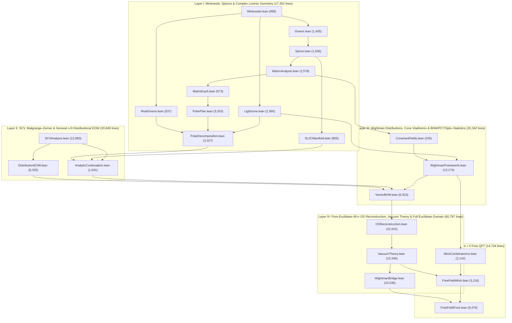

## Axiomatic & Constructive Quantum Field Theory in Lean 4

A machine-checked Lean 4 formalization of **4-dimensional relativistic axiomatic and constructive Quantum Field Theory (QFT)** built on [Mathlib](https://github.com/leanprover-community/mathlib4) (`v4.32.2`).

Starting from real and complex Minkowski geometry, the spinor double cover $SL(2,\mathbb{C}) \times SL(2,\mathbb{C}) \to SO^+(1,3;\mathbb{C})$, several complex variables, and Schwartz tempered distributions, this library develops:

1. **Complex Lorentz Geometry & Jost's Theorem**: Real and complex Lorentz groups, polar/Cartan/Jordan decompositions, path-connectedness of forward-tube stabilizer orbits, and the equivalence between real Jost configurations and real points of the extended tube ($n > 1$).
2. **UV-Cutoff-Free Cone Vladimirov Boundary Values, General $n$-Dimensional Edge-of-the-Wedge, Malgrange–Zerner Flat-Tube Analyticity & Locality**: Construction of forward-tube holomorphic extensions (`coneVladimirovTubeExtension`) for arbitrary Poincaré-covariant tempered Wightman families satisfying the relativistic forward-cone `SpectrumCondition`—with no ultraviolet momentum cutoff—together with general $N$-dimensional Osgood and Malgrange–Zerner flattened-tube / local cross analyticity theorems (`osgood_nd`, `malgrange_zerner_flat_tube`, `malgrange_zerner_local_cross`), general $n$-dimensional analytic (`orthant_eow_extension`, `eow_all_dim`) and polynomial-growth tempered distributional (`local_eow_of_tempered_boundary`) Edge-of-the-Wedge theorems, $4n$-dimensional Jost-window holomorphic continuation (`coneVladimirov_jost_eow_extension`), and the derivation of Jost `WeakLocality` from adjacent spacelike `LocalCommutativity`.
3. **General Spinor Bargmann–Hall–Wightman (BHW), Relativistic PCT & Unconditional Spin–Statistics**: Single-valued analytic continuation from the forward tube $\mathcal{T}_n$ to the extended tube $\mathcal{T}'_n$ for arbitrary finite-dimensional polynomial representations of $SL(2,\mathbb{C}) \times SL(2,\mathbb{C})$, equivalence of forward-tube PCT symmetry and Jost weak locality (`tubePCT_iff_weakLocality`), the full distributional relativistic PCT theorem (`wightman_pct_of_spectrumCondition`), and the **unconditional general-spin Spin–Statistics theorem** (`spin_statistics_of_spectrumCondition`, `WightmanAxioms.spin_statistics`) proving $\eta = \varepsilon$ for arbitrary `(R, S)` with $2\pi$-rotation spin parity $\varepsilon \in \{\pm 1\}$ (including off-diagonal $C = \gamma^0$ Dirac bispinors and general $(m_1/2, m_2/2) \oplus (m_2/2, m_1/2)$ spinor-tensors).
4. **Pure-Euclidean All $n$-Point Osterwalder–Schrader (OS) Reconstruction, Canonical Functional Calculus, Canonical Hilbert Unitary Equivalence & Full Non-Coincident Euclidean Gluing**: Construction of the OS GNS Hilbert space from reflection positivity on time-ordered Euclidean configurations, **canonical spectral functional calculus construction of `OSHolomorphicSemigroup` and its weak holomorphicity directly from `OSAxioms`** (`canonicalOSHolomorphicSemigroup`, `isWeaklyHolomorphic_canonicalOSHolomorphicSemigroup`, eliminating exogenous `spec`), **multi-time semigroup analytic continuation on $(\mathbb{C}_+)^{n-1} \times \mathbb{R}^{3n}$ and pure-Euclidean all $n$-point OS $\to$ Wightman full reconstruction directly from `OSAxioms` + `OSTimeClusterDecomposition` + `OSDampedFieldBounded`** (`osMultiTimeH`, `osReconstructedWightmanFamily`, `osReconstructed_poincareCovariant`, `osReconstructed_spectrumCondition`, `osReconstructedTubeExtensionData`, `os_full_wightman_reconstruction`, eliminating exogenous `OSTubeExtensionData`, exogenous spectral measures `F`, exogenous wavepacket maps `Φ`, and exogenous Wightman `Positivity` across all $n \in \mathbb{N}$), **canonical Euclidean Laplace wavepacket unitary equivalence $\mathcal{H}_{\mathrm{OS}} \simeq_{\mathbb{C}} \mathcal{H}_W$ intertwining spacetime translations and transporting cluster/unique-vacuum properties** (`osToWightmanLinearIsometryEquiv`, `toGeneralWightmanAxiomsWithUniqueVacuum`), **pure-Euclidean 2-point OS $\to$ Wightman reconstruction** (`os_two_point_wightman_reconstruction`), **unconditional promotion of `LocalCommutativity` to `FullEuclidOSAxioms`** (`euclidExtendedTubePermLocality_of_localCommutativity`, `ForwardConeOSReconstructedWightman.toFullEuclidOSAxioms`), unconditional Spin–Statistics (`osAxioms_spin_statistics`, `fullEuclidOSAxioms_spin_statistics`), and unconditional uniqueness (`fullEuclid_eq_of_eq_on_orderedEuclidN`, `wightman_unique_unconditional`).
5. **Constructive 4D Massive ($m > 0$) Free Klein–Gordon & Spin-1/2 Dirac QFT**: All $n$-point bosonic and fermionic Wick combinatorics (including partial-pairing and adjacent-swap crossing parity), explicit mass-shell tempered Wightman distributions satisfying adjacent spacelike `LocalCommutativity`, `PermSpacelikeLocality`, and `WeakLocality`, **Fock damped field operator boundedness `OSDampedFieldBounded` (`K = 3`) and pure-Euclidean all $n$-point OS reconstruction agreement (`freeKGOSDampedFieldBounded`, `freeDiracOSDampedFieldBounded`, `freeKG_osReconstructedWightmanFamily_eq`, `freeDirac_osReconstructedWightmanFamily_eq`, `freeKG_pure_os_full_reconstruction`, `freeDirac_pure_os_full_reconstruction`)**, forward-tube polynomial growth `OSTubeGrowthBound` (`N = 2n`) and concrete `OSTubeExtensionData` instances, pure-Euclidean 2-point OS reconstruction agreement (`freeKG_two_point_os_eq_freeKGW`, `freeDirac_two_point_os_eq_freeDiracW`), full non-coincident Euclidean Schwinger functions `freeKGFullS` and `freeDiracFullS` inhabiting `FullEuclidOSAxioms` across $\mathbb{R}^{4n}_{\neq}$, symmetric and antisymmetric $L^2$ Fock space representations proving all $n$-point Wightman positivity and OS reflection positivity, sharp mass-gap exponential time clustering $\mathcal{O}(e^{-m\tau})$, and Lorentz cluster decomposition along every nonzero spacetime direction $a \neq 0$ (`WightmanAxiomsWithUniqueVacuum`).

---

## Table of Contents

1. [Verification Guarantees & Codebase Metrics](#1-verification-guarantees--codebase-metrics)
2. [Architecture & Module Dependency Graph](#2-architecture--module-dependency-graph)
3. [Core Mathematical Definitions (Verbatim Lean 4)](#3-core-mathematical-definitions-verbatim-lean-4)
4. [Main Formalized Theorems (Verbatim Lean 4)](#4-main-formalized-theorems-verbatim-lean-4)
5. [Non-Vacuity Witnesses & No-Go Theorems](#5-non-vacuity-witnesses--no-go-theorems)
6. [Key Proof Architectures & Technical Highlights](#6-key-proof-architectures--technical-highlights)
7. [Mathematical Scope, Design Choices & Open Boundaries](#7-mathematical-scope-design-choices--open-boundaries)
8. [Build Instructions, Axiom Verification & Literature Cross-Reference](#8-build-instructions-axiom-verification--literature-cross-reference)

---

## 1. Verification Guarantees & Codebase Metrics

Formalizing infinite-dimensional functional analysis and axiomatic QFT carries well-known specification hazards: definitions can inadvertently collapse to zero-momentum constants via ultraviolet cutoffs, structures can become uninhabited due to incompatible sign or chirality conventions, or theorems can hold vacuously. To mitigate these risks, the codebase has been checked against the Lean 4 kernel, syntactic vacuity heuristics, and explicit $m > 0$ free-field witnesses—while remaining open to independent human audit of its mathematical specifications.

| Metric | Verified Value | Details |
| :--- | :---: | :--- |
| **Lean 4 / Mathlib Toolchain** | `v4.32.2` | `leanprover/lean4:v4.32.2` with `mathlib` `v4.32.2` |
| **QFT & Analysis Modules** | **22 files** | Located in `src/` (see [Section 2](#2-architecture--module-dependency-graph)) |
| **Total Lines of Lean 4** | **134,024 lines** | Comment-free, linter-clean (`weak.linter.mathlibStandardSet = true`) |
| **Top-Level Declarations** | **7,443** | `2,099` `theorem`, `3,869` `lemma`, `1,349` `def`, `34` `abbrev`, `31` `structure`, `56` `instance`, `5` `inductive` |
| **`sorry` / `admit` / Custom `axiom`** | **0** | Mechanically checked by the Lean 4 kernel (reproducible via `#print axioms` in [Section 8](#8-build-instructions-axiom-verification--literature-cross-reference)) |
| **`unsafe` / `opaque` / Metaprogramming Bypasses** | **0** | Purely logical definitions and proofs; independently verifiable in a fresh `lake build` |
| **Permitted Kernel Axioms** | **Standard 3 only** | Every audited theorem depends exclusively on `[propext, Classical.choice, Quot.sound]` |
| **Automated Vacuity Checks** | **0 flagged (within audit scope)** | No syntactic empty-type (`False.elim` / `IsEmpty`) positive proofs or unused-hypothesis traps found in our audit; full semantic non-vacuity remains subject to independent verification |
| **Concrete 4D $m > 0$ Models** | **2 full theories** | Massive real scalar Klein–Gordon ($\eta = +1$) and spin-1/2 Dirac ($\eta = -1$) fields |

> [!NOTE]
> **Scope of Verification (Kernel Guarantees vs. Independent Semantic Audit)**:
> - **Kernel-Guaranteed**: The absence of `sorry` (`sorryAx`), custom `axiom` declarations, `unsafe`, and `opaque` is checked mechanically by the Lean 4 kernel; anyone can reproduce these checks independently using the `#print axioms` commands in [Section 8](#8-build-instructions-axiom-verification--literature-cross-reference).
> - **Subject to Independent Verification**: While our automated kernel/AST checks and explicit 4D $m > 0$ Klein–Gordon and Dirac model instantiations uncovered no vacuous positive theorems or specification collapses within the scope we inspected, no automated check can guarantee that subtle semantic vacuity, unintended degeneracies, or definition mismatches are completely absent across all 7,000+ declarations. Independent mathematical review of all definitions and theorem statements ([Section 3](#3-core-mathematical-definitions-verbatim-lean-4) and [Section 4](#4-main-formalized-theorems-verbatim-lean-4)) is encouraged.

---

## 2. Architecture & Module Dependency Graph

The 22 modules are organized into five mathematical layers. Arrows in the dependency graph point from imported foundational modules to downstream consumers (`A --> B` means `B` imports `A`).



### Complete Module Inventory

#### Layer I: Minkowski Geometry, $SL(2,\mathbb{C})$ Spinors & Complex Lorentz Polar Decomposition (`17,302` lines)

| Module | Lines | Mathematical Scope |
| :--- | ---: | :--- |
| `src/Minkowski.lean` | 958 | Signature $(+,-,-,-)$ real and complex Minkowski metrics, forward/backward lightcones, real and complex Lorentz groups, forward tube $\mathcal{T}_n$, extended tube $\mathcal{T}'_n$, and Jost convex hulls/points. |
| `src/Givens.lean` | 1,405 | Complex Givens rotations and elementary $SL(2,\mathbb{C})$ / $SO(4,\mathbb{C})$ matrix factorizations. |
| `src/RealGivens.lean` | 537 | Real orthogonal Givens reductions and $SO(3)$ / $SO^+(1,3)$ boost-rotation decompositions. |
| `src/Spinor.lean` | 1,506 | Pauli/Hermitian $2 \times 2$ encoding of 4-vectors, the double-cover homomorphism `spinorPhi : SL(2,ℂ) × SL(2,ℂ) →* SO⁺(1,3;ℂ)`, and surjectivity onto proper orthochronous Lorentz transformations. |
| `src/SL2CManifold.lean` | 805 | Complex Lie-manifold topology, path-connectedness, and holomorphic chart structure of $SL(2,\mathbb{C})$. |
| `src/MatrixAnalysis.lean` | 2,578 | Matrix norms, spectral/Jordan analysis, convergent power series, and complex orthogonal Lie algebra estimates. |
| `src/MatrixExpS.lean` | 573 | Exponential map properties for complex skew-Minkowski generators and determinant/metric preservation. |
| `src/PolarPlan.lean` | 3,253 | Complex Lorentz polar and Cartan decompositions $\Lambda = R \exp(i B)$ and canonical normal forms of Minkowski-skew generators. |
| `src/Lightcone.lean` | 2,360 | Hahn–Banach hyperplane separation of Jost convex hulls from the forward lightcone, complex boost mapping into $\mathcal{T}_n$, and **Jost's Theorem** (`jost_theorem`). |
| `src/PolarDecomposition.lean` | 3,327 | Path-connectedness of complex Lorentz orbit domains `{Λ ∈ SO⁺(1,3;ℂ) | Λ • z ∈ forward_tube_n n}` (`orbit_domain_path_connected`), eliminating multi-valuedness in BHW continuation. |

#### Layer II: Several Complex Variables (SCV), Malgrange–Zerner Flat-Tube Analyticity & General $n$-Dimensional Distributional Edge-of-the-Wedge (`20,849` lines)

| Module | Lines | Mathematical Scope |
| :--- | ---: | :--- |
| `src/SCVAnalysis.lean` | 12,983 | Polydisc Cauchy integral formulas, **General $N$-Dimensional Osgood Lemma** (`osgood_nd`), **General $N$-Dimensional Malgrange–Zerner Flattened-Tube & Local Cross Analyticity Theorems** (`malgrange_zerner_flat_tube`, `malgrange_zerner_local_cross`), identity theorems on connected open sets in $\mathbb{C}^N$, 2D bounded L-shaped **Bochner Tube Theorem** (`bochner_tube_theorem`), and **General $n$-Dimensional Analytic Edge-of-the-Wedge Theorems** (`orthant_eow_extension`, `eow_all_dim`) across arbitrary convex open cones $V_+ \subset \mathbb{R}^n$. |
| `src/DistributionEOW.lean` | 6,325 | Test-function spaces $\mathcal{D}(\Omega)$ and distributions $\mathcal{D}'(\Omega,\mathbb{C})$, distributional boundary values from open cones, polynomial tube growth (`HasPolynomialTubeGrowth`), and **General $n$-Dimensional Continuous & Tempered Distributional Edge-of-the-Wedge Theorems** (`local_eow_of_continuous_boundary`, `local_eow_of_tempered_boundary`) via iterated cone-ODE antiderivative regularization. |
| `src/AnalyticContinuation.lean` | 1,541 | Scalar Bargmann–Hall–Wightman continuation from $\mathcal{T}_n$ to $\mathcal{T}'_n$ by gluing along path-connected complex Lorentz orbits. |

#### Layer III: Tempered Wightman Distributions, Cone Vladimirov Extension & Spinor BHW/PCT/Spin–Statistics (`20,342` lines)

| Module | Lines | Mathematical Scope |
| :--- | ---: | :--- |
| `src/CovariantFields.lean` | 245 | Finite-dimensional polynomial representations `HolomorphicLorentzRep ι` of $SL(2,\mathbb{C}) \times SL(2,\mathbb{C})$, $2\pi$-rotation spin parity `HasSpinParity`, restricted real representations `R.rep`, and distributional `PoincareCovariant`. |
| `src/WightmanFramework.lean` | 13,174 | `WightmanFamily`, Minkowski Fourier transforms, relativistic `SpectrumCondition`, adjacent spacelike `LocalCommutativity` $\implies$ `PermSpacelikeLocality` $\implies$ Jost `WeakLocality`, `Positivity`, the **UV-cutoff-free Cone Vladimirov Tube Extension** (`coneVladimirovTubeExtension`) via Schwartz finite-order jet factorizations and Hahn–Banach extension, and 2-point split-product Schwartz density (`wightman_two_eq_zero_of_schwartzProdSplit_eq_zero`). |
| `src/VectorBHW.lean` | 6,923 | **General Spinor BHW Theorem** (`spinor_bhw_theorem`), **Relativistic PCT Theorem** (`wightman_pct_of_spectrumCondition`), chiral Weyl star-structure no-go (`isEmpty_starStructure_leftWeylRep`), PSD/PCT sesquilinear matrix vanishing (`eq_zero_of_psd_pct_pair_ne_spinParity`), **Unconditional General-Spin Spin–Statistics** (`spin_statistics_of_spectrumCondition`), nonempty real Jost permutation overlaps (`jost_inter_perm_nonempty`, `spinor_H_ext_perm_eq_on_jost_inter`), and **$4n$-Dimensional Jost-Window Tempered EOW Continuation** (`coneVladimirov_jost_eow_extension`). |

#### Layer IV: Pure-Euclidean All $n$-Point Osterwalder–Schrader Reconstruction, Canonical Functional Calculus & Full Euclidean Axioms (`60,797` lines)

| Module | Lines | Mathematical Scope |
| :--- | ---: | :--- |
| `src/OSReconstruction.lean` | 22,915 | Time-ordered `orderedEuclidN n` and full non-coincident `nonCoincidentEuclidN n`, `OSAxioms` and `FullEuclidOSAxioms`, **canonical C\*-algebraic spectral functional calculus `canonicalOSHolomorphicSemigroup` on $\mathrm{Re}(z) > 0$ eliminating exogenous `spec`**, **damped OS field operator bound `OSDampedFieldBounded` & general $n$-point multi-time holomorphic continuation `osMultiTimeH` on $(\mathbb{C}_+)^{n-1} \times \mathbb{R}^{3n}$ (`exists_osMultiTimeH_growth_bound`)**, $SO(4) \times S_n$ Euclidean orbit covering (`exists_euclidRot_perm_mem_orderedEuclidN`), **unconditional relativistic-to-Euclidean extended-tube locality & gluing** (`euclidExtendedTubePermLocality_of_localCommutativity`, `schwingerFromPermutedTube_fullEuclidOSAxioms_of_localCommutativity`), **unconditional Euclidean & OS Spin–Statistics** (`osAxioms_spin_statistics`, `fullEuclidOSAxioms_spin_statistics`), and **unconditional uniqueness** (`fullEuclid_eq_of_eq_on_orderedEuclidN`, `wightman_unique_unconditional`). |
| `src/VacuumTheory.lean` | 13,346 | Equivalence `tubePCT_iff_weakLocality`, Spin–Statistics from `TubePCT` + `WeakLocality`, explicit 4-momentum symmetry-breaking counterexamples (`fourMomentumW q`, `fourMomentumS q` for $q \neq 0$), concrete `OSDampedFieldBounded` witnesses (`vacOSDampedFieldBounded`, `twoModeOSDampedFieldBounded`, `coherentOSDampedFieldBounded`, `z2FreeOSDampedFieldBounded`), and standalone massive propagator analysis. |
| `src/WightmanBridge.lean` | 24,536 | Bundled `WightmanAxioms` and `GeneralWightmanAxiomsWithUniqueVacuum`, weak holomorphicity of `canonicalOSHolomorphicSemigroup`, **canonical Euclidean Laplace wavepacket unitary equivalence `osToWightmanLinearIsometryEquiv : P.Hilbert ≃ₗᵢ[ℂ] P.WightmanHilbertSpace` eliminating exogenous `Φ`**, **Vladimirov boundary values & constructive OS $\to$ Wightman `Positivity` (`positivity_of_osAxioms_and_tube`)**, **pure-Euclidean all $n$-point OS $\to$ Wightman reconstruction (`osReconstructedWightmanFamily`, `osReconstructed_poincareCovariant`, `osReconstructed_spectrumCondition`, `osReconstructedTubeExtensionData`, `os_full_wightman_reconstruction`, eliminating exogenous `OSTubeExtensionData` for all $n \in \mathbb{N}$)**, and pure-Euclidean 2-point OS reconstruction (`os_two_point_wightman_reconstruction`). |

#### Layer V: Wick Combinatorics & 4D $m > 0$ Constructive Free QFT on $L^2$ Fock Space (`14,734` lines)

| Module | Lines | Mathematical Scope |
| :--- | ---: | :--- |
| `src/WickCombinatorics.lean` | 2,142 | Fixed-point-free involutions (`ChordPairing`), partial pairings (`PartialPairing`), reversed concatenation bijections (`concatRev`), exact fermionic chord-crossing parity (`cross_concatRev`), adjacent-swap pairing conjugation (`conjSwap`, `eta_pow_cross_conjSwap`), and $S_n$-permutation covariance of abstract Wick sums (`wickPairingSum_perm`). |
| `src/FreeFieldWick.lean` | 3,116 | Lorentz-invariant positive-energy mass-shell measures ($m > 0$), all $n$-point Wick expansions `freeKGW`, `freeKGS`, `freeKGFullS`, `freeDiracW`, `freeDiracS`, `freeDiracFullS`, forward-cone spectrum condition, Poincaré covariance, **adjacent spacelike `LocalCommutativity`** & `PermSpacelikeLocality` & Jost `WeakLocality`, PCT, full non-coincident Euclidean smoothness/covariance/permutation symmetry, explicit equal-time non-coincident non-vanishing witnesses, `¬ ZeroMomentumSpectrumCondition`, and unconditional Spin–Statistics. |
| `src/FreeFieldFock.lean` | 9,476 | Direct-sum $\sigma$-finite measure-theoretic Fock space `FockHilbert ν = Lp ℂ 2 (fockMeasure ν)`, symmetric/antisymmetric sector projections, all $n$-point Wightman `Positivity` and `OSReflectionPositive`, `freeKGFullEuclidOSAxioms` & `freeDiracFullEuclidOSAxioms`, sharp exponential OS clustering $e^{-m\tau}$, **Fock creation/annihilation operator bounds proving `OSDampedFieldBounded` ($K = 3$) & pure-Euclidean all $n$-point OS reconstruction agreement (`freeKGOSDampedFieldBounded`, `freeDiracOSDampedFieldBounded`, `freeKG_osReconstructedWightmanFamily_eq`, `freeDirac_osReconstructedWightmanFamily_eq`, `freeKG_pure_os_full_reconstruction`, `freeDirac_pure_os_full_reconstruction`)**, concrete `OSTubeExtensionData` producers, and `freeKG_grand_master` / `freeDirac_grand_master`. |

---

## 3. Core Mathematical Definitions (Verbatim Lean 4)

To make the exact mathematical content completely transparent—without paraphrasing—all primary definitions below are reproduced verbatim from `src/`.

### 3.1 Minkowski Geometry, Complex Tubes & Jost Points (`Minkowski.lean`)

Spacetime points are modeled as `Fin 4 → ℝ` (and complexified spacetime as `Fin 4 → ℂ`) with the signature $(+,-,-,-)$ inner product $x \cdot y = x^0 y^0 - x^1 y^1 - x^2 y^2 - x^3 y^3$. The forward tube $\mathcal{T}_n$ requires every successive difference $z_i - z_{i+1}$ to have its negated imaginary part in the open forward lightcone $V^+$:

```lean
def minkowskiInner (x y : Fin 4 → ℝ) : ℝ :=
  dotProduct x (minkowskiMetricReal.mulVec y)

def forward_light_cone : Set (Fin 4 → ℝ) :=
  { x | x 0 > 0 ∧ minkowskiInner x x > 0 }

def forward_tube_n (n : ℕ) : Set (Fin n → Fin 4 → ℂ) :=
  { z | ∀ (i : Fin n) (hi : i.val + 1 < n),
    (fun k => -((z i - z ⟨i.val + 1, hi⟩) k).im) ∈ forward_light_cone }

def extended_tube_n (n : ℕ) : Set (Fin n → Fin 4 → ℂ) :=
  ⋃ Λ : SpecialSpecialComplexLorentzGroup, (fun z => Λ • z) '' forward_tube_n n

def is_spacelike (v : Fin 4 → ℝ) : Prop :=
  minkowskiInner v v < 0

def jost_differences_n (n : ℕ) (x : Fin n → Fin 4 → ℝ) : Set (Fin 4 → ℝ) :=
  { v | ∃ (i : Fin n) (hi : i.val + 1 < n), v = x i - x ⟨i.val + 1, hi⟩ }

def jost_convex_hull (n : ℕ) (x : Fin n → Fin 4 → ℝ) : Set (Fin 4 → ℝ) :=
  convexHull ℝ (jost_differences_n n x)

def jost_points_n (n : ℕ) : Set (Fin n → Fin 4 → ℝ) :=
  { x | ∀ v ∈ jost_convex_hull n x, is_spacelike v }
```

### 3.2 Holomorphic Spinor Representations & Star Structures (`CovariantFields.lean`, `WightmanFramework.lean`)

Arbitrary spinor/tensor field multiplets indexed by a finite type `ι` carry a multiplicative representation $\sigma : SL(2,\mathbb{C}) \times SL(2,\mathbb{C}) \to \mathrm{Mat}_{\iota \times \iota}(\mathbb{C})$ whose matrix entries are complex polynomials in the entries of $(A, B) \in SL(2,\mathbb{C}) \times SL(2,\mathbb{C})$. Restricting along the diagonal embedding $A \mapsto (A, \overline{A})$ yields the physical real $SL(2,\mathbb{C})$ representation `R.rep`:

```lean
structure HolomorphicLorentzRep (ι : Type*) [Fintype ι] [DecidableEq ι] where
  σ : SL2C × SL2C →* Matrix ι ι ℂ
  polynomial : ∀ i j : ι, ∃ P : MvPolynomial ((Fin 2 × Fin 2) ⊕ (Fin 2 × Fin 2)) ℂ,
    ∀ p : SL2C × SL2C,
      σ p i j = MvPolynomial.eval
        (Sum.elim (fun a => (p.1 : Matrix (Fin 2) (Fin 2) ℂ) a.1 a.2)
                  (fun a => (p.2 : Matrix (Fin 2) (Fin 2) ℂ) a.1 a.2)) P

noncomputable def HolomorphicLorentzRep.rep (R : HolomorphicLorentzRep ι) :
    SL2C →* Matrix ι ι ℂ :=
  R.σ.comp ((MonoidHom.id SL2C).prod sl2cConjHom)

def HolomorphicLorentzRep.HasSpinParity (R : HolomorphicLorentzRep ι) (ε : ℂ) : Prop :=
  R.σ ((-1 : SL2C), (-1 : SL2C)) = ε • (1 : Matrix ι ι ℂ) ∧ (ε = 1 ∨ ε = -1)

def PoincareCovariant {ι : Type*} [Fintype ι] [DecidableEq ι] (R : HolomorphicLorentzRep ι)
    (W : ∀ n : ℕ, (Fin n → ι) → TemperedDistribution (Fin n → Fin 4 → ℝ) ℂ) : Prop :=
  ∀ (n : ℕ) (a : Fin 4 → ℝ) (A : SL2C)
    (f f' : SchwartzMap (Fin n → Fin 4 → ℝ) ℂ),
    (∀ x : Fin n → Fin 4 → ℝ, f' (fun i => poincareAct a A (x i)) = f x) →
    ∀ α : Fin n → ι,
      W n α f' = ∑ β : Fin n → ι, (∏ i, R.rep A (α i) (β i)) * W n β f

structure StarStructure (R : HolomorphicLorentzRep ι) where
  C : Matrix ι ι ℂ
  involutive : C * C.map star = 1
  intertwine : ∀ A B : SL2C,
    C * R.σ (A, B) = (R.σ (sl2c_conj B, sl2c_conj A)).map star * C
```

Concrete instances include `trivialRep` / `trivialStarStructure` (scalar fields, $\iota = \mathrm{Unit}$), `stdRep` / `stdStarStructure` (4-vector fields, $\iota = \mathrm{Fin}\ 4$), `leftWeylRep` and `rightWeylRep` (2-component chiral Weyl spinors, $\iota = \mathrm{Fin}\ 2$), and `diracRep` / `diracStarStructure` (4-component $(1/2,0) \oplus (0,1/2)$ Dirac bispinors, $\iota = \mathrm{Fin}\ 2 \oplus \mathrm{Fin}\ 2$, with off-diagonal chiral swap matrix $C = \gamma^0$).

### 3.3 Tempered Wightman Distributions, Spectrum, Locality, Positivity & Tube Extensions (`WightmanFramework.lean`, `VectorBHW.lean`)

An $n$-point Wightman function is a genuine Mathlib `TemperedDistribution` (a continuous linear functional `SchwartzMap (Fin n → Fin 4 → ℝ) ℂ →L[ℂ] ℂ`). The relativistic `SpectrumCondition` asserts that $W_n(f) = 0$ whenever the Minkowski Fourier transform of $f$ vanishes on an open neighborhood of the joint forward-cone spectral region $\sum_{i=0}^{n-1} p_i = 0$, $\sum_{i \le k} p_i \in \overline{V^+}$:

```lean
abbrev WightmanFamily (ι : Type*) : Type _ :=
  ∀ n : ℕ, (Fin n → ι) → TemperedDistribution (Fin n → Fin 4 → ℝ) ℂ

noncomputable def minkowskiFourier {n : ℕ} (f : SchwartzMap (Fin n → Fin 4 → ℝ) ℂ)
    (p : Fin n → Fin 4 → ℝ) : ℂ :=
  ∫ x : Fin n → Fin 4 → ℝ,
    f x * Complex.exp (-(Complex.I * ((∑ k, minkowskiInner (p k) (x k) : ℝ) : ℂ)))

def spectralRegion (n : ℕ) : Set (Fin n → Fin 4 → ℝ) :=
  { p | (∑ i, p i = 0) ∧
    (∀ k : Fin n, (∑ i ∈ Finset.univ.filter (fun i : Fin n => i ≤ k), p i) ∈
      closure forward_light_cone) }

def SpectrumCondition (W : WightmanFamily ι) : Prop :=
  ∀ (n : ℕ) (α : Fin n → ι) (f : SchwartzMap (Fin n → Fin 4 → ℝ) ℂ),
    (∃ U : Set (Fin n → Fin 4 → ℝ), IsOpen U ∧ spectralRegion n ⊆ U ∧
      ∀ p ∈ U, minkowskiFourier f p = 0) → W n α f = 0

def LocalCommutativity (η : ℂ) (W : WightmanFamily ι) : Prop :=
  ∀ (n : ℕ) (i : Fin n) (hi : i.val + 1 < n) (α : Fin n → ι)
    (f f' : SchwartzMap (Fin n → Fin 4 → ℝ) ℂ),
    tsupport (f : (Fin n → Fin 4 → ℝ) → ℂ) ⊆
      { x | is_spacelike (x i - x ⟨i.val + 1, hi⟩) } →
    (∀ x : Fin n → Fin 4 → ℝ, f' (x ∘ Equiv.swap i ⟨i.val + 1, hi⟩) = f x) →
    W n α f = η * W n (α ∘ Equiv.swap i ⟨i.val + 1, hi⟩) f'

def WeakLocality (η : ℂ) (W : WightmanFamily ι) : Prop :=
  ∀ (n : ℕ) (α : Fin n → ι) (f f' : SchwartzMap (Fin n → Fin 4 → ℝ) ℂ),
    tsupport (f : (Fin n → Fin 4 → ℝ) → ℂ) ⊆ jost_points_n n →
    (∀ x : Fin n → Fin 4 → ℝ, f' (fun i => x (Fin.rev i)) = f x) →
    W n α f = η ^ (n * (n - 1) / 2) * W n (α ∘ Fin.rev) f'

def Positivity {R : HolomorphicLorentzRep ι} (S : StarStructure R) (W : WightmanFamily ι) :
    Prop :=
  ∀ (N : ℕ) (F : ∀ j : ℕ, (Fin j → ι) → SchwartzMap (Fin j → Fin 4 → ℝ) ℂ)
    (G : ∀ j k : ℕ, (Fin j → ι) → (Fin k → ι) →
      SchwartzMap (Fin (j + k) → Fin 4 → ℝ) ℂ),
    (∀ j k α α' (x : Fin (j + k) → Fin 4 → ℝ),
      G j k α α' x =
        (starRingEnd ℂ) (F j α (fun i => x (Fin.castAdd k (Fin.rev i)))) *
          F k α' (fun i => x (Fin.natAdd j i))) →
    0 ≤ ∑ j ∈ Finset.range (N + 1), ∑ k ∈ Finset.range (N + 1),
      ∑ α : Fin j → ι, ∑ α' : Fin k → ι, ∑ β : Fin j → ι,
        (∏ i, S.C (α i) (β i)) * W (j + k) (Fin.append (β ∘ Fin.rev) α') (G j k α α')
```

Holomorphic forward-tube extensions, tube Lorentz covariance, and tube/distributional PCT symmetry are defined by:

```lean
structure TubeExtension (W : WightmanFamily ι) where
  H : ∀ n : ℕ, (Fin n → ι) → (Fin n → Fin 4 → ℂ) → ℂ
  analytic : ∀ n α, AnalyticOn ℂ (H n α) (forward_tube_n n)
  boundary : ∀ (n : ℕ) (α : Fin n → ι) (f : SchwartzMap (Fin n → Fin 4 → ℝ) ℂ)
    (v : Fin 4 → ℝ), v ∈ forward_light_cone →
    Tendsto (fun t : ℝ => ∫ x : Fin n → Fin 4 → ℝ,
        H n α (fun i k => (x i k : ℂ) + Complex.I * ((t * (i : ℕ) * v k : ℝ) : ℂ)) * f x)
      (𝓝[>] 0) (𝓝 (W n α f))

def TubeCovariant {W : WightmanFamily ι} (R : HolomorphicLorentzRep ι)
    (E : TubeExtension W) : Prop :=
  ∀ (n : ℕ) (A : SL2C) (z : Fin n → Fin 4 → ℂ),
    z ∈ forward_tube_n n → spinorPhi (A, sl2c_conj A) • z ∈ forward_tube_n n →
    ∀ α : Fin n → ι,
      E.H n α (spinorPhi (A, sl2c_conj A) • z) =
        ∑ β : Fin n → ι, (∏ i, R.rep A (α i) (β i)) * E.H n β z

def TubePCT (η : ℂ) (R : HolomorphicLorentzRep ι) {W : WightmanFamily ι}
    (E : TubeExtension W) : Prop :=
  ∀ (n : ℕ) (α : Fin n → ι), ∀ z ∈ forward_tube_n n,
    E.H n α (-(z ∘ Fin.rev)) =
      η ^ (n * (n - 1) / 2) *
        ∑ β : Fin n → ι, (∏ i, R.σ (-1, 1) (α i) (β i)) * E.H n (β ∘ Fin.rev) z

def WightmanPCT (η : ℂ) (R : HolomorphicLorentzRep ι) (W : WightmanFamily ι) : Prop :=
  ∀ (n : ℕ) (α : Fin n → ι) (f f' : SchwartzMap (Fin n → Fin 4 → ℝ) ℂ),
    (∀ x : Fin n → Fin 4 → ℝ, f' (fun i => -x (Fin.rev i)) = f x) →
    W n α f =
      η ^ (n * (n - 1) / 2) *
        ∑ β : Fin n → ι, (∏ i, R.σ (-1, 1) (α i) (β i)) * W n (β ∘ Fin.rev) f'
```

### 3.4 Bundled Relativistic Wightman Axiom Systems (`WightmanBridge.lean`)

`WightmanAxioms` and `WightmanAxiomsWithUniqueVacuum` package the relativistic Wightman axioms together with their GNS Hilbert space `A.Hilbert`, cyclic vacuum vector `A.vacuum`, all-direction cluster decomposition ($\forall a \neq 0$), and uniqueness of translation-invariant vectors:

```lean
structure WightmanAxioms (R : HolomorphicLorentzRep ι) (S : StarStructure R)
    (η : ℂ) where
  WData : WightmanPositiveData R S
  E : TubeExtension WData.W
  positivity : Positivity S WData.W
  poincare : PoincareCovariant R WData.W
  spectrum : ForwardConeSpectrumCondition WData.W
  weakLocality : WeakLocality η WData.W
  tube_covariant : TubeCovariant R E
  tube_pct : TubePCT η R E
  cyclic : WightmanVacuumCyclic WData

structure WightmanAxiomsWithUniqueVacuum
    (R : HolomorphicLorentzRep ι) (S : StarStructure R) (η : ℂ) extends
    WightmanAxioms R S η where
  vacuumNormalized : WightmanVacuumNormalized S WData.W
  cluster : ∀ a : Fin 4 → ℝ, a ≠ 0 → WightmanClusterAlong WData a
  vacuumUnique :
    WightmanVacuumUnique WData
      (wightmanTranslationInvariant_of_poincare R poincare)
```

*(Note: `ForwardConeSpectrumCondition` is `abbrev ForwardConeSpectrumCondition (W : WightmanFamily ι) : Prop := SpectrumCondition W`.)*

### 3.5 Time-Ordered & Full Non-Coincident Euclidean Configurations and Osterwalder–Schrader Axioms (`OSReconstruction.lean`)

On the Euclidean side, `OSReconstruction.lean` formulates both `OSAxioms` on strictly time-ordered Euclidean configurations $x_0^0 < x_1^0 < \dots < x_{n-1}^0$ (`orderedEuclidN n`) and `FullEuclidOSAxioms` across the full pairwise non-coincident domain $\mathbb{R}^{4n}_{\neq}$ (`nonCoincidentEuclidN n`), with $SU(2) \times SU(2)$ Euclidean spinor rotation covariance, Euclidean translation invariance, Hermitian reflection positivity on positive-time configurations (`OSConfig ι →₀ ℂ`), and full $S_n$ permutation covariance (`OSPermutationSymmetry`):

```lean
def orderedEuclidN (n : ℕ) : Set (Fin n → Fin 4 → ℝ) :=
  { x | ∀ (i : Fin n) (hi : i.val + 1 < n), x i 0 < x ⟨i.val + 1, hi⟩ 0 }

def nonCoincidentEuclidN (n : ℕ) : Set (Fin n → Fin 4 → ℝ) :=
  {x | ∀ i j : Fin n, i ≠ j → x i ≠ x j}

def OSReflectionPositive {R : HolomorphicLorentzRep ι} (S : StarStructure R)
    (𝒮 : SchwingerFamily ι) : Prop :=
  ∀ Ψ : OSConfig ι →₀ ℂ, 0 ≤ (osPreInner S 𝒮 Ψ Ψ).re

def OSTranslationInvariant (𝒮 : SchwingerFamily ι) : Prop :=
  ∀ (n : ℕ) (α : Fin n → ι) (x : Fin n → Fin 4 → ℝ),
    x ∈ orderedEuclidN n → ∀ a : Fin 4 → ℝ,
    𝒮 n α (fun i => x i + a) = 𝒮 n α x

def EuclidRotCovariant (R : HolomorphicLorentzRep ι) (𝒮 : SchwingerFamily ι) : Prop :=
  ∀ (n : ℕ) (U V : SU2) (x : Fin n → Fin 4 → ℝ),
    x ∈ orderedEuclidN n → euclidRotN n U V x ∈ orderedEuclidN n →
    ∀ α : Fin n → ι,
    𝒮 n α (euclidRotN n U V x) =
      ∑ β : Fin n → ι,
        (∏ i : Fin n, R.σ (su2ToSL2C U, su2ToSL2C V) (α i) (β i)) * 𝒮 n β x

structure OSAxioms (R : HolomorphicLorentzRep ι) (S : StarStructure R)
    (η : ℂ) (𝒮 : SchwingerFamily ι) : Prop where
  os0_smooth : ∀ (n : ℕ) (α : Fin n → ι),
    ContDiffOn ℝ (⊤ : ℕ∞) (𝒮 n α) (orderedEuclidN n)
  os1_translation : OSTranslationInvariant 𝒮
  os1_rotation : EuclidRotCovariant R 𝒮
  os2_hermiticity : OSHermiticity S 𝒮
  os2_positivity : OSReflectionPositive S 𝒮
  os3_symmetry : ∀ (n : ℕ) (α : Fin n → ι) (x : Fin n → Fin 4 → ℝ),
    x ∈ orderedEuclidN n →
    𝒮 n α (-(x ∘ Fin.rev)) =
      η ^ (n * (n - 1) / 2) *
        ∑ β : Fin n → ι,
          (∏ i : Fin n, R.σ (-1, 1) (α i) (β i)) * 𝒮 n (β ∘ Fin.rev) x

def OSPermutationSymmetry (η : ℂ) (𝒮 : SchwingerFamily ι) : Prop :=
  ∀ (n : ℕ) (π : Equiv.Perm (Fin n)) (α : Fin n → ι) (x : Fin n → Fin 4 → ℝ),
    x ∈ nonCoincidentEuclidN n →
    𝒮 n (α ∘ π) (x ∘ π) = η ^ permInversions π * 𝒮 n α x

structure FullEuclidOSAxioms (R : HolomorphicLorentzRep ι) (S : StarStructure R)
    (η : ℂ) (𝒮 : SchwingerFamily ι) : Prop where
  os0_smooth : ∀ (n : ℕ) (α : Fin n → ι),
    ContDiffOn ℝ (⊤ : ℕ∞) (𝒮 n α) (nonCoincidentEuclidN n)
  os1_translation : FullEuclidTranslationInvariant 𝒮
  os1_rotation : FullEuclidRotCovariant R 𝒮
  os2_hermiticity : OSHermiticity S 𝒮
  os2_positivity : OSReflectionPositive S 𝒮
  os3_permutation : OSPermutationSymmetry η 𝒮

def OSTimeClusterDecomposition {R : HolomorphicLorentzRep ι} {S : StarStructure R}
    (D : OSReflectionPositiveData R S) : Prop :=
  ∀ A B : OSConfig ι,
    Tendsto
      (fun τ : ℝ =>
        osKernel S D.𝒮 A (osConfigTimeShift (max τ 0) (le_max_right τ 0) B))
      atTop
      (𝓝 (osKernel S D.𝒮 A (osVacuumConfig ι) *
        osKernel S D.𝒮 (osVacuumConfig ι) B))

def OSDampedFieldBounded {R : HolomorphicLorentzRep ι} {S : StarStructure R}
    (D : OSReflectionPositiveData R S) : Prop :=
  ∃ (C₀ : ℝ) (K : ℕ), 0 ≤ C₀ ∧
    ∀ (α₀ : ι) (x_sp : Fin 3 → ℝ) (ε : ℝ) (hε : 0 < ε) (Ψ : OSPreHilbertSpace D),
      ‖osPrependShiftLM D α₀ x_sp ε hε Ψ‖ ≤ C₀ * (1 + ε⁻¹) ^ K * ‖Ψ‖
```

### 3.6 Wick Pairings, $L^2$ Fock Space & 4D $m > 0$ Free Fields (`WickCombinatorics.lean`, `FreeFieldWick.lean`, `FreeFieldFock.lean`)

All $n$-point free fields are built via complete chord pairings (`ChordPairing n`), partial pairings (`PartialPairing n r`, which factorize an $(j+k)$-point Wick sum across the $t = 0$ hyperplane into $r$-particle intermediate states), and a genuine Mathlib $L^2$ space `FockHilbert ν` over the $\sigma$-finite direct sum of $r$-particle momentum-spin sectors, providing both time-ordered (`freeKGS`, `freeDiracS`) and full non-coincident (`freeKGFullS`, `freeDiracFullS`) Euclidean Schwinger families:

```lean
structure ChordPairing (n : ℕ) where
  mate : Equiv.Perm (Fin n)
  involutive : Function.Involutive mate
  ne_self : ∀ i : Fin n, mate i ≠ i

structure PartialPairing (n r : ℕ) where
  unpaired : Fin r → Fin n
  strictMono_unpaired : StrictMono unpaired
  mate : Equiv.Perm (Fin n)
  involutive : Function.Involutive mate
  fixed_iff : ∀ i : Fin n, mate i = i ↔ ∃ a : Fin r, unpaired a = i

abbrev FockHilbert (ν : ℕ) : Type :=
  MeasureTheory.Lp ℂ 2 (fockMeasure ν)

noncomputable def freeKGW (m : ℝ) (hm : 0 < m) : WightmanFamily Unit :=
  wickMassShellW m 1 massiveKGCoeff (massiveKGCoeff_data hm)

noncomputable def freeKGS (m : ℝ) (hm : 0 < m) : SchwingerFamily Unit :=
  wickMassShellS m hm 1 massiveKGCoeff (massiveKGCoeff_data hm)

noncomputable def freeKGFullS (m : ℝ) (hm : 0 < m) : SchwingerFamily Unit :=
  wickMassShellFullS trivialRep m hm 1 massiveKGCoeff (massiveKGCoeff_data hm)

noncomputable def freeDiracW (m : ℝ) (hm : 0 < m) :
    WightmanFamily (Fin 2 ⊕ Fin 2) :=
  wickMassShellW m (-1) (diracMassShellCoeff m) (diracMassShellCoeff_data hm)

noncomputable def freeDiracS (m : ℝ) (hm : 0 < m) :
    SchwingerFamily (Fin 2 ⊕ Fin 2) :=
  wickMassShellS m hm (-1) (diracMassShellCoeff m) (diracMassShellCoeff_data hm)

noncomputable def freeDiracFullS (m : ℝ) (hm : 0 < m) :
    SchwingerFamily (Fin 2 ⊕ Fin 2) :=
  wickMassShellFullS diracRep m hm (-1) (diracMassShellCoeff m) (diracMassShellCoeff_data hm)
```

---

## 4. Main Formalized Theorems (Verbatim Lean 4)

### 4.1 Complex Lorentz Geometry, Orbit Path-Connectedness & Jost's Theorem

- **Jost's Theorem** (`src/Lightcone.lean:2322`): For every $n > 1$, a real $n$-point configuration $x$ belongs to the Jost set (every vector in the convex hull of successive differences $x_i - x_{i+1}$ is spacelike) if and only if its complexification lies in the extended tube $\mathcal{T}'_n$.
- **Path-Connectedness of Complex Lorentz Stabilizer Orbits** (`src/PolarDecomposition.lean:3302`): For any $z \in \mathcal{T}_n$, the set $\{\Lambda \in SO^+(1,3;\mathbb{C}) \mid \Lambda \cdot z \in \mathcal{T}_n\}$ is path-connected—the key topological input ensuring single-valuedness in the Bargmann–Hall–Wightman theorem.

```lean
theorem jost_theorem (n : ℕ) (x : Fin n → Fin 4 → ℝ) (hn : n > 1) :
  x ∈ jost_points_n n ↔ coeReal n x ∈ extended_tube_n n

lemma orbit_domain_path_connected (n : ℕ) (z : Fin n → Fin 4 → ℂ) (hz : z ∈ forward_tube_n n) :
    IsPathConnected (orbit_domain n z)
```

### 4.2 Several Complex Variables, Malgrange–Zerner Flat-Tube Analyticity & General $n$-Dimensional Edge-of-the-Wedge Theorems

- **Bounded 2D Bochner Tube Theorem** (`src/SCVAnalysis.lean:5451`): Any bounded holomorphic function on the tube over a 2D L-shaped domain extends holomorphically to the tube over its convex hull.
- **General $N$-Dimensional Osgood Lemma & Malgrange–Zerner Flattened-Tube / Local Cross Analyticity Theorems** (`src/SCVAnalysis.lean:10714, 12291, 12669`): Any continuous function on an open subset of $\mathbb{C}^N$ that is separately complex-differentiable in each coordinate is jointly holomorphic (`osgood_nd`). Building on `osgood_nd`, Gaussian-regularized $N$-dimensional Fourier–Laplace integral representations, and convex log-phase domination, `malgrange_zerner_flat_tube` proves that $N$ bounded continuous 1D strip branches $f_m$ on $\mathbb{R}^N + i (-\alpha, \alpha) e_m$ sharing a common real boundary value $f_0$ glue into a single bounded holomorphic function on the convex octahedron tube $\mathrm{TubeDomain}(\{y \in \mathbb{R}^N \mid \sum_m |y_m| < \alpha\})$, and `malgrange_zerner_local_cross` localizes this via Möbius strip-to-disc conformal maps to real-analytic balls of explicit radius $\rho(N, r, R) > 0$ on bounded real cubes.
- **General $n$-Dimensional Analytic Edge-of-the-Wedge Theorems** (`src/SCVAnalysis.lean:10179, 10511`): For arbitrary dimension $n \in \mathbb{N}$ and any nonempty convex open cone $V_+ \subset \mathbb{R}^n$, any function holomorphic on `TubeDomain V_plus` and `TubeDomain (-V_plus)` and continuous across an open real window $U \subset \mathbb{R}^n$ extends holomorphically to an open neighborhood $W \subset \mathbb{C}^n$ of `WedgeDomain V_plus (-V_plus) U`.
- **General $n$-Dimensional Tempered / Polynomial-Growth Distributional Edge-of-the-Wedge Theorem** (`src/DistributionEOW.lean:3479, 3566, 5685`) & **$4n$-Dimensional Jost-Window Continuation** (`src/VectorBHW.lean:6732`): Without assuming prior continuity up to the real boundary, any pair of holomorphic functions $f_\pm$ on opposite tubes satisfying polynomial boundary growth `HasPolynomialTubeGrowth V_± f_±` whose distributional boundary values agree on an open window $U \subset \Omega_n$ extend to a single holomorphic function on a complex neighborhood $W$ of $U$—instantiated directly in $4n$ variables for `coneVladimirovTubeExtension` across the open Jost set `jostFlatOpens n`.

```lean
theorem osgood_nd : ∀ (N : ℕ) {U : Set (Fin N → ℂ)}, IsOpen U →
    ∀ (f : (Fin N → ℂ) → ℂ), ContinuousOn f U →
    (∀ z ∈ U, ∀ m : Fin N, DifferentiableAt ℂ (fun w => f (Function.update z m w)) (z m)) →
    DifferentiableOn ℂ f U

theorem malgrange_zerner_flat_tube (N : ℕ) {α M : ℝ} (hα : 0 < α) (hM : 0 ≤ M)
    (f₀ : (Fin N → ℝ) → ℂ) (f_br : Fin N → (Fin N → ℂ) → ℂ)
    (hf₀_cont : Continuous f₀) (hf₀_bdd : ∀ x : Fin N → ℝ, ‖f₀ x‖ ≤ M)
    (h_real : ∀ (m : Fin N) (x : Fin N → ℝ), f_br m (fun j => (x j : ℂ)) = f₀ x)
    (h_cont_br : ∀ m : Fin N, ContinuousOn (f_br m) (FlatStrip N α m))
    (h_bdd_br : ∀ (m : Fin N), ∀ z ∈ FlatStrip N α m, ‖f_br m z‖ ≤ M)
    (h_holo_br : ∀ (m : Fin N) (x : Fin N → ℝ),
      DifferentiableOn ℂ (fun w => f_br m (Function.update (fun j => (x j : ℂ)) m w))
        { w : ℂ | |w.im| < α }) :
    ∃ F : (Fin N → ℂ) → ℂ,
      DifferentiableOn ℂ F (TubeDomain (Octahedron N α)) ∧
      (∀ z ∈ TubeDomain (Octahedron N α), ‖F z‖ ≤ M) ∧
      (∀ x : Fin N → ℝ, F (fun j => (x j : ℂ)) = f₀ x) ∧
      (∀ (m : Fin N), ∀ z ∈ FlatStrip N α m, F z = f_br m z)

theorem malgrange_zerner_local_cross (N : ℕ) {r R M : ℝ}
    (hr : 0 < r) (hR : 0 < R) (hM : 0 ≤ M) (x₀ : Fin N → ℝ)
    (f₀ : (Fin N → ℝ) → ℂ) (f_br : Fin N → (Fin N → ℂ) → ℂ)
    (hf₀_cont : ContinuousOn f₀ (RealCube N x₀ r))
    (hf₀_bdd : ∀ x ∈ RealCube N x₀ r, ‖f₀ x‖ ≤ M)
    (h_real : ∀ (m : Fin N), ∀ x ∈ RealCube N x₀ r, f_br m (fun j => (x j : ℂ)) = f₀ x)
    (h_cont_br : ∀ m : Fin N, ContinuousOn (f_br m) (LocalCrossBranch N x₀ r R m))
    (h_bdd_br : ∀ (m : Fin N), ∀ z ∈ LocalCrossBranch N x₀ r R m, ‖f_br m z‖ ≤ M)
    (h_holo_br : ∀ (m : Fin N), ∀ x ∈ RealCube N x₀ r,
      DifferentiableOn ℂ (fun w => f_br m (Function.update (fun j => (x j : ℂ)) m w))
        { w : ℂ | |w.re - x₀ m| < r ∧ |w.im| < R }) :
    let ρ := mzCrossRadius N r R
    ∃ H : (Fin N → ℂ) → ℂ,
      DifferentiableOn ℂ H (Metric.ball (fun m => (x₀ m : ℂ)) ρ) ∧
      (∀ z ∈ Metric.ball (fun m => (x₀ m : ℂ)) ρ, ‖H z‖ ≤ M) ∧
      (∀ x : Fin N → ℝ, (fun m => (x m : ℂ)) ∈ Metric.ball (fun m => (x₀ m : ℂ)) ρ →
        H (fun m => (x m : ℂ)) = f₀ x) ∧
      (∀ (m : Fin N), ∀ z ∈ Metric.ball (fun m => (x₀ m : ℂ)) ρ ∩ LocalCrossBranch N x₀ r R m,
        H z = f_br m z) ∧
      (∀ m : Fin N,
        ‖deriv (fun ζ => H (Function.update (fun j => (x₀ j : ℂ)) m ζ)) (x₀ m)‖ ≤
          2 * M / ρ)

theorem bochner_tube_theorem (r R : ℝ) (hr : 0 < r) (hR : r < R)
    (f : (Fin 2 → ℂ) → ℂ)
    (hf_holo : DifferentiableOn ℂ f (TubeDomain (LShape r R)))
    (hf_bound : ∃ M : ℝ, ∀ z : Fin 2 → ℂ, ‖f z‖ ≤ M) :
    ∃ (F : (Fin 2 → ℂ) → ℂ),
      DifferentiableOn ℂ F (TubeDomain (LShapeConvexHull r R)) ∧
      EqOn F f (TubeDomain (LShape r R))

theorem orthant_eow_extension (n : ℕ) (g : (Fin n → ℂ) → ℂ) {ρ : ℝ} (hρ : 0 < ρ)
    (hdata : OrthantEOWData n g ρ) :
    OrthantEOWCore n g

theorem eow_all_dim {n : ℕ} (V_plus U : Set (Fin n → ℝ))
    (hV_plus_open : IsOpen V_plus)
    (hV_plus_convex : Convex ℝ V_plus)
    (hV_plus_cone : ∀ v ∈ V_plus, ∀ (c : ℝ), c > 0 → (fun i => c * v i) ∈ V_plus)
    (hV_plus_ne : V_plus.Nonempty)
    (hU_open : IsOpen U)
    (f : (Fin n → ℂ) → ℂ)
    (h_cont : ContinuousOn f (WedgeDomain V_plus ((fun v : Fin n → ℝ => -v) '' V_plus) U))
    (h_holo_plus : DifferentiableOn ℂ f (TubeDomain V_plus))
    (h_holo_minus : DifferentiableOn ℂ f (TubeDomain ((fun v : Fin n → ℝ => -v) '' V_plus))) :
    ∃ W : Set (Fin n → ℂ), IsOpen W ∧
      (WedgeDomain V_plus ((fun v : Fin n → ℝ => -v) '' V_plus) U) ⊆ W ∧
      ∃ F : (Fin n → ℂ) → ℂ, DifferentiableOn ℂ F W ∧
      EqOn F f (WedgeDomain V_plus ((fun v : Fin n → ℝ => -v) '' V_plus) U)

def HasPolynomialTubeGrowth {n : ℕ} (V : Set (Fin n → ℝ)) (f : (Fin n → ℂ) → ℂ) : Prop :=
  ∀ (K L : Set (Fin n → ℝ)), IsCompact K → IsCompact L → L ⊆ V →
    ∃ (N : ℕ) (C : ℝ), 0 ≤ C ∧
      ∀ x ∈ K, ∀ y ∈ L, ∀ s : ℝ, 0 < s → s ≤ 1 →
        ‖f (fun i => (x i : ℂ) + ((s * y i : ℝ) : ℂ) * Complex.I)‖ ≤ C / s ^ N

theorem local_eow_of_tempered_boundary {n : ℕ}
    (Ω_n : Opens (Fin n → ℝ))
    (V_plus V_minus : Set (Fin n → ℝ))
    (hV_plus_open : IsOpen V_plus)
    (hV_minus_open : IsOpen V_minus)
    (h_opposite : V_minus = (fun v => -v) '' V_plus)
    (hV_plus_conv : Convex ℝ V_plus)
    (hV_ne : V_plus.Nonempty)
    (h0_not_mem : (0 : Fin n → ℝ) ∉ V_plus)
    (hV_plus_cone : ∀ v ∈ V_plus, ∀ c : ℝ, c > 0 → (fun i => c * v i) ∈ V_plus)
    (f_plus f_minus : (Fin n → ℂ) → ℂ)
    (hf_plus_holo : DifferentiableOn ℂ f_plus (TubeDomain V_plus))
    (hf_minus_holo : DifferentiableOn ℂ f_minus (TubeDomain V_minus))
    (hf_plus_growth : HasPolynomialTubeGrowth V_plus f_plus)
    (hf_minus_growth : HasPolynomialTubeGrowth V_minus f_minus)
    (U : Opens (Fin n → ℝ)) (hU : (U : Set (Fin n → ℝ)) ⊆ Ω_n)
    (T_plus : 𝓓'(Ω_n, ℂ)) (hT_plus : HasBoundaryValue Ω_n f_plus V_plus T_plus)
    (T_minus : 𝓓'(Ω_n, ℂ)) (hT_minus : HasBoundaryValue Ω_n f_minus V_minus T_minus)
    (h_match : EqualOn Ω_n T_plus T_minus U hU) :
    ∃ (W : Opens (Fin n → ℂ)) (F : (Fin n → ℂ) → ℂ),
      (∀ x ∈ U, (fun i => (x i : ℂ)) ∈ W) ∧
      DifferentiableOn ℂ F (W : Set (Fin n → ℂ)) ∧
      EqOn F f_plus ((W : Set (Fin n → ℂ)) ∩ TubeDomain V_plus) ∧
      EqOn F f_minus ((W : Set (Fin n → ℂ)) ∩ TubeDomain V_minus)

theorem coneVladimirov_jost_eow_extension
    {η : ℂ} (R : HolomorphicLorentzRep ι) (W : WightmanFamily ι)
    (hspec : SpectrumCondition W) (hP : PoincareCovariant R W)
    (hloc : WeakLocality η W) (n : ℕ) (α : Fin n → ι) :
    ∃ (W_jost : TopologicalSpace.Opens (Fin (n * 4) → ℂ))
      (F : (Fin (n * 4) → ℂ) → ℂ),
      (∀ u ∈ jostFlatOpens n, (fun p => (u p : ℂ)) ∈ W_jost) ∧
      DifferentiableOn ℂ F (W_jost : Set (Fin (n * 4) → ℂ)) ∧
      EqOn F (tubeForwardFlat (coneVladimirovTubeExtension R W hspec hP) n α)
        ((W_jost : Set (Fin (n * 4) → ℂ)) ∩ TubeDomain (forwardTubeConeFlat n)) ∧
      EqOn F (tubeBackwardRevFlat η (coneVladimirovTubeExtension R W hspec hP) n α)
        ((W_jost : Set (Fin (n * 4) → ℂ)) ∩
          TubeDomain ((fun y => -y) '' forwardTubeConeFlat n))
```

### 4.3 UV-Cutoff-Free Cone Vladimirov Extension & Locality Hierarchy

- **Cone Vladimirov Tube Extension** (`src/WightmanFramework.lean:12441`): Every `PoincareCovariant` tempered `WightmanFamily` satisfying the relativistic `SpectrumCondition` admits a genuine holomorphic `TubeExtension` on $\mathcal{T}_n$ that is both `TubeCovariant` and `TubeTranslationInvariant` and converges to $W_n(f)$ in the Schwartz boundary-value topology as $t \to 0^+$.
- **Adjacent Spacelike Locality $\implies$ Jost Weak Locality** (`src/WightmanFramework.lean:9242`): Standard adjacent spacelike `LocalCommutativity` implies full permutation spacelike locality and hence Jost `WeakLocality` with inversion sign $\eta^{n(n-1)/2}$.

```lean
noncomputable def coneVladimirovTubeExtension {ι : Type*} [Fintype ι] [DecidableEq ι]
    (R : HolomorphicLorentzRep ι) (W : WightmanFamily ι)
    (hspec : SpectrumCondition W) (hP : PoincareCovariant R W) : TubeExtension W

lemma coneVladimirov_tubeCovariant {ι : Type*} [Fintype ι] [DecidableEq ι]
    (R : HolomorphicLorentzRep ι) (W : WightmanFamily ι)
    (hspec : SpectrumCondition W) (hP : PoincareCovariant R W) :
    TubeCovariant R (coneVladimirovTubeExtension R W hspec hP)

lemma coneVladimirov_tubeTranslationInvariant {ι : Type*} [Fintype ι] [DecidableEq ι]
    (R : HolomorphicLorentzRep ι) (W : WightmanFamily ι)
    (hspec : SpectrumCondition W) (hP : PoincareCovariant R W) :
    TubeTranslationInvariant (coneVladimirovTubeExtension R W hspec hP)

theorem LocalCommutativity.toWeakLocality {η : ℂ} {W : WightmanFamily ι}
    (hloc : LocalCommutativity η W) : WeakLocality η W
```

### 4.4 General Spinor Bargmann–Hall–Wightman & Relativistic PCT Theorems

- **Spinor Bargmann–Hall–Wightman Theorem** (`src/VectorBHW.lean:3257`): Any `TubeCovariant` holomorphic forward-tube extension uniquely extends to an analytic function `H_ext` on `extended_tube_n n` transforming covariantly under the full complexified spinor group $SL(2,\mathbb{C}) \times SL(2,\mathbb{C})$.
- **Equivalence of Tube PCT and Jost Weak Locality** (`src/VacuumTheory.lean:10652`) and **Full Relativistic PCT Theorem** (`src/VectorBHW.lean:4686`): Combining `coneVladimirovTubeExtension`, `spinor_bhw_theorem`, and `jost_theorem` proves `WightmanPCT η R W` directly from `SpectrumCondition W`, `PoincareCovariant R W`, and `WeakLocality η W`.

```lean
theorem spinor_bhw_theorem (R : HolomorphicLorentzRep ι) (W : WightmanFamily ι)
    (E : TubeExtension W) (h_cov : TubeCovariant R E) :
    ∃! H_ext : ∀ n : ℕ, (Fin n → ι) → (Fin n → Fin 4 → ℂ) → ℂ,
      (∀ n α, AnalyticOn ℂ (H_ext n α) (extended_tube_n n)) ∧
      (∀ n (g : SL2C × SL2C) z α,
        H_ext n α (spinorPhi g • z) =
          ∑ β : Fin n → ι, (∏ i, R.σ g (α i) (β i)) * H_ext n β z) ∧
      (∀ n α, ∀ z ∈ forward_tube_n n, H_ext n α z = E.H n α z) ∧
      (∀ n α, ∀ z ∉ extended_tube_n n, H_ext n α z = 0)

theorem tubePCT_iff_weakLocality (R : HolomorphicLorentzRep ι)
    (W : WightmanFamily ι) {η : ℂ} (E : TubeExtension W)
    (h_cov : TubeCovariant R E) :
    TubePCT η R E ↔ WeakLocality η W

theorem wightman_pct_of_spectrumCondition (R : HolomorphicLorentzRep ι) (W : WightmanFamily ι)
    {η : ℂ} (hspec : SpectrumCondition W) (hP : PoincareCovariant R W)
    (hloc : WeakLocality η W) :
    WightmanPCT η R W
```

### 4.5 Unconditional General-Spin Spin–Statistics Theorems

- **Unconditional Relativistic General-Spin Spin–Statistics** (`src/VectorBHW.lean:5139-5205`, `src/WightmanBridge.lean:5017-5027`): For *any* finite-dimensional polynomial Lorentz representation `R : HolomorphicLorentzRep ι` with $2\pi$-rotation spin parity `R.HasSpinParity ε` ($\varepsilon \in \{+1, -1\}$) and *any* `S : StarStructure R` (including off-diagonal star matrices such as $C = \gamma^0$ on `diracRep` and general $(m_1/2, m_2/2) \oplus (m_2/2, m_1/2)$ bispinor tensors), `SpectrumCondition W`, `PoincareCovariant R W`, `Positivity S W`, and `WeakLocality η W` unconditionally force $W_2 \equiv 0$ whenever $\eta \neq \varepsilon$, and hence $\eta = \varepsilon$ whenever $W_2 \not\equiv 0$—with zero exogenous spin-exchange hypotheses.
- **Unconditional Euclidean & OS Reconstructed General-Spin Spin–Statistics from Any $n$-Point Function** (`src/OSReconstruction.lean:6699-6720, 12551-12686, 15633-15652`): Directly from `OSAxioms R S η 𝒮` (on `orderedEuclidN n`) or `FullEuclidOSAxioms R S η 𝒮` (across all of `nonCoincidentEuclidN n`, including equal-time non-coincident points) and `R.HasSpinParity ε`, wrong statistics ($\eta \neq \varepsilon$) forces **every** $n$-point Schwinger function ($n \ge 1$) to vanish identically, and on any `ForwardConeOSReconstructedWightman R S η 𝒮` forces all $n$-point Schwinger, forward-tube, and Wightman distributions ($n \ge 1$) to vanish and collapses the OS Hilbert space to the vacuum ray. Thus any single non-vanishing $n$-point function ($n \ge 1$) forces $\eta = \varepsilon$, specializing immediately to scalar ($\eta = +1$), 4-vector ($\eta = +1$), Dirac ($\eta = -1$), and general $(m_1/2, m_2/2)$ bispinor ($\eta = (-1)^{m_1 + m_2}$) fields.
- **Unconditional Concrete 4D $m > 0$ Klein–Gordon & Dirac Spin–Statistics** (`src/FreeFieldWick.lean:2853, 3023`, `src/FreeFieldFock.lean:5547-5561`): Both Minkowski weak locality with parameter $\eta$ (`freeKGW`, `freeDiracW`) and full non-coincident Euclidean `FullEuclidOSAxioms` (`freeKGFullS`, `freeDiracFullS`) unconditionally force $\eta = 1$ for Klein–Gordon and $\eta = -1$ for Dirac.

```lean
theorem spin_statistics_of_spectrumCondition {R : HolomorphicLorentzRep ι}
    (S : StarStructure R) (W : WightmanFamily ι) {η ε : ℂ}
    (hspec : SpectrumCondition W) (hP : PoincareCovariant R W)
    (hpos : Positivity S W) (hε : R.HasSpinParity ε)
    (hloc : WeakLocality η W)
    (h_nondeg : ∃ β : Fin 2 → ι, W 2 β ≠ 0) :
    η = ε

theorem WightmanAxioms.spin_statistics (A : WightmanAxioms R S η)
    {ε : ℂ} (hε : R.HasSpinParity ε)
    (h_nondeg : ∃ β : Fin 2 → ι, A.WData.W 2 β ≠ 0) :
    η = ε

theorem osAxioms_spin_statistics
    {R : HolomorphicLorentzRep ι} {S : StarStructure R} {η ε : ℂ} {𝒮 : SchwingerFamily ι}
    (hOS : OSAxioms R S η 𝒮) (hε : R.HasSpinParity ε)
    (h_nondeg : ∃ (n : ℕ) (_ : 1 ≤ n) (α : Fin n → ι) (x : Fin n → Fin 4 → ℝ),
      x ∈ orderedEuclidN n ∧ 𝒮 n α x ≠ 0) :
    η = ε

theorem fullEuclidOSAxioms_spin_statistics
    {R : HolomorphicLorentzRep ι} {S : StarStructure R} {η ε : ℂ} {𝒮 : SchwingerFamily ι}
    (hOS : FullEuclidOSAxioms R S η 𝒮) (hε : R.HasSpinParity ε)
    (h_nondeg : ∃ (n : ℕ) (_ : 1 ≤ n) (α : Fin n → ι) (x : Fin n → Fin 4 → ℝ),
      x ∈ nonCoincidentEuclidN n ∧ 𝒮 n α x ≠ 0) :
    η = ε

theorem ForwardConeOSReconstructedWightman.wrong_statistics_all_nPoint_eq_zero
    (P : ForwardConeOSReconstructedWightman R S η 𝒮)
    {ε : ℂ} (hε : R.HasSpinParity ε)
    (h_wrong : η ≠ ε) :
    (∀ (n : ℕ), 1 ≤ n → ∀ (α : Fin n → ι) (x : Fin n → Fin 4 → ℝ),
      x ∈ orderedEuclidN n → 𝒮 n α x = 0) ∧
    (∀ (n : ℕ), 1 ≤ n → ∀ (α : Fin n → ι) (z : Fin n → Fin 4 → ℂ),
      z ∈ forward_tube_n n → P.E.H n α z = 0) ∧
    (∀ (n : ℕ), 1 ≤ n → ∀ (α : Fin n → ι) (f : SchwartzMap (Fin n → Fin 4 → ℝ) ℂ),
      P.W n α f = 0) ∧
    (OSVacuumNormalized 𝒮 → ∀ Φ : P.Hilbert, Φ = ⟪P.vacuum, Φ⟫_ℂ • P.vacuum)

theorem ForwardConeOSReconstructedWightman.spin_statistics_of_any_wightman_ne_zero
    (P : ForwardConeOSReconstructedWightman R S η 𝒮)
    {ε : ℂ} (hε : R.HasSpinParity ε)
    (h_nondeg : ∃ (n : ℕ) (_ : 1 ≤ n) (α : Fin n → ι)
      (f : SchwartzMap (Fin n → Fin 4 → ℝ) ℂ), P.W n α f ≠ 0) :
    η = ε

theorem dirac_forwardCone_os_spin_statistics_any_nPoint
    {η : ℂ} {𝒮 : SchwingerFamily (Fin 2 ⊕ Fin 2)}
    (P : ForwardConeOSReconstructedWightman diracRep diracStarStructure η 𝒮)
    (h_nondeg : ∃ (n : ℕ) (_ : 1 ≤ n) (α : Fin n → Fin 2 ⊕ Fin 2)
      (f : SchwartzMap (Fin n → Fin 4 → ℝ) ℂ), P.W n α f ≠ 0) :
    η = -1

theorem spinorTensorBispinor_forwardCone_os_spin_statistics_any_nPoint
    (m₁ m₂ : ℕ) {η : ℂ}
    {𝒮 : SchwingerFamily (((Fin m₁ → Fin 2) × (Fin m₂ → Fin 2)) ⊕
      ((Fin m₁ → Fin 2) × (Fin m₂ → Fin 2)))}
    (P : ForwardConeOSReconstructedWightman
      (directSumRep (spinorTensorRep m₁ m₂) (chiralSwapRep (spinorTensorRep m₁ m₂)))
      (spinorTensorBispinorStarStructure m₁ m₂) η 𝒮)
    (h_nondeg : ∃ (n : ℕ) (_ : 1 ≤ n)
      (α : Fin n → ((Fin m₁ → Fin 2) × (Fin m₂ → Fin 2)) ⊕
        ((Fin m₁ → Fin 2) × (Fin m₂ → Fin 2)))
      (f : SchwartzMap (Fin n → Fin 4 → ℝ) ℂ), P.W n α f ≠ 0) :
    η = (-1 : ℂ) ^ (m₁ + m₂)

theorem freeKG_spin_statistics {m : ℝ} (hm : 0 < m) {η : ℂ}
    (hloc : WeakLocality η (freeKGW m hm)) :
    η = 1

theorem freeDirac_spin_statistics {m : ℝ} (hm : 0 < m) {η : ℂ}
    (hloc : WeakLocality η (freeDiracW m hm)) :
    η = -1

theorem freeKGFullS_spin_statistics {m : ℝ} (hm : 0 < m) {η : ℂ}
    (hOS : FullEuclidOSAxioms trivialRep trivialStarStructure η (freeKGFullS m hm)) :
    η = 1

theorem freeDiracFullS_spin_statistics {m : ℝ} (hm : 0 < m) {η : ℂ}
    (hOS : FullEuclidOSAxioms diracRep diracStarStructure η (freeDiracFullS m hm)) :
    η = -1
```

### 4.6 Pure-Euclidean All $n$-Point Osterwalder–Schrader $\to$ Wightman Reconstruction, Canonical Hilbert Unitary Equivalence & Full Non-Coincident Euclidean Gluing

- **Canonical Spectral Functional Calculus `OSHolomorphicSemigroup` & Canonical Unitary Equivalence $\mathcal{H}_{\mathrm{OS}} \simeq_{\mathbb{C}} \mathcal{H}_W$** (`src/OSReconstruction.lean:4287, 13933`, `src/WightmanBridge.lean:6264, 9382, 9589, 9934, 10040`): Using continuous functional calculus on self-adjoint contractions in $[0,1] \subset \mathbb{R}$, `canonicalOSHolomorphicSemigroup` constructs the right-half-plane holomorphic contraction semigroup directly from `OSAxioms` + contraction/clustering without exogenous spectral measures `spec`, and `isWeaklyHolomorphic_canonicalOSHolomorphicSemigroup` proves its weak holomorphicity. Furthermore, Paley–Wiener–Laplace uniqueness on $(0,\infty)^n$ proves that positive-Euclidean-time Schwartz wavepackets span a dense subspace of $\mathcal{H}_W$, yielding a canonical surjective linear isometry `osToWightmanLinearIsometryEquiv : P.Hilbert ≃ₗᵢ[ℂ] P.WightmanHilbertSpace` intertwining Euclidean/Minkowski spacetime translations and transporting unique vacuum to `GeneralWightmanAxiomsWithUniqueVacuum` without any exogenous map `Φ`.
- **Multi-Time Semigroup Continuation & Pure-Euclidean All $n$-Point OS $\to$ Wightman Full Reconstruction** (`src/OSReconstruction.lean:21618, 22606, 22851`, `src/WightmanBridge.lean:18464, 20121, 24458, 24470, 24479, 24498`): Under pure Euclidean `OSAxioms` + `OSTimeClusterDecomposition` + `OSDampedFieldBounded`—with **zero** exogenous `OSTubeExtensionData`—`osMultiTimeH` analytically continues the $n$-point Schwinger functions onto the multi-time right-half-plane domain $(\mathbb{C}_+)^{n-1} \times \mathbb{R}^{3n}$ with polynomial boundary growth (`exists_osMultiTimeH_growth_bound`). Iterated ODE regularization extracts tempered Minkowski boundary values `osReconstructedWightmanFamily`; Malgrange–Zerner real-analytic spatial-derivative Cauchy bounds and $SU(2) \times SU(2)$ Euclidean angular-momentum Ward identities integrate infinitesimal boosts to full $SL(2,\mathbb{C})$ Poincaré covariance (`osReconstructed_poincareCovariant`) and relativistic forward-cone `SpectrumCondition` (`osReconstructed_spectrumCondition`); `coneVladimirov_H_wickEmbedN_eq_schwinger` recovers $\mathcal{S}_n(y) = H_n(\mathrm{wickEmbedN}(y))$ on `orderedEuclidN n`; and `osReconstructedTubeExtensionData` + `os_full_wightman_reconstruction` automatically generate `OSTubeExtensionData`, `GeneralWightmanAxiomsWithUniqueVacuum`, $\mathcal{H}_{\mathrm{OS}} \simeq_{\mathbb{C}} \mathcal{H}_W$, Spin–Statistics, and unconditional promotion to `FullEuclidOSAxioms` for **all** $n \in \mathbb{N}$.
- **Vladimirov Tempered Boundary Values, Constructive OS $\to$ Wightman `Positivity` & Pure-Euclidean 2-Point Reconstruction** (`src/WightmanBridge.lean:11822, 13227, 13831, 14008, 16506, 16627`): Any forward-tube holomorphic family `H` satisfying `OSTubeGrowthBound H` determines `vladimirovFromTubeWightmanFamily` and inherits all $n$-point relativistic Wightman `Positivity` (`positivity_of_osAxioms_and_tube`). For $n \le 2$, `os_two_point_wightman_reconstruction` independently constructs $H_{\le 2}$ and $W_{\le 2}$ from `OSPositiveTimeTwoPointPowerBound` via proper-time analytic continuation $\tau(z_1 - z_0) = \sqrt{-(z_1 - z_0)_M^2}$ and complex spinor boost $A(\zeta) = -(i / \tau(\zeta)) \mathrm{vecToSpinor}(\zeta) \in SL(2, \mathbb{C})$ (`vec_to_spinor`).
- **$SO(4) \times S_n$ Orbit Covering, Unconditional Gluing from Relativistic `LocalCommutativity` & Unconditional Uniqueness** (`src/OSReconstruction.lean:14063, 16993, 17188, 18159, 18686`, `src/WightmanBridge.lean:5055, 10064`): Every non-coincident Euclidean configuration lands in `orderedEuclidN n` under $SO(4) \times S_n$, yielding full-Euclidean uniqueness (`fullEuclid_eq_of_eq_on_orderedEuclidN`), unconditional reconstructed Wightman uniqueness (`wightman_unique_unconditional`), and unconditional promotion of relativistic `LocalCommutativity` to `EuclidExtendedTubePermLocality` and `FullEuclidOSAxioms`.

```lean
theorem exists_osMultiTimeH_growth_bound
    {R : HolomorphicLorentzRep ι} {S : StarStructure R}
    {η : ℂ} {𝒮 : SchwingerFamily ι}
    (hOS : OSAxioms R S η 𝒮)
    (hcluster : OSTimeClusterDecomposition hOS.toReflectionPositiveData)
    (hdamped : OSDampedFieldBounded hOS.toReflectionPositiveData) :
    ∀ (n : ℕ), ∃ (C_n : ℝ) (M_n : ℕ), 0 ≤ C_n ∧
      ∀ (α : Fin n → ι) (x_sp : Fin n → Fin 3 → ℝ) (τ : Fin (n - 1) → ℂ),
        (∀ k : Fin (n - 1), 0 < (τ k).re) →
        ‖osMultiTimeH hOS hcluster hdamped n α x_sp τ‖ ≤
          C_n * ∏ k : Fin (n - 1), (1 + ((τ k).re)⁻¹) ^ M_n

noncomputable def osReconstructedWightmanFamily
    {R : HolomorphicLorentzRep ι} {S : StarStructure R} {η : ℂ} {𝒮 : SchwingerFamily ι}
    (hOS : OSAxioms R S η 𝒮)
    (hcluster : OSTimeClusterDecomposition hOS.toReflectionPositiveData)
    (hdamped : OSDampedFieldBounded hOS.toReflectionPositiveData) :
    WightmanFamily ι

theorem osReconstructed_poincareCovariant
    {R : HolomorphicLorentzRep ι} {S : StarStructure R} {η : ℂ} {𝒮 : SchwingerFamily ι}
    (hOS : OSAxioms R S η 𝒮)
    (hcluster : OSTimeClusterDecomposition hOS.toReflectionPositiveData)
    (hdamped : OSDampedFieldBounded hOS.toReflectionPositiveData) :
    PoincareCovariant R (osReconstructedWightmanFamily hOS hcluster hdamped)

theorem osReconstructed_spectrumCondition
    {R : HolomorphicLorentzRep ι} {S : StarStructure R} {η : ℂ} {𝒮 : SchwingerFamily ι}
    (hOS : OSAxioms R S η 𝒮)
    (hcluster : OSTimeClusterDecomposition hOS.toReflectionPositiveData)
    (hdamped : OSDampedFieldBounded hOS.toReflectionPositiveData) :
    SpectrumCondition (osReconstructedWightmanFamily hOS hcluster hdamped)

noncomputable def osReconstructedTubeExtensionData
    {R : HolomorphicLorentzRep ι} {S : StarStructure R} {η : ℂ} {𝒮 : SchwingerFamily ι}
    (hOS : OSAxioms R S η 𝒮)
    (hcluster : OSTimeClusterDecomposition hOS.toReflectionPositiveData)
    (hdamped : OSDampedFieldBounded hOS.toReflectionPositiveData) :
    OSTubeExtensionData R 𝒮

theorem os_full_wightman_reconstruction
    {R : HolomorphicLorentzRep ι} {S : StarStructure R} {η : ℂ} {𝒮 : SchwingerFamily ι}
    (hOS : OSAxioms R S η 𝒮)
    (hcluster : OSTimeClusterDecomposition hOS.toReflectionPositiveData)
    (hdamped : OSDampedFieldBounded hOS.toReflectionPositiveData)
    (hnorm : OSVacuumNormalized 𝒮) :
    let T := osReconstructedTubeExtensionData hOS hcluster hdamped
    let P := T.toForwardConeOSReconstructedWightman hOS hcluster
    let G := T.toGeneralWightmanAxiomsWithUniqueVacuum hOS hcluster hnorm
    let U := T.osToWightmanUnitaryEquiv hOS hcluster
    G.WData.W = osReconstructedWightmanFamily hOS hcluster hdamped ∧
    (∀ (n : ℕ) (α : Fin n → ι) (x : Fin n → Fin 4 → ℝ),
      x ∈ orderedEuclidN n → 𝒮 n α x = schwingerFromTube T.E n α x) ∧
    U P.vacuum = P.wightmanVacuumVec ∧
    (∀ (a : Fin 4 → ℝ) (Ψ : P.Hilbert),
      U (P.semigroup.spacetimeTranslate P.osAxioms.os1_translation (euclidTimeReflect a) Ψ) =
        wightmanTranslate P.toWightmanPositiveData
          (wightmanTranslationInvariant_of_poincare R P.poincare) a (U Ψ)) ∧
    ((∀ {ε : ℂ}, R.HasSpinParity ε →
        (∃ β : Fin 2 → ι, osReconstructedWightmanFamily hOS hcluster hdamped 2 β ≠ 0) →
        η = ε) ∧
      (∀ {ε : ℂ}, R.HasSpinParity ε →
        (∃ (n : ℕ) (_ : 1 ≤ n) (α : Fin n → ι) (x : Fin n → Fin 4 → ℝ),
          x ∈ orderedEuclidN n ∧ 𝒮 n α x ≠ 0) → η = ε)) ∧
    ((η = 1 ∨ η = -1) →
      LocalCommutativity η (osReconstructedWightmanFamily hOS hcluster hdamped) →
      FullEuclidOSAxioms R S η P.permutedSchwinger ∧
      ∀ (n : ℕ) (α : Fin n → ι) (x : Fin n → Fin 4 → ℝ),
        x ∈ orderedEuclidN n → P.permutedSchwinger n α x = 𝒮 n α x)

noncomputable def ForwardConeOSReconstructedWightman.osToWightmanLinearIsometryEquiv
    (P : ForwardConeOSReconstructedWightman R S η 𝒮) :
    P.Hilbert ≃ₗᵢ[ℂ] P.WightmanHilbertSpace

theorem positivity_of_osAxioms_and_tube
    {R : HolomorphicLorentzRep ι} {S : StarStructure R} {η : ℂ} {𝒮 : SchwingerFamily ι}
    {W : WightmanFamily ι} (hOS : OSAxioms R S η 𝒮) (E : TubeExtension W)
    (h_schw : ∀ (n : ℕ) (α : Fin n → ι) (x : Fin n → Fin 4 → ℝ),
      x ∈ orderedEuclidN n → 𝒮 n α x = schwingerFromTube E n α x)
    (hspec : SpectrumCondition W) (hP : PoincareCovariant R W) :
    Positivity S W

structure OSTubeExtensionData (R : HolomorphicLorentzRep ι) (𝒮 : SchwingerFamily ι) where
  H : ∀ n : ℕ, (Fin n → ι) → (Fin n → Fin 4 → ℂ) → ℂ
  analytic : ∀ n α, AnalyticOn ℂ (H n α) (forward_tube_n n)
  growth : OSTubeGrowthBound H
  schwinger_eq : ∀ (n : ℕ) (α : Fin n → ι) (x : Fin n → Fin 4 → ℝ),
    x ∈ orderedEuclidN n → 𝒮 n α x = H n α (wickEmbedN n x)
  tube_covariant : ∀ (n : ℕ) (A : SL2C) (z : Fin n → Fin 4 → ℂ),
    z ∈ forward_tube_n n → spinorPhi (A, sl2c_conj A) • z ∈ forward_tube_n n →
    ∀ α : Fin n → ι,
      H n α (spinorPhi (A, sl2c_conj A) • z) =
        ∑ β : Fin n → ι, (∏ i, R.rep A (α i) (β i)) * H n β z

theorem os_two_point_wightman_reconstruction
    {R : HolomorphicLorentzRep ι} {S : StarStructure R} {η : ℂ} {𝒮 : SchwingerFamily ι}
    (hOS : OSAxioms R S η 𝒮)
    (hcluster : OSTimeClusterDecomposition hOS.toReflectionPositiveData)
    (hpow : OSPositiveTimeTwoPointPowerBound 𝒮) :
    let W₂ := osTwoPointWightmanFamily hOS hcluster hpow
    let E₂ := osTwoPointExtension hOS hcluster hpow
    (∀ (n : ℕ), n ≤ 2 → ∀ (α : Fin n → ι) (x : Fin n → Fin 4 → ℝ),
      x ∈ orderedEuclidN n → 𝒮 n α x = schwingerFromTube E₂ n α x) ∧
    TubeCovariant R E₂ ∧
    TubeTranslationInvariant E₂ ∧
    SpectrumCondition W₂ ∧
    PoincareCovariant R W₂ ∧
    TubePCT η R E₂ ∧
    WeakLocality η W₂ ∧
    PositivityUpTo 1 S W₂

theorem os_to_wightman_full_synthesis
    {R : HolomorphicLorentzRep ι} {S : StarStructure R} {η : ℂ} {𝒮 : SchwingerFamily ι}
    (hOS : OSAxioms R S η 𝒮)
    (hcluster : OSTimeClusterDecomposition hOS.toReflectionPositiveData)
    (hnorm : OSVacuumNormalized 𝒮)
    (T : OSTubeExtensionData R 𝒮) :
    let P := T.toForwardConeOSReconstructedWightman hOS hcluster
    let G := T.toGeneralWightmanAxiomsWithUniqueVacuum hOS hcluster hnorm
    let U := T.osToWightmanUnitaryEquiv hOS hcluster
    G.WData.W = T.W ∧
    (∀ (n : ℕ) (α : Fin n → ι) (x : Fin n → Fin 4 → ℝ),
      x ∈ orderedEuclidN n → 𝒮 n α x = schwingerFromTube T.E n α x) ∧
    U P.vacuum = P.wightmanVacuumVec ∧
    (∀ (a : Fin 4 → ℝ) (Ψ : P.Hilbert),
      U (P.semigroup.spacetimeTranslate P.osAxioms.os1_translation (euclidTimeReflect a) Ψ) =
        wightmanTranslate P.toWightmanPositiveData
          (wightmanTranslationInvariant_of_poincare R P.poincare) a (U Ψ)) ∧
    ((∀ {ε : ℂ}, R.HasSpinParity ε → (∃ β : Fin 2 → ι, T.W 2 β ≠ 0) → η = ε) ∧
      (∀ {ε : ℂ}, R.HasSpinParity ε →
        (∃ (n : ℕ) (_ : 1 ≤ n) (α : Fin n → ι) (x : Fin n → Fin 4 → ℝ),
          x ∈ orderedEuclidN n ∧ 𝒮 n α x ≠ 0) → η = ε)) ∧
    ((η = 1 ∨ η = -1) → LocalCommutativity η T.W →
      FullEuclidOSAxioms R S η P.permutedSchwinger ∧
      ∀ (n : ℕ) (α : Fin n → ι) (x : Fin n → Fin 4 → ℝ),
        x ∈ orderedEuclidN n → P.permutedSchwinger n α x = 𝒮 n α x)

theorem exists_euclidRot_perm_mem_orderedEuclidN {n : ℕ} {x : Fin n → Fin 4 → ℝ}
    (hx : x ∈ nonCoincidentEuclidN n) :
    ∃ (U : SU2) (π : Equiv.Perm (Fin n)), euclidRotN n U 1 (x ∘ π) ∈ orderedEuclidN n

theorem euclidExtendedTubePermLocality_of_localCommutativity
    (R : HolomorphicLorentzRep ι) (W : WightmanFamily ι) {η : ℂ}
    (E : TubeExtension W) (h_cov : TubeCovariant R E) (hloc : LocalCommutativity η W) :
    EuclidExtendedTubePermLocality η (spinor_H_ext R W E)

theorem ForwardConeOSReconstructedWightman.toFullEuclidOSAxioms
    (P : ForwardConeOSReconstructedWightman R S η 𝒮) (hη : η = 1 ∨ η = -1)
    (hloc : LocalCommutativity η P.W) :
    FullEuclidOSAxioms R S η P.permutedSchwinger

theorem ForwardConeOSReconstructedWightman.wightman_unique_unconditional
    (P₁ P₂ : ForwardConeOSReconstructedWightman R S η 𝒮) :
    P₁.W = P₂.W
```

### 4.7 Constructive 4D Massive ($m > 0$) Free Klein–Gordon & Spin-1/2 Dirac QFT

In `WickCombinatorics.lean`, `FreeFieldWick.lean`, and `FreeFieldFock.lean`, every axiom on both the Euclidean OS side (`OSAxioms` and `FullEuclidOSAxioms`) and the relativistic Wightman side (including adjacent spacelike `LocalCommutativity`, `PermSpacelikeLocality`, `WeakLocality`, and `WightmanAxiomsWithUniqueVacuum`) is constructively inhabited for any mass $m > 0$:

```lean
theorem cross_concatRev {j k r : ℕ} (L : PartialPairing j r) (R : PartialPairing k r)
    (σ : Equiv.Perm (Fin r)) :
    (concatRev L R σ).cross = L.partialCross + R.partialCross + permInversions σ

theorem eta_pow_cross_conjSwap {η : ℂ} (hη : η = 1 ∨ η = -1)
    {n : ℕ} (P : ChordPairing n) (i : Fin n) (hi : i.val + 1 < n) :
    η ^ (conjSwap P i hi).cross =
      (if P.mate i = ⟨i.val + 1, hi⟩ then 1 else η) * η ^ P.cross

theorem freeKG_localCommutativity {m : ℝ} (hm : 0 < m) :
    LocalCommutativity 1 (freeKGW m hm)

theorem freeDirac_localCommutativity {m : ℝ} (hm : 0 < m) :
    LocalCommutativity (-1) (freeDiracW m hm)

theorem freeKGFullEuclidOSAxioms {m : ℝ} (hm : 0 < m) :
    FullEuclidOSAxioms trivialRep trivialStarStructure 1 (freeKGFullS m hm)

theorem freeDiracFullEuclidOSAxioms {m : ℝ} (hm : 0 < m) :
    FullEuclidOSAxioms diracRep diracStarStructure (-1) (freeDiracFullS m hm)

noncomputable def freeKGWightmanAxiomsWithUniqueVacuum {m : ℝ} (hm : 0 < m) :
    WightmanAxiomsWithUniqueVacuum trivialRep trivialStarStructure 1

noncomputable def freeDiracWightmanAxiomsWithUniqueVacuum {m : ℝ} (hm : 0 < m) :
    WightmanAxiomsWithUniqueVacuum diracRep diracStarStructure (-1)
```

Both models satisfy Fock damped-field operator bounds (`K = 3`), pure-Euclidean all $n$-point OS reconstruction agreement (`src/FreeFieldFock.lean:9139-9299`), sharp exponential Euclidean time-cluster bounds with mass gap $m > 0$ (`src/FreeFieldFock.lean:5379-5399`), and end-to-end synthesis theorems (`src/FreeFieldFock.lean:9301-9476`):

```lean
theorem freeKGOSDampedFieldBounded {m : ℝ} (hm : 0 < m) :
    OSDampedFieldBounded (freeKGOSAxioms hm).toReflectionPositiveData

theorem freeDiracOSDampedFieldBounded {m : ℝ} (hm : 0 < m) :
    OSDampedFieldBounded (freeDiracOSAxioms hm).toReflectionPositiveData

theorem freeKG_osReconstructedWightmanFamily_eq {m : ℝ} (hm : 0 < m) :
    osReconstructedWightmanFamily (freeKGOSAxioms hm) (freeKGOSTimeCluster hm)
      (freeKGOSDampedFieldBounded hm) = freeKGW m hm

theorem freeDirac_osReconstructedWightmanFamily_eq {m : ℝ} (hm : 0 < m) :
    osReconstructedWightmanFamily (freeDiracOSAxioms hm) (freeDiracOSTimeCluster hm)
      (freeDiracOSDampedFieldBounded hm) = freeDiracW m hm

theorem freeKG_grand_master {m : ℝ} (hm : 0 < m) :
    FullEuclidOSAxioms trivialRep trivialStarStructure 1 (freeKGFullS m hm) ∧
    OSAxioms trivialRep trivialStarStructure 1 (freeKGS m hm) ∧
    OSVacuumNormalized (freeKGFullS m hm) ∧
    OSVacuumNormalized (freeKGS m hm) ∧
    freeKGFullS m hm 2 default (equalTimeTwoPoint 1) ≠ 0 ∧
    (∀ {η : ℂ}, FullEuclidOSAxioms trivialRep trivialStarStructure η (freeKGFullS m hm) →
      η = 1) ∧
    (∀ {τ : ℝ} (hτ : 0 ≤ τ) (A B : OSConfig Unit),
      ‖osKernel trivialStarStructure (freeKGS m hm) A (osConfigTimeShift τ hτ B) -
          osKernel trivialStarStructure (freeKGS m hm) A (osVacuumConfig Unit) *
            osKernel trivialStarStructure (freeKGS m hm) (osVacuumConfig Unit) B‖ ≤
        ‖fockOSMap hm (kgModeData hm) (massiveKGCoeff_data hm) A‖ *
          ‖fockOSMap hm (kgModeData hm) (massiveKGCoeff_data hm) B‖ *
            Real.exp (-(m * τ))) ∧
    (freeKGOSHolomorphicSemigroup hm).IsWeaklyHolomorphic ∧
    (freeKGFullForwardConeOSReconstructedWightman hm).W = freeKGW m hm ∧
    (freeKGForwardConeOSReconstructedWightman hm).W = freeKGW m hm ∧
    (freeKGOSTubeExtensionData hm).W = freeKGW m hm ∧
    (freeKGFullOSTubeExtensionData hm).W = freeKGW m hm ∧
    (∀ {n : ℕ}, n ≤ 2 →
      osTwoPointWightmanFamily (freeKGOSAxioms hm) (freeKGOSTimeCluster hm)
        (freeKGS_positiveTimeTwoPointPowerBound hm) n = freeKGW m hm n) ∧
    OSDampedFieldBounded (freeKGOSAxioms hm).toReflectionPositiveData ∧
    OSDampedFieldBounded
      (freeKGFullEuclidOSAxioms hm).toOSAxioms.toReflectionPositiveData ∧
    osReconstructedWightmanFamily (freeKGOSAxioms hm) (freeKGOSTimeCluster hm)
      (freeKGOSDampedFieldBounded hm) = freeKGW m hm ∧
    osReconstructedWightmanFamily (freeKGFullEuclidOSAxioms hm).toOSAxioms
      (freeKGFullOSTimeCluster hm) (freeKGFullOSDampedFieldBounded hm) = freeKGW m hm ∧
    Positivity trivialStarStructure (freeKGW m hm) ∧
    PoincareCovariant trivialRep (freeKGW m hm) ∧
    ForwardConeSpectrumCondition (freeKGW m hm) ∧
    LocalCommutativity 1 (freeKGW m hm) ∧
    PermSpacelikeLocality 1 (freeKGW m hm) ∧
    WeakLocality 1 (freeKGW m hm) ∧
    WightmanPCT 1 trivialRep (freeKGW m hm) ∧
    WightmanVacuumNormalized trivialStarStructure (freeKGW m hm) ∧
    (∀ {a : Fin 4 → ℝ}, a ≠ 0 → WightmanClusterAlong (freeKGWightmanAxioms hm).WData a) ∧
    WightmanVacuumUnique (freeKGWightmanAxioms hm).WData
      (freeKGWightmanAxioms hm).translationInvariant ∧
    (∀ {η : ℂ}, WeakLocality η (freeKGW m hm) → η = 1) ∧
    freeKGW m hm 2 default ≠ 0 ∧
    ¬ ZeroMomentumSpectrumCondition (freeKGW m hm)

theorem freeDirac_grand_master {m : ℝ} (hm : 0 < m) :
    FullEuclidOSAxioms diracRep diracStarStructure (-1) (freeDiracFullS m hm) ∧
    OSAxioms diracRep diracStarStructure (-1) (freeDiracS m hm) ∧
    OSVacuumNormalized (freeDiracFullS m hm) ∧
    OSVacuumNormalized (freeDiracS m hm) ∧
    (∃ β : Fin 2 → Fin 2 ⊕ Fin 2, freeDiracFullS m hm 2 β (equalTimeTwoPoint 1) ≠ 0) ∧
    (∀ {η : ℂ}, FullEuclidOSAxioms diracRep diracStarStructure η (freeDiracFullS m hm) →
      η = -1) ∧
    (∀ {τ : ℝ} (hτ : 0 ≤ τ) (A B : OSConfig (Fin 2 ⊕ Fin 2)),
      ‖osKernel diracStarStructure (freeDiracS m hm) A (osConfigTimeShift τ hτ B) -
          osKernel diracStarStructure (freeDiracS m hm) A (osVacuumConfig (Fin 2 ⊕ Fin 2)) *
            osKernel diracStarStructure (freeDiracS m hm) (osVacuumConfig (Fin 2 ⊕ Fin 2)) B‖ ≤
        ‖fockOSMap hm (diracModeData hm) (diracMassShellCoeff_data hm) A‖ *
          ‖fockOSMap hm (diracModeData hm) (diracMassShellCoeff_data hm) B‖ *
            Real.exp (-(m * τ))) ∧
    (freeDiracOSHolomorphicSemigroup hm).IsWeaklyHolomorphic ∧
    (freeDiracFullForwardConeOSReconstructedWightman hm).W = freeDiracW m hm ∧
    (freeDiracForwardConeOSReconstructedWightman hm).W = freeDiracW m hm ∧
    (freeDiracOSTubeExtensionData hm).W = freeDiracW m hm ∧
    (freeDiracFullOSTubeExtensionData hm).W = freeDiracW m hm ∧
    (∀ {n : ℕ}, n ≤ 2 →
      osTwoPointWightmanFamily (freeDiracOSAxioms hm) (freeDiracOSTimeCluster hm)
        (freeDiracS_positiveTimeTwoPointPowerBound hm) n = freeDiracW m hm n) ∧
    OSDampedFieldBounded (freeDiracOSAxioms hm).toReflectionPositiveData ∧
    OSDampedFieldBounded
      (freeDiracFullEuclidOSAxioms hm).toOSAxioms.toReflectionPositiveData ∧
    osReconstructedWightmanFamily (freeDiracOSAxioms hm) (freeDiracOSTimeCluster hm)
      (freeDiracOSDampedFieldBounded hm) = freeDiracW m hm ∧
    osReconstructedWightmanFamily (freeDiracFullEuclidOSAxioms hm).toOSAxioms
      (freeDiracFullOSTimeCluster hm) (freeDiracFullOSDampedFieldBounded hm) =
      freeDiracW m hm ∧
    Positivity diracStarStructure (freeDiracW m hm) ∧
    PoincareCovariant diracRep (freeDiracW m hm) ∧
    ForwardConeSpectrumCondition (freeDiracW m hm) ∧
    LocalCommutativity (-1) (freeDiracW m hm) ∧
    PermSpacelikeLocality (-1) (freeDiracW m hm) ∧
    WeakLocality (-1) (freeDiracW m hm) ∧
    WightmanPCT (-1) diracRep (freeDiracW m hm) ∧
    WightmanVacuumNormalized diracStarStructure (freeDiracW m hm) ∧
    (∀ {a : Fin 4 → ℝ}, a ≠ 0 → WightmanClusterAlong (freeDiracWightmanAxioms hm).WData a) ∧
    WightmanVacuumUnique (freeDiracWightmanAxioms hm).WData
      (freeDiracWightmanAxioms hm).translationInvariant ∧
    (∀ {η : ℂ}, WeakLocality η (freeDiracW m hm) → η = -1) ∧
    (∃ β : Fin 2 → Fin 2 ⊕ Fin 2, freeDiracW m hm 2 β ≠ 0) ∧
    ¬ ZeroMomentumSpectrumCondition (freeDiracW m hm)
```

---

## 5. Non-Vacuity Witnesses & No-Go Theorems

Beyond positive theorems, the library proves sharp algebraic and analytic **no-go theorems** and **counterexamples** confirming that the hypotheses of the axioms are independent, tight, and non-trivial:

1. **Strict Separation from Zero-Momentum / Constant Models & Equal-Time Non-Coincident Witnesses** (`src/FreeFieldWick.lean:2657, 2804, 2940, 2972, 3096`):
   Both `freeKGW m hm` and `freeDiracW m hm` have non-vanishing 2-point distributions and explicitly refute `ZeroMomentumSpectrumCondition`, certifying genuine propagation on the curved mass hyperboloid $p_0 = \sqrt{m^2 + |\mathbf{p}|^2} > 0$. On the Euclidean side, at the equal-time spatially separated configuration `equalTimeTwoPoint r = ![0, ![0, r, 0, 0]]` ($r > 0$), which lies strictly **outside** `orderedEuclidN 2` ($x_0^0 = x_1^0 = 0$) inside `nonCoincidentEuclidN 2`, both `freeKGFullS` and `freeDiracFullS` are proved strictly non-vanishing:
   ```lean
   theorem not_zeroMomentumSpectrumCondition_freeKGW {m : ℝ} (hm : 0 < m) :
       ¬ ZeroMomentumSpectrumCondition (freeKGW m hm)

   theorem not_zeroMomentumSpectrumCondition_freeDiracW {m : ℝ} (hm : 0 < m) :
       ¬ ZeroMomentumSpectrumCondition (freeDiracW m hm)

   theorem freeKGFullS_equalTime_ne_zero {m : ℝ} (hm : 0 < m) {r : ℝ} (hr : 0 < r) :
       freeKGFullS m hm 2 default (equalTimeTwoPoint r) ≠ 0

   theorem freeDiracFullS_equalTime_exists_ne_zero {m : ℝ} (hm : 0 < m) {r : ℝ} (hr : 0 < r) :
       ∃ α : Fin 2 → Fin 2 ⊕ Fin 2, freeDiracFullS m hm 2 α (equalTimeTwoPoint r) ≠ 0
   ```

2. **Chiral Weyl Star-Structure No-Go Theorems** (`src/VectorBHW.lean:4073`, `src/OSReconstruction.lean:3787`):
   Complex conjugation swaps $(1/2,0)$ and $(0,1/2)$ representations of $SL(2,\mathbb{C}) \times SL(2,\mathbb{C})$. Evaluating the intertwining identity $C \sigma(A,B) = \overline{\sigma(\overline{B},\overline{A})} C$ at $(-1, 1)$ and $(1, -1)$ forces $-I_2 = I_2$, proving that pure 2-component chiral Weyl representations admit **no** self-conjugate `StarStructure` (whereas their direct sum `diracRep` is inhabited by `diracStarStructure`):
   ```lean
   theorem isEmpty_starStructure_leftWeylRep : IsEmpty (StarStructure leftWeylRep)
   theorem isEmpty_starStructure_rightWeylRep : IsEmpty (StarStructure rightWeylRep)
   ```

3. **Spontaneous Lorentz Symmetry Breaking & Euclidean Bridge Obstruction at Fixed Momentum $q \neq 0$** (`src/VacuumTheory.lean:5724, 5926`):
   For a plane-wave 2-point family `fourMomentumW q` / `fourMomentumS q` concentrated at a single 4-momentum $q \in \overline{V^+}$, any $q \neq 0$ breaks `PoincareCovariant` and obstructs `ForwardConeOSReconstructedWightman` (with an Euclidean-to-tube bridge existing if and only if $q = 0$):
   ```lean
   theorem not_poincareCovariant_fourMomentumW {q : Fin 4 → ℝ} (hq : q ≠ 0) :
       ¬ PoincareCovariant trivialRep (fourMomentumW q)

   theorem isEmpty_forwardConeOSReconstructedWightman_fourMomentumS
       {q : Fin 4 → ℝ} (hq : q ≠ 0) (η : ℂ) :
       IsEmpty (ForwardConeOSReconstructedWightman trivialRep trivialStarStructure η
         (fourMomentumS q))
   ```

4. **Wrong-Statistics Impossibility** (`src/VacuumTheory.lean:12481, 13171`):
   Massive scalar propagators cannot satisfy fermionic weak antilocality ($\eta = -1$), and massive Dirac propagators cannot satisfy bosonic weak locality ($\eta = +1$):
   ```lean
   theorem not_fermionic_weakLocality_massiveKGW {m : ℝ} (hm : 0 < m) :
       ¬ WeakLocality (-1) (massiveKGW m hm)

   theorem not_bosonic_weakLocality_massiveDiracW {m : ℝ} (hm : 0 < m) :
       ¬ WeakLocality 1 (massiveDiracW m hm)
   ```

---

## 6. Key Proof Architectures & Technical Highlights

### 6.1 Orbit Path-Connectedness via Explicit Complex Lorentz Polar & Jordan Normal Forms
Textbook proofs of the Bargmann–Hall–Wightman theorem typically invoke local Lie-algebra arguments or quote the connectedness of complexified stabilizer intersections without explicit matrix bounds. In `PolarPlan.lean` and `PolarDecomposition.lean`, every $\Lambda \in SO^+(1,3;\mathbb{C})$ mapping $z \in \mathcal{T}_n$ into $\mathcal{T}_n$ is explicitly deformed to a real proper orthochronous Lorentz transformation $R \in SO^+(1,3;\mathbb{R})$ while keeping the entire homotopy inside $\mathcal{T}_n$, by analyzing canonical Jordan/Givens normal forms of Minkowski-skew generators and convexity/openness of $V^+$. Real Lorentz transformations are then connected to the identity via spatial $SO(3)$ Givens rotations and hyperbolic boosts.

### 6.2 UV-Cutoff-Free Cone Vladimirov Extension via Schwartz Jet Factorization
Constructing the holomorphic forward-tube function $H_n(z)$ from a general tempered distribution $W_n \in \mathcal{S}'(\mathbb{R}^{4n})$ satisfying `SpectrumCondition` is analytically delicate because the Laplace exponential $e^{i \sum_k p_k \cdot z_k}$ is **not** a Schwartz function on all of $\mathbb{R}^{4n}$ (it grows exponentially outside the dual forward cone). Rather than introducing an artificial compact momentum ball cutoff (which would restrict the theory to entire zero-momentum constants), `WightmanFramework.lean` constructs smooth cone cutoff multipliers adapted to $\overline{V^+}$, proves polynomial Schwartz seminorm growth estimates uniformly on compact subsets of $\mathcal{T}_n$, and uses finite-order Taylor/jet vanishing together with Hahn–Banach kernel annihilator arguments to establish cutoff-independence, holomorphicity, Lorentz covariance, and $t \to 0^+$ Schwartz boundary-value convergence (`coneVladimirovTubeExtension`).

### 6.3 Fermionic Reflection Positivity via Partial Pairings & Crossing-Number Parity
For bosonic fields ($\eta = +1$), positivity of the $n$-point Wick expansion follows after combinatorial bookkeeping of symmetric contractions. For spin-1/2 Dirac fermions ($\eta = -1$), every complete Wick pairing $P$ on $j + k$ points carries a topological chord-crossing sign $(-1)^{\mathrm{cross}(P)}$ intertwined with the Dirac spin-sum projector $(\not{p} + m)\gamma^0$. In `WickCombinatorics.lean`, every complete pairing on `Fin (j + k)` is bijectively factored into:
- an internal left partial pairing $L \in \mathrm{PartialPairing}\ j\ r$ (in reversed order under time/star conjugation),
- an internal right partial pairing $R \in \mathrm{PartialPairing}\ k\ r$, and
- a bridge permutation $\sigma \in S_r$ matching the $r$ open fermion lines across the $t = 0$ cut.

The theorem `cross_concatRev` proves the exact additive identity
$$\mathrm{cross}(\mathrm{concatRev}(L, R, \sigma)) = \mathrm{partialCross}(L) + \mathrm{partialCross}(R) + \mathrm{inv}(\sigma),$$
allowing `FreeFieldFock.lean` to express both the relativistic Wightman sesquilinear form and the Euclidean OS reflection-positivity form as genuine norm-squares $\| \Psi_{\mathrm{Fock}} \|_{L^2}^2 \ge 0$ in the antisymmetric $L^2$ Fock space `FockHilbert 4`, using $u_s(p), v_s(p)$ completeness of $(\not{p} + m)$ on the mass shell.

### 6.4 All-Direction Lorentz Cluster Decomposition via Mass-Shell Non-Stationary Phase
In `FreeFieldFock.lean`, uniqueness of the translation-invariant Wightman vacuum (`freeKGVacuumUnique`, `freeDiracVacuumUnique`) is proved from cluster decomposition along **every** nonzero 4-vector $a \in \mathbb{R}^4 \setminus \{0\}$ (`freeKGClusterAlong`, `freeDiracClusterAlong`). When the spatial part $\mathbf{a} \neq 0$, clustering follows by integration by parts in $\mathbf{p}$. Even in the purely timelike direction $\mathbf{a} = 0, a^0 \neq 0$ (where $\nabla_{\mathbf{p}}(a^0 \omega_m(\mathbf{p})) = a^0 \mathbf{p}/\omega_m(\mathbf{p})$ vanishes at $\mathbf{p} = 0$), splitting the mass-shell integral into a small ball $B_\varepsilon(0)$ of arbitrarily small $L^1$ measure and applying non-stationary phase outside $B_\varepsilon(0)$ yields $t \to \infty$ decay of all connected cross-sector pairings.

### 6.5 Unconditional General-Spin Spin–Statistics via PSD/PCT Sesquilinear Cancellation & Split-Product Spectral Density
Classic proofs of the Spin–Statistics theorem for higher-spin or Dirac fields must handle non-diagonal Hermitian conjugation matrices (such as $C = \gamma^0$, which swaps left- and right-handed Weyl blocks so individual diagonal components are zero). Our proof avoids representation-by-representation casework through two general mechanisms:
1. **Algebraic PSD + PCT Matrix Cancellation** (`src/VectorBHW.lean`, `eq_zero_of_psd_pct_pair_ne_spinParity`): Evaluating `StarStructure.intertwine` at $P_{\mathrm{PT}} = (-1, 1) \in SL(2,\mathbb{C}) \times SL(2,\mathbb{C})$ and combining with `R.HasSpinParity ε` ($\sigma(-1,-1) = \varepsilon I$) yields the exact intertwining relation $C \sigma(-1,1) = \varepsilon \overline{\sigma(-1,1)} C$. Whenever two $\iota \times \iota$ two-point matrices $M_1, M_2$ satisfy positive-semidefiniteness $u^\dagger (C M_k) u \ge 0$ ($\forall u \in \mathbb{C}^\iota$) together with mutual PCT transposition $M_1 = \eta \sigma(-1,1) M_2^{\mathsf{T}} \sigma(-1,1)^{\mathsf{T}}$ and $M_2 = \eta \sigma(-1,1) M_1^{\mathsf{T}} \sigma(-1,1)^{\mathsf{T}}$, polarization implies $C M_k$ is Hermitian and congruency forces $u^\dagger (C M_1) u$ and $(\eta \varepsilon) u^\dagger (C M_1) u$ to be simultaneously $\ge 0$—forcing $M_1 = M_2 = 0$ whenever $\eta \neq \varepsilon$ ($\varepsilon = \pm 1$).
2. **Forward-Cone Split-Product Fourier Density & OS Cauchy–Schwarz Propagation** (`src/WightmanFramework.lean`, `wightman_two_eq_zero_of_schwartzProdSplit_eq_zero`; `src/OSReconstruction.lean`, `osAxioms_wrong_statistics_schwinger_eq_zero`): On the relativistic side, applying the algebraic lemma to $M_1(\varphi) = W_2(\varphi^* \otimes \varphi)$ and $M_2(\varphi) = W_2(\widetilde{\varphi}^* \otimes \widetilde{\varphi})$ kills $W_2(\varphi^* \otimes \varphi)$, polarization kills all split Schwartz products $\psi_1 \otimes \psi_2$, and evaluating on cone-adapted Schwartz wavepackets recovers $H_2(z) \equiv 0$ on $\mathcal{T}_2$ and hence $W_2 \equiv 0$ on all of $\mathcal{S}(\mathbb{R}^8)$. On the Euclidean OS side, applying the same matrix lemma directly to $M_{bc}(y) = \mathcal{S}_2((b,c), (-y^0, \mathbf{y}; y^0, \mathbf{y}))$ kills all 1-point OS Hilbert norms $\| \Psi_{1,c,y} \|_{\mathrm{OS}}^2 = 0$, which by Cauchy–Schwarz kills **every** $n$-point Schwinger function ($n \ge 1$) on `orderedEuclidN n`—and by $SO(4) \times S_n$ orbit covering (`exists_euclidRot_perm_mem_orderedEuclidN`), across all of `nonCoincidentEuclidN n`.

### 6.6 Full Non-Coincident Euclidean Gluing & Minkowski Adjacent Spacelike Locality
Extending Schwinger functions across the equal-time walls $x_i^0 = x_j^0$ ($x_i \neq x_j$) and proving adjacent spacelike `LocalCommutativity` for all $n$-point free Bose/Fermi fields combine three geometric and combinatorial mechanisms:
1. **$SO(4) \times S_n$ Euclidean Orbit Covering** (`src/OSReconstruction.lean`, `exists_euclidRot_perm_mem_orderedEuclidN`, `wickEmbedN_mem_permuted_extended_tube_n`): Since finitely many hyperplanes $\{u \in \mathbb{R}^4 \mid \langle u, x_i - x_j \rangle_E = 0\}$ ($i \neq j$) cannot cover $\mathbb{R}^4$, there exists $u \neq 0$ separating all $n$ projections. Left quaternionic multiplication by $U = \mathrm{alignPosTimeSU2}(u) \in SU(2)$ rotates $u$ onto $(\|u\|, \mathbf{0})$ so the rotated Euclidean times become pairwise distinct, and sorting them via $\pi \in S_n$ lands in `orderedEuclidN n`. Applying the inverse complexified $SU(2) \times \{1\} \subset SL(2,\mathbb{C}) \times SL(2,\mathbb{C})$ element embeds `wickEmbedN n (x ∘ π)` directly into $\mathcal{T}'_n$, proving both `fullEuclid_eq_of_eq_on_orderedEuclidN` and smooth gluing of `schwingerFromPermutedTube`.
2. **Adjacent-Swap Chord-Crossing Parity** (`src/WickCombinatorics.lean`, `eta_pow_cross_conjSwap`, `wickPairingSum_perm`): Conjugating a complete chord pairing $P \in \mathrm{ChordPairing}\ n$ by an adjacent transposition $s_i = (i, i+1)$ leaves the chord-crossing parity unchanged when $P$ pairs $i$ with $i+1$, and flips the crossing parity by exactly $\eta$ when $i$ and $i+1$ belong to distinct chords—yielding exact $S_n$-permutation covariance $\sum_P \eta^{\mathrm{cross}(P)} \prod_c K(x_{\pi(c_1)}, x_{\pi(c_2)}) = \eta^{\mathrm{inv}(\pi)} \sum_P \eta^{\mathrm{cross}(P)} \prod_c K(x_{c_1}, x_{c_2})$ whenever $K(y, x) = \eta K(x, y)$.
3. **2-Point Spacelike Slice Cancellation** (`src/FreeFieldWick.lean`, `wickMassShellLocalCommutativity`): For an $n$-point Schwartz test function $f$ supported where $x_i - x_{i+1}$ is spacelike, pairings with $P.\mathrm{mate}(i) \neq i+1$ pair up via `conjSwap P i hi` with sign $\eta$, while pairings with $P.\mathrm{mate}(i) = i+1$ factor by Fubini's theorem into $(n-2)/2$ outer mass-shell integrals and an inner 2-point integral over $(x_i, x_{i+1})$. Since every 2-point slice $g(x, y)$ of $f$ has spacelike support—which for $n = 2$ coincides identically with `jost_points_n 2`—2-point Jost weak locality cancels the inner integral against its swapped partner with factor $\eta$.

### 6.7 General $n$-Dimensional Edge-of-the-Wedge & Unconditional Relativistic-to-Full-Euclidean Bridge
Connecting relativistic adjacent spacelike `LocalCommutativity` to full non-coincident Euclidean permutation symmetry for arbitrary $n$-point interacting Wightman fields without exogenous complex overlap assumptions combines three analytic and geometric pillars:
1. **General $n$-Dimensional Continuous & Tempered Distributional Edge-of-the-Wedge** (`src/SCVAnalysis.lean`, `orthant_eow_extension`, `eow_all_dim`; `src/DistributionEOW.lean`, `local_eow_of_continuous_boundary`, `local_eow_of_tempered_boundary`): First, `orthant_eow_extension` proves the general $n$-variable continuous-boundary EOW theorem by slicing along diagonal complex lines $w \mapsto z + w \cdot \mathbf{1}$ via 1D Morera extension and promoting separate coordinate holomorphicity on polydiscs to joint $\mathbb{C}^n$-analyticity via Cauchy integral formulas; invertible linear frames map arbitrary nonempty convex open cones $V_+ \subset \mathbb{R}^n$ onto orthants (`eow_all_dim`). Second, when $f_\pm$ satisfy only `HasPolynomialTubeGrowth` ($\|f_\pm(x + i s y)\| \le C / s^N$) without boundary continuity, `local_eow_of_tempered_boundary` integrates $(N+2)$ times along a cone direction $v_0 \in V_+$ to obtain boundary-continuous holomorphic antiderivatives $F_\pm$, matches their boundary difference to a polynomial in $\langle x, v_0 \rangle$ annihilated by $(\partial_{v_0})^{N+2}$, applies `local_eow_of_continuous_boundary`, and recovers holomorphic continuation of $f_\pm$ by applying $(\partial_{v_0})^{N+2}$—instantiated directly in $4n$ dimensions for `coneVladimirovTubeExtension` (`coneVladimirov_jost_eow_extension`).
2. **Real Jost Permutation Overlap & Complex Spatial-Time Strip Continuation** (`src/VectorBHW.lean`, `jost_inter_perm_nonempty`, `spinor_H_ext_perm_eq_on_jost_inter`; `src/OSReconstruction.lean`, `wickEmbedN_mem_extended_tube_iff_exists_euclidSep`, `euclidExtendedTubePermLocality_of_localCommutativity`): Every pair of permutations exhibits a nonempty open real Jost overlap $J_n \cap \sigma^{-1}(J_n)$ (witnessed by collinear spatial configurations $x_i = (0, i, 0, 0)$), where `LocalCommutativity.toPermSpacelikeLocality` and Schwartz bump density force `spinor_H_ext` to agree up to $\eta^{\mathrm{inv}(\sigma)}$. Next, `wickEmbedN_mem_extended_tube_iff_exists_euclidSep` characterizes `wickEmbedN n y ∈ extended_tube_n n` via Euclidean hyperplane separation $\langle u, y_{i+1} - y_i \rangle_E > 0$. Given $y$ separated by $u_1$ and $y \circ \pi$ separated by $u_2$, choosing a unit 4-vector $w \perp u_1, u_2$ (available strictly because spacetime dimension is $4 \ge 3$) and rotating $(u_1, u_2, w)$ into $(e_0, (\cos\theta)e_0 + (\sin\theta)e_1, e_2)$ constructs a single-variable complex curve $\gamma(s) = s \cdot \mathrm{wickEmbed}(y') + (1 - s)\varepsilon(0,0,i,0)$ ($\mathrm{Re}(s) \in (0,1)$) connecting real Jost overlap points ($s = i\tau$, $\tau > 0$) to the target Wick configuration ($s \to 1^-$) while staying simultaneously inside $\mathcal{T}'_n \cap \pi^{-1}(\mathcal{T}'_n)$ via an explicit complex Lorentz transformation in $SO^+(1,3;\mathbb{C})$. One-variable identity continuation along the strip $\mathrm{Re}(s) \in (0,1)$ and continuity at $s = 1$ establish `EuclidExtendedTubePermLocality` and hence `FullEuclidOSAxioms` unconditionally (`schwingerFromPermutedTube_fullEuclidOSAxioms_of_localCommutativity`, `WightmanAxioms.toFullEuclidOSAxioms`, `ForwardConeOSReconstructedWightman.toFullEuclidOSAxioms`).

### 6.8 Multi-Time Semigroup Continuation, Malgrange–Zerner Cross Analyticity & Pure-Euclidean All $n$-Point OS Reconstruction
Eliminating exogenous `OSTubeExtensionData` for arbitrary $n \in \mathbb{N}$—so that full relativistic Wightman QFT is reconstructed directly from pure Euclidean `OSAxioms` + `OSTimeClusterDecomposition` + `OSDampedFieldBounded`—unites four analytic and operator-theoretic stages:
1. **General $N$-Dimensional Malgrange–Zerner Flattened-Tube & Local Cross Analyticity** (`src/SCVAnalysis.lean`, `osgood_nd`, `malgrange_zerner_flat_tube`, `malgrange_zerner_local_cross`): For $N$ continuous 1D strip branches $f_m$ on $\mathbb{R}^N + i (-\alpha, \alpha) e_m$ agreeing with $f_0$ on $\mathbb{R}^N$, multiplying by the Gaussian $\exp(-\varepsilon \sum_j z_j^2)$, shifting one contour at a time inside $|\mathrm{Im}(z_m)| < \alpha$, dominating the exponential Fourier growth via convexity on the octahedron $\sum_m |y_m| < \alpha$, and passing $\varepsilon \to 0^+$ via Cauchy integral derivative bounds constructs a joint holomorphic extension on `TubeDomain (Octahedron N α)`. Conformal strip-to-disc pullbacks localize this to bounded real cubes with explicit Cauchy derivative bounds $2 M / \rho(N, r, R)$ (`malgrange_zerner_local_cross`).
2. **Damped OS Field Operators & Multi-Time Holomorphic Continuation on $(\mathbb{C}_+)^{n-1} \times \mathbb{R}^{3n}$** (`src/OSReconstruction.lean`, `OSDampedFieldBounded`, `osMultiTimeH`, `exists_osMultiTimeH_growth_bound`): Under `OSDampedFieldBounded` ($\|\Phi_\varepsilon(\alpha_0, \mathbf{x}) \Psi\|_{\mathrm{OS}} \le C_0 (1 + \varepsilon^{-1})^K \|\Psi\|_{\mathrm{OS}}$ for the damped field-prepend-and-shift operator $\Phi_\varepsilon = e^{-\varepsilon H} \phi(\varepsilon, \mathbf{x}) e^{-\varepsilon H}$), iterating $\Phi_\varepsilon$ interleaved with the canonical right-half-plane holomorphic contraction semigroup $Z(\tau_k - 2\varepsilon)$ defines `osMultiTimeH` across all $(\tau_1, \dots, \tau_{n-1}) \in (\mathbb{C}_+)^{n-1}$ independently of the splitting parameter $\varepsilon > 0$ (verified via 1D identity continuation and `osgood_nd`), with uniform polynomial growth $\prod_k (1 + (\mathrm{Re}(\tau_k))^{-1})^{M_n}$.
3. **Boost Ward Identities & Full Forward-Tube Reconstruction** (`src/WightmanBridge.lean`, `osReconstructedWightmanFamily`, `osReconstructed_poincareCovariant`, `osReconstructed_spectrumCondition`, `coneVladimirov_H_wickEmbedN_eq_schwinger`, `os_full_wightman_reconstruction`): Iterated ODE antiderivatives along positive-time directions extract tempered Minkowski boundary values `osReconstructedWightmanFamily` satisfying spatial $SU(2)$ covariance, translation invariance, and joint energy positivity $\sum_{i \le k} p_i^0 \ge 0$. Differentiating Euclidean $SU(2) \times SU(2)$ rotation covariance on `orderedEuclidN n` yields Euclidean angular-momentum Ward identities; combining `malgrange_zerner_local_cross` real-analyticity in $(\tau, \mathbf{x})$ with analytic continuation from $\tau_k > 0$ to $\tau_k = \delta + i t_k$ ($\delta \to 0^+$) converts Euclidean $(0, j)$-rotations into infinitesimal Minkowski boosts, whose first-order ODE integrates along hyperbolic 1-parameter subgroups to full $SL(2,\mathbb{C})$ `PoincareCovariant`! Combined with energy positivity, Lorentz covariance forces full relativistic forward-cone `SpectrumCondition`, whence `coneVladimirovTubeExtension` automatically generates `osReconstructedTubeExtensionData : OSTubeExtensionData R 𝒮` and closes `os_full_wightman_reconstruction`.
4. **Fock Creation/Annihilation Damped Bounds ($K = 3$) for 4D $m > 0$ Free Bose & Fermi Fields** (`src/FreeFieldFock.lean`, `wickMassShellOSDampedFieldBounded`, `freeKGOSDampedFieldBounded`, `freeDiracOSDampedFieldBounded`, `freeKG_pure_os_full_reconstruction`, `freeDirac_pure_os_full_reconstruction`): Decomposing `PartialPairing (j + 1) r` at index `0` (`partialPairingSuccZeroEquiv` and `partialPairingSuccSuccEquiv` with exact fermionic crossing parity `partialCross_prependUnpaired` / `partialCross_prependPaired`) splits the damped OS prepend-shift action on `FockHilbert ν` into a damped creation operator plus a damped annihilation operator. Bounding $(r + 1) e^{-4\varepsilon r m} \le 1 + (4 e m \varepsilon)^{-1}$ uniformly in the particle number $r$ and $\int_{\mathbb{R}^3} e^{-2\varepsilon \sqrt{m^2 + |\mathbf{q}|^2}} d^3q \le C_m (1 + \varepsilon^{-1})^3$ establishes `OSDampedFieldBounded` with sharp exponent $K = 3$ for both Klein–Gordon and Dirac fields, and proves `osReconstructedWightmanFamily = freeKGW` / `freeDiracW` across all $n \in \mathbb{N}$.

---

## 7. Mathematical Scope, Design Choices & Open Boundaries

In the spirit of completely transparent formalization reporting, the boundaries between what is **unconditionally proved today** and what currently relies on **structured hypotheses or restricted domains** are documented explicitly below:

1. **Euclidean Domains (`orderedEuclidN n` and Full Non-Coincident `nonCoincidentEuclidN n`) — Unconditionally Connected**:
   - Both the time-ordered chamber `orderedEuclidN n` (`OSAxioms`) and the full pairwise non-coincident Euclidean domain $\mathbb{R}^{4n}_{\neq}$ (`nonCoincidentEuclidN n`, `FullEuclidOSAxioms`) are fully developed in `OSReconstruction.lean` and `WightmanBridge.lean`: $SO(4) \times S_n$ orbit covering (`exists_euclidRot_perm_mem_orderedEuclidN`), uniqueness from `orderedEuclidN n` (`fullEuclid_eq_of_eq_on_orderedEuclidN`), unconditional full-Euclidean Spin–Statistics (`fullEuclidOSAxioms_spin_statistics`), and **unconditional general $n$-point gluing directly from relativistic `LocalCommutativity`** (`euclidExtendedTubePermLocality_of_localCommutativity`, `schwingerFromPermutedTube_fullEuclidOSAxioms_of_localCommutativity`, `WightmanAxioms.toFullEuclidOSAxioms`, `ForwardConeOSReconstructedWightman.toFullEuclidOSAxioms`, `coneVladimirov_fullEuclidOSAxioms_of_localCommutativity`).
   - Constructively, both massive 4D $m > 0$ free theories also inhabit `FullEuclidOSAxioms` across all $n \in \mathbb{N}$ (`freeKGFullEuclidOSAxioms`, `freeDiracFullEuclidOSAxioms`) with explicit non-vanishing witnesses on equal-time spatially separated points (`freeKGFullS_equalTime_ne_zero`, `freeDiracFullS_equalTime_exists_ne_zero`).

2. **Pure-Euclidean All $n$-Point Osterwalder–Schrader Reconstruction (All Exogenous Operator/Hilbert/Positivity/Tube Inputs Eliminated)**:
   - **End-to-End Pure-Euclidean Reconstruction Across All $n \in \mathbb{N}$**:
     1. *Canonical Spectral Functional Calculus* (`canonicalOSHolomorphicSemigroup`, `isWeaklyHolomorphic_canonicalOSHolomorphicSemigroup`): The right-half-plane holomorphic contraction semigroup `Z(z)` ($\mathrm{Re}(z) > 0$) and its weak holomorphicity are constructed directly from `OSAxioms` via continuous C\*-functional calculus on $[0,1] \subset \mathbb{R}$, eliminating exogenous spectral measure spaces `spec`.
     2. *Multi-Time Semigroup Continuation, Malgrange–Zerner Boost Ward Identities & Automatic `OSTubeExtensionData` Generation* (`osMultiTimeH`, `osReconstructedWightmanFamily`, `osReconstructed_poincareCovariant`, `osReconstructed_spectrumCondition`, `osReconstructedTubeExtensionData`, `os_full_wightman_reconstruction`): Directly from pure Euclidean `OSAxioms` + `OSTimeClusterDecomposition` + `OSDampedFieldBounded`—with **zero** exogenous `OSTubeExtensionData`, **zero** exogenous spectral measures `F`, and **zero** exogenous Wightman `Positivity`—the library constructs all $n$-point tempered Wightman distributions, full forward-tube analytic continuations on $\mathcal{T}_n$, `GeneralWightmanAxiomsWithUniqueVacuum`, Spin–Statistics, and unconditional promotion to `FullEuclidOSAxioms` (alongside the independent $n \le 2$ proper-time reconstruction `os_two_point_wightman_reconstruction`).
     3. *Canonical Hilbert Space Unitary Equivalence* (`osToWightmanLinearIsometryEquiv`, `toGeneralWightmanAxiomsWithUniqueVacuum`): Positive-Euclidean-time Schwartz wavepacket embedding and Paley–Wiener–Laplace density construct a canonical unitary equivalence $\mathcal{H}_{\mathrm{OS}} \simeq_{\mathbb{C}} \mathcal{H}_W$ intertwining spacetime translations and transporting cluster/unique-vacuum properties without any exogenous wavepacket map `Φ`.
   - **Operator-Level `OSDampedFieldBounded` vs OS 1975 Schwinger Seminorm Growth ($E0'$)**: In the present formalization, the Euclidean regularity/growth hypothesis accompanying `OSAxioms` is formulated directly as the damped OS field operator bound `OSDampedFieldBounded` ($\|\Phi_\varepsilon(\alpha_0, \mathbf{x}) \Psi\|_{\mathrm{OS}} \le C_0 (1 + \varepsilon^{-1})^K \|\Psi\|_{\mathrm{OS}}$), verified constructively across `vacS`, finite-mode / coherent / $\mathbb{Z}_2$ models, and 4D $m > 0$ free Klein–Gordon and Dirac fields (`K = 3`). Deriving `OSDampedFieldBounded` from raw factorial-power Schwartz seminorm bounds ($E0'$) of Osterwalder–Schrader (1975) or constructing non-Gaussian interacting models ($P(\phi)_2$, $\mathrm{Yukawa}_2$) remain natural future extensions.

3. **Spin–Statistics Theorem (Self-Conjugate Representations vs Pure Chiral Weyl Fields)**:
   - **Unconditionally Proved for All `(R, S)` with `HasSpinParity ε`**: Both on the relativistic Wightman side (`spin_statistics_of_spectrumCondition`, `WightmanAxioms.spin_statistics`) and on the Euclidean OS side (`osAxioms_spin_statistics`, `fullEuclidOSAxioms_spin_statistics`, `ForwardConeOSReconstructedWightman.spin_statistics_of_any_wightman_ne_zero`), $\eta = \varepsilon$ is proved unconditionally for **every** finite-dimensional polynomial Lorentz representation `R` with `R.HasSpinParity ε` admitting a `StarStructure R` (covering scalars, 4-vectors, Dirac bispinors with off-diagonal $C = \gamma^0$, and arbitrary $(m_1/2, m_2/2) \oplus (m_2/2, m_1/2)$ bispinor tensors), as well as for the concrete massive `freeKGW` and `freeDiracW` models.
   - **Pure Chiral Representations Without `StarStructure`**: As proved by `isEmpty_starStructure_leftWeylRep` and `isEmpty_starStructure_rightWeylRep`, a single 2-component Weyl spinor $(1/2, 0)$ or $(0, 1/2)$ cannot carry a self-conjugate `StarStructure` without adjoining its conjugate partner (forming a Majorana/Dirac pair). For pure chiral two-point functions on $\mathcal{T}_n$, `OSReconstruction.lean` separately proves Clebsch–Gordan origin-antisymmetry Spin–Statistics (`leftWeyl_spin_statistics_unconditional`, `rightWeyl_spin_statistics_unconditional`, `leftWeyl_wightman_spin_statistics_unconditional`) under non-vanishing at a zero-difference tube point $z_0 = z_1$.

4. **Edge-of-the-Wedge, Malgrange–Zerner & Tube Continuation Scope**:
   - The **general $N$-dimensional Osgood lemma and Malgrange–Zerner flattened-tube / local cross analyticity theorems** (`osgood_nd`, `malgrange_zerner_flat_tube`, `malgrange_zerner_local_cross`), the **general $n$-dimensional continuous-boundary Edge-of-the-Wedge theorems** (`orthant_eow_extension`, `eow_all_dim`, `local_eow_of_continuous_boundary`), and the **general $n$-dimensional polynomial-growth tempered distributional Edge-of-the-Wedge theorem** (`local_eow_of_tempered_boundary`, together with `coneVladimirov_jost_eow_extension`) are all proved **unconditionally for arbitrary dimension**.
   - For convex-envelope continuation on single open non-convex tubes, the bounded 2D L-shaped `bochner_tube_theorem` is proved unconditionally in `SCVAnalysis.lean` (general arbitrary-codimension unbounded Bochner tube continuation on $\mathbb{R}^n + i \Omega$ and multi-cone non-opposite Epstein hull theorems remain future SCV extensions).

5. **Modern `ForwardConeSpectrumCondition` vs Legacy `ZeroMomentumSpectrumCondition` Infrastructure**:
   - Early sections of `WightmanFramework.lean` (`vladimirov_H`) and `OSReconstruction.lean` (`OSReconstructedWightman`) contain an initial zero-momentum stepping-stone layer (`ZeroMomentumSpectrumCondition`). All physical theorems and 4D $m > 0$ models use the modern, UV-cutoff-free relativistic `SpectrumCondition` (`ForwardConeSpectrumCondition`), `coneVladimirovTubeExtension`, and `ForwardConeOSReconstructedWightman`.

---

## 8. Build Instructions, Axiom Verification & Literature Cross-Reference

### Prerequisites & Building

Install [`elan`](https://github.com/leanprover/elan) (which automatically selects `leanprover/lean4:v4.32.2` from `lean-toolchain`), fetch the precompiled Mathlib cache, and build the QFT modules:

```bash
# Fetch Mathlib v4.32.2 build cache
lake exe cache get

# Build the complete QFT hierarchy culminating in FreeFieldFock
lake build FreeFieldFock
```

You can also build any individual layer target directly:

```bash
lake build PolarDecomposition Lightcone       # Layer I: Complex Lorentz & Jost
lake build SCVAnalysis DistributionEOW        # Layer II: SCV & General n-D Distributional EOW
lake build WightmanFramework VectorBHW        # Layer III: Cone Vladimirov, Spinor BHW & PCT
lake build OSReconstruction VacuumTheory WightmanBridge  # Layer IV: OS & Wightman Axioms
lake build WickCombinatorics FreeFieldWick FreeFieldFock # Layer V: 4D m > 0 Free KG & Dirac
```

### Reproducible Kernel Axiom Verification

To verify directly in the Lean 4 kernel that the flagship theorems depend exclusively on the three standard axioms `[propext, Classical.choice, Quot.sound]`, run:

```bash
lake env lean --stdin <<'EOF'
import FreeFieldFock

#print axioms Geometry.jost_theorem
#print axioms Geometry.PolarDecomposition.orbit_domain_path_connected
#print axioms QFT.Bochner.bochner_tube_theorem
#print axioms QFT.osgood_nd
#print axioms QFT.malgrange_zerner_flat_tube
#print axioms QFT.malgrange_zerner_local_cross
#print axioms QFT.orthant_eow_extension
#print axioms QFT.eow_all_dim
#print axioms Distribution.local_eow_of_continuous_boundary
#print axioms Distribution.local_eow_of_tempered_boundary
#print axioms QFT.coneVladimirovTubeExtension
#print axioms QFT.coneVladimirov_jost_eow_extension
#print axioms QFT.LocalCommutativity.toWeakLocality
#print axioms QFT.spinor_bhw_theorem
#print axioms QFT.wightman_pct_of_spectrumCondition
#print axioms QFT.spin_statistics_of_spectrumCondition
#print axioms QFT.WightmanAxioms.spin_statistics
#print axioms QFT.osAxioms_spin_statistics
#print axioms QFT.fullEuclidOSAxioms_spin_statistics
#print axioms QFT.exists_euclidRot_perm_mem_orderedEuclidN
#print axioms QFT.fullEuclid_eq_of_eq_on_orderedEuclidN
#print axioms QFT.euclidExtendedTubePermLocality_of_localCommutativity
#print axioms QFT.schwingerFromPermutedTube_fullEuclidOSAxioms_of_localCommutativity
#print axioms QFT.WightmanAxioms.toFullEuclidOSAxioms
#print axioms QFT.ForwardConeOSReconstructedWightman.toFullEuclidOSAxioms
#print axioms QFT.coneVladimirov_fullEuclidOSAxioms_of_localCommutativity
#print axioms QFT.ForwardConeOSReconstructedWightman.spin_statistics_of_any_wightman_ne_zero
#print axioms QFT.ForwardConeOSReconstructedWightman.wightman_unique_unconditional
#print axioms QFT.ForwardConeOSReconstructedWightman.osToWightmanLinearIsometryEquiv
#print axioms QFT.ForwardConeOSReconstructedWightman.toGeneralWightmanAxiomsWithUniqueVacuum
#print axioms QFT.positivity_of_osAxioms_and_tube
#print axioms QFT.os_two_point_wightman_reconstruction
#print axioms QFT.os_to_wightman_full_synthesis
#print axioms QFT.exists_osMultiTimeH_growth_bound
#print axioms QFT.osReconstructedWightmanFamily
#print axioms QFT.osReconstructed_poincareCovariant
#print axioms QFT.osReconstructed_spectrumCondition
#print axioms QFT.osReconstructedTubeExtensionData
#print axioms QFT.os_full_wightman_reconstruction
#print axioms QFT.dirac_forwardCone_os_spin_statistics_any_nPoint
#print axioms QFT.spinorTensorBispinor_forwardCone_os_spin_statistics_any_nPoint
#print axioms QFT.osterwalder_schrader_measure_reconstruction_of_data
#print axioms QFT.freeKG_localCommutativity
#print axioms QFT.freeDirac_localCommutativity
#print axioms QFT.freeKGFullEuclidOSAxioms
#print axioms QFT.freeDiracFullEuclidOSAxioms
#print axioms QFT.freeKGOSDampedFieldBounded
#print axioms QFT.freeDiracOSDampedFieldBounded
#print axioms QFT.freeKG_osReconstructedWightmanFamily_eq
#print axioms QFT.freeDirac_osReconstructedWightmanFamily_eq
#print axioms QFT.freeKG_pure_os_full_reconstruction
#print axioms QFT.freeDirac_pure_os_full_reconstruction
#print axioms QFT.freeKG_os_to_wightman_synthesis
#print axioms QFT.freeDirac_os_to_wightman_synthesis
#print axioms QFT.freeKG_grand_master
#print axioms QFT.freeDirac_grand_master
EOF
```

Every `#print axioms` query outputs:
```text
'...' depends on axioms: [propext, Classical.choice, Quot.sound]
```

### Classical Mathematical Physics Literature Cross-Reference

| Classical Result & Primary Reference | Formalized Lean 4 Counterpart |
| :--- | :--- |
| **Bargmann, Hall & Wightman (1957)**, *Nuovo Cimento* **5**, 1–31 — Single-valued analytic continuation from $\mathcal{T}_n$ to $\mathcal{T}'_n$ | `orbit_domain_path_connected` (`PolarDecomposition.lean`), `bhw_theorem` (`AnalyticContinuation.lean`), `spinor_bhw_theorem` (`VectorBHW.lean`) |
| **Jost (1957 / 1965)**, *The General Theory of Quantized Fields*, Ch. IV — Real points of $\mathcal{T}'_n$, equivalence of PCT and Weak Locality | `jost_theorem` (`Lightcone.lean`), `tubePCT_iff_weakLocality` (`VacuumTheory.lean`), `wightman_pct_of_spectrumCondition` (`VectorBHW.lean`) |
| **Bogoliubov, Vladimirov & Epstein (1958 / 1960)**, *J. Math. Phys.* **1**, 524–531 — General $n$-dimensional analytic & tempered distributional Edge-of-the-Wedge theorem | `orthant_eow_extension` & `eow_all_dim` (`SCVAnalysis.lean`), `local_eow_of_continuous_boundary` & `local_eow_of_tempered_boundary` (`DistributionEOW.lean`), `coneVladimirov_jost_eow_extension` (`VectorBHW.lean`) |
| **Malgrange & Zerner (1961) / Komatsu (1966)**, *Séminaire Schwartz* & *J. Fac. Sci. Univ. Tokyo* — Flattened-tube & separate real-analyticity convex-hull continuation | `osgood_nd`, `malgrange_zerner_flat_tube` & `malgrange_zerner_local_cross` (`SCVAnalysis.lean`) |
| **Streater & Wightman (1964)**, *PCT, Spin and Statistics, and All That*, Ch. 2–4 — Tempered Wightman axioms, GNS reconstruction, Spin–Statistics, cluster uniqueness | `WightmanFramework.lean`, `spin_statistics_of_spectrumCondition` (`VectorBHW.lean`), `WightmanAxioms` & `WightmanAxiomsWithUniqueVacuum` (`WightmanBridge.lean`) |
| **Vladimirov (1979)**, *Methods of the Theory of Generalized Functions* — Laplace transform of tempered distributions supported in dual cones | `coneVladimirovTubeExtension`, `coneVladimirov_tubeCovariant` (`WightmanFramework.lean`), `coneVladimirov_hasPolynomialTubeGrowth_forward` & `coneVladimirov_hasBoundaryValue_forward` (`VectorBHW.lean`) |
| **Osterwalder & Schrader (1973, 1975)**, *Commun. Math. Phys.* **31**, 83–112 & **42**, 281–305 — Reflection positivity, multi-time contraction semigroup, pure-Euclidean all $n$-point Schwinger–Wightman reconstruction & full non-coincident Euclidean analytic continuation | `OSAxioms`, `FullEuclidOSAxioms`, `OSDampedFieldBounded`, `osMultiTimeH`, `exists_osMultiTimeH_growth_bound`, `euclidExtendedTubePermLocality_of_localCommutativity` (`OSReconstruction.lean`), `osReconstructedWightmanFamily`, `osReconstructed_poincareCovariant`, `osReconstructed_spectrumCondition`, `osReconstructedTubeExtensionData`, `os_full_wightman_reconstruction` (`WightmanBridge.lean`) |
| **Glimm & Jaffe (1987)**, *Quantum Physics: A Functional Integral Point of View*, Ch. 6 — Free bosonic/fermionic Euclidean & Minkowski fields, damped Fock field bounds & mass gap $e^{-m\tau}$ | `WickCombinatorics.lean`, `FreeFieldWick.lean`, `freeKGOSDampedFieldBounded`, `freeDiracOSDampedFieldBounded`, `freeKG_pure_os_full_reconstruction`, `freeDirac_pure_os_full_reconstruction`, `freeKG_grand_master` & `freeDirac_grand_master` (`FreeFieldFock.lean`) |
